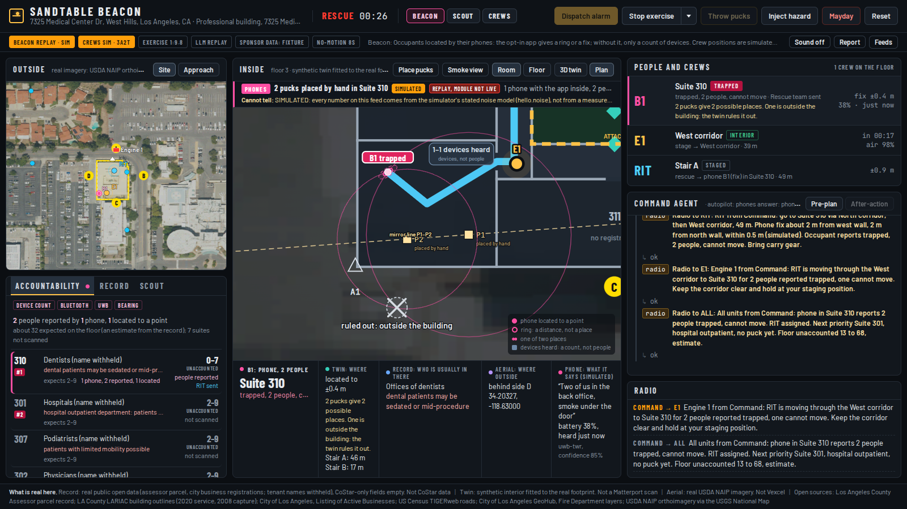

# Sandtable Beacon

Find the people still inside a burning building, and show them on a command board built from the building's own data.



*The command board in the hands-free exercise on the stand-in building (phones, pucks and crews simulated; the agent's turns are replays of a recorded real model run). Two pucks on the door wall of Suite 310: phone B1 is located to within 0.4 m because its mirror-image spot falls outside the building and is ruled out; phone B2 is still one of two places inside the suite, so the agent orders a search. Every layer carries its source in the footer.*

## The story

1. **The alarm comes in.** The command board pulls the building: the CoStar record (storeys, construction, sprinklers, elevators, who leases which floor and how many people work there, life hazards such as a clinic with sedated patients), the Matterport 3D scan of the interior, and Vexcel aerial imagery. Before anyone goes in, the crew sees the floor plan, the doors and stairs, the sides of the building, the hydrants, and who should be inside.
2. **A firefighter throws the beacon in.** The beacon is two small UWB pucks (Qorvo DWM3001CDK boards). The responder marks on the plan which room it went into.
3. **The pucks measure their own spacing** by ranging each other, so their positions on the plan come from a measurement, not a guess.
4. **The people inside are found.** Occupants who have the Sandtable Beacon app and press SOS are ranged by both pucks. Each phone's distances reach the board, which places the person on the plan exactly as far as the measurement supports (a ring, two candidate spots, or a fix with its uncertainty), with their status (trapped, injured, able to move) and how many people are with them.
5. **Command.** An AI command agent sets the phones against the building record ("the record expects about 25 to 62 people on this floor; phones report 3; 5 suites have no puck in range"), routes a rescue crew through the twin, issues radio orders and writes the report the command post keeps.

**Only phones running the app are found.** A phone transmits no UWB until an app on it opens a ranging session, so phones without the app are not detected. The board says so, and uses the building record to show where people are expected but nobody has reported.

## Run it in five minutes (no hardware, no keys)

```bash
git clone https://github.com/iujab/sandtable-beacon.git
cd sandtable-beacon/sandtable-live-fireground-twin
bash run_demo.sh --storyboard        # open http://127.0.0.1:1810
```

Windows, the real building's data, and the real boards and phones: **[RUNBOOK.md](RUNBOOK.md)**, step by step.
