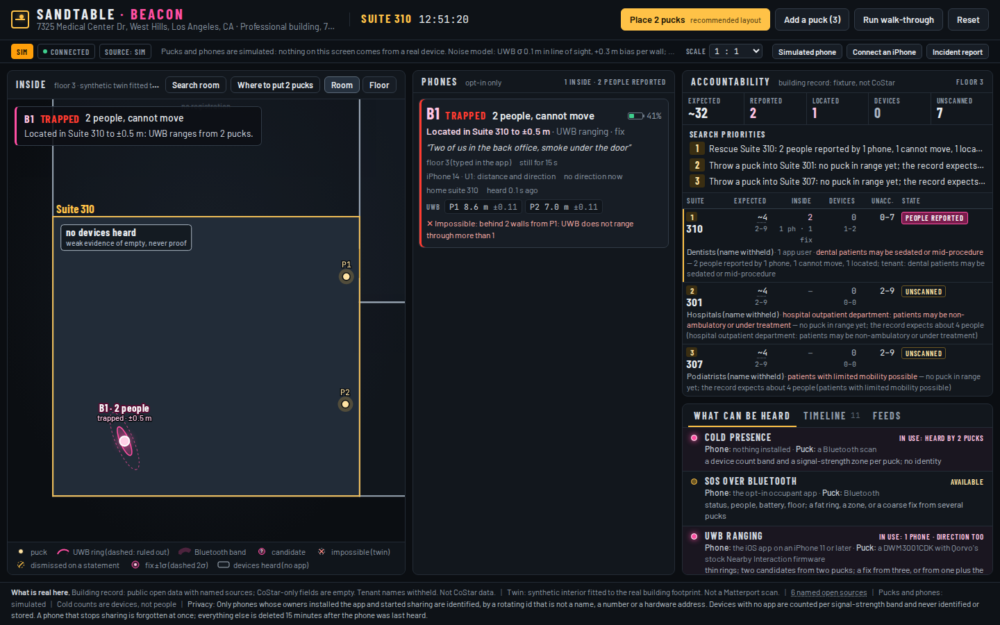
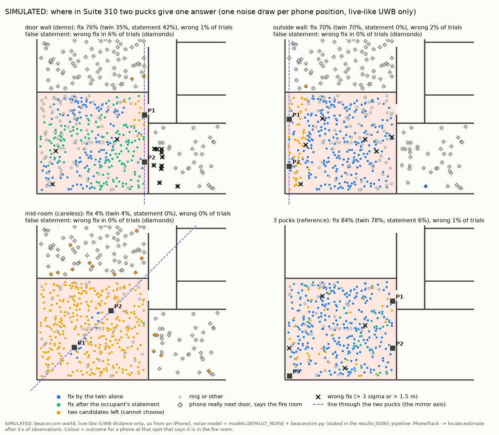
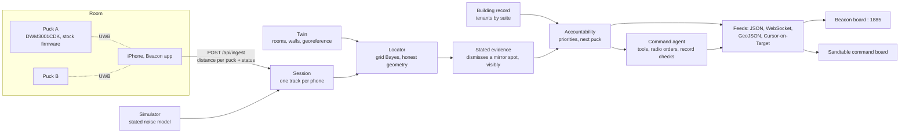

# Sandtable Beacon

**Set two pucks down inside the door: they range the phones of the people trapped in the room, the building's twin turns two rings into one position, and the tenant roster says who is still missing.**

Beacon is the headline mode of Sandtable, an incident-command board for fire crews. A crew sets small UWB pucks (Qorvo DWM3001CDK boards on Qorvo's stock firmware) just inside a smoke-filled room. A person who opened the Beacon app on their iPhone is ranged by each puck over ultra-wideband, through Apple's Nearby Interaction accessory protocol, and the app sends a status with it: how many people, whether they can move, battery, which suite. A locator fuses the ranges with the walls of the building's 3D twin and is honest about geometry: one puck gives a ring, two give two mirror spots, and the twin's walls or the occupant's own statement decide between them, visibly. The building record's tenant roster is compared with the phones still inside, so a command agent can order the search, say where the next puck goes and file what the record got wrong. Everything on screen is simulated until real iPhones report, and says so.



*Simulated ranges (noise model stated on screen and in `beacon/models.py`), fixture building record and twin, both labelled.*

Built for HackPrinceton Fall 2026. Main track: **Education** (as Sandtable). Special tracks: **CoStar "Inside and Out: AI for the Built World"**, **Best Hardware Hack**, **Best Physical AI Hack**, **Amazon Best Practical AI Innovation**.

> **Status: nothing has run on hardware yet.** The iOS app is uncompiled Swift source (written on a machine with no Mac). The guides in `hardware/` are written from documentation and forum reports. `project.json` carries the live task list.

## The problem

- In smoke, a search crew cannot see a person three metres away. Cameras and LiDAR do not see through it either. Radio does.
- Almost everyone trapped in an office building is holding a phone with an ultra-wideband radio in it, accurate to tens of centimetres. Nothing on the fire ground can talk to it.
- Command knows who should be in the building only from a paper roster, if at all, while the building record already lists every tenant by suite.

## What it does

| Step | What happens |
|---|---|
| The app | An occupant opens Beacon and presses Trapped, Injured, Sheltering or I am out. No account, no name: a random id that rotates. The screen shows exactly what is sent |
| The pucks | Each puck ranges every phone that opted in. One iPhone ranges both pucks at once; one board serves one phone at a time, so two phones take turns or each puck position carries two boards |
| The locator | One puck: a ring, clipped where the twin says nobody can be. Two pucks: two mirror spots. With both pucks just inside the wall the door is in, the mirror spot falls outside the room. The twin rules it out when it lies outside the building, inside a wall, or two walls away from a puck (the range model assumes ranging through one wall at most: an assumption, not a measurement); otherwise it is dismissed on the occupant's stated suite and shown as dismissed. With pucks mid-room, the board says "cannot choose" |
| The record | Tenants by suite from the building record, expected head counts with their basis, phones inside, people reported, people who pressed "I am out": an accountability table, search priorities, where to throw the next puck |
| The agent | A tool-using command agent reads the phones and the record and issues radio orders, the next-puck plan and record checks; a printable incident report closes the loop |
| The feed | Everything is published for the Sandtable command board: JSON, WebSocket, GeoJSON and Cursor-on-Target (`docs/BEACON_FEED.md`) |

## One puck, two pucks: what the geometry supports

<!-- TWO_PUCK_NUMBERS:BEGIN -->
**Simulated** (`results/eval_two_puck.json`; 800 phone positions per layout over the fire room; what a real iPhone would deliver: UWB distances only, no line-of-sight flag; noise model with sources in `beacon/models.py`):

| Layout | One position | of which by the twin alone | of which after the occupant's stated suite | Cannot choose (two spots) | Ring or less | Wrong position: share of the positions shown (share of all trials) | Position error, median / 90th percentile |
|---|---|---|---|---|---|---|---|
| Both pucks just inside the wall the door is in (recommended) | 76% | 35% | 42% | 3% | 21% | 1.5% (1.1%) | 0.26 m / 0.77 m |
| Both pucks along the outside wall | 70% | 70% | 0% | 11% | 18% | 2.3% (1.6%) | 0.25 m / 0.78 m |
| Both pucks mid-room (careless) | 4% | 4% | 0% | 86% | 10% | 3.0% (0.1%) | 0.30 m / 0.73 m |
| Three pucks: the door-wall pair plus one in the far corner | 84% | 78% | 6% | 8% | 8% | 1.2% (1.0%) | 0.20 m / 0.59 m |

Two phones taking turns on two boards (simulated, 100 phone scenes): the wait for a position is 3.5 s in the median and 9 s at the 90th percentile; 23% get none within the scene; 2.7% of the positions shown are wrong.

"Ring or less" is mostly a phone that only one puck reached (a blocked link in the simulation). A wrong position is one more than three sigma or 1.5 m from the truth.

When the occupant's stated suite is false (the phone is really in a neighbouring room, 300 trials): with the door-wall layout the board mostly shows a ring, but it shows a position in 6.3% of trials and 100% of those positions are wrong (6.0% of trials are wrong positions produced by the statement; 22.5% for the suite that shares that wall). That is the price of dismissing a spot on a statement, and why the board shows the dismissal.
<!-- TWO_PUCK_NUMBERS:END -->



The owner asked whether both boards could ride on one thrown device instead:

<!-- LAYOUT_NUMBERS:BEGIN -->
**Simulated** (`results/eval_layouts.json`; 50 trials per row, phone 2 to 8 m away in the fire room, pucks thrown not placed; noise model with sources in `beacon/models.py`). Bearing error is measured after choosing the nearer of the two mirror solutions, so the mirror ambiguity is on top of it:

| Layout | Bearing error to the phone, median | Sideways (cross-range) error, median | Mirror ambiguity left | A position is published | Position error when published, median | Area the phone is confined to, median |
|---|---|---|---|---|---|---|
| Two boards on one device, 0.1 m apart | 37 degrees | 2.19 m | 100% | 0% | n/a | 16.0 m2 |
| Two boards on one device, 0.3 m apart | 19 degrees | 1.55 m | 100% | 0% | n/a | 15.4 m2 |
| Two boards on one device, 0.5 m apart | 22 degrees | 1.38 m | 98% | 0% | n/a | 12.8 m2 |
| Two separate pucks 2 m apart | 8 degrees | 0.60 m | 100% | 0% | n/a | 5.5 m2 |
| Two separate pucks 3 m apart | 7 degrees | 0.47 m | 98% | 2% | 0.44 m | 3.5 m2 |
| Two separate pucks 4 m apart | 4 degrees | 0.30 m | 96% | 4% | 0.34 m | 3.0 m2 |
| Three separate pucks (thrown) | n/a | n/a | n/a | 56% | 0.21 m | 1.2 m2 |

Two boards on one device never produce a position: the locator publishes a ring. Two separate pucks a few metres apart confine the phone to a much smaller area with a several times better bearing, and the twin removes the mirror solution in part of the cases even with thrown pucks (the placed layouts are in `results/eval_two_puck.json`).
<!-- LAYOUT_NUMBERS:END -->

And by number of pucks and by radio:

<!-- MAIN_NUMBERS:BEGIN -->
**Simulated** (`results/eval_beacon.json`; 90 trials per cell; pucks thrown from the door, not placed; the phone is in the fire room in 60% of trials and in a neighbouring suite in 40%; noise model: UWB 0.10 m white noise plus a static 0.10 m bias per link, +0.30 m per wall, a body in the way on 25% of links; Bluetooth 6 dB shadowing; sources in `beacon/models.py`):

| Method | Pucks | A position is published | Position error, median | Area the phone is confined to, median | Wrong position: share of the positions shown (share of all trials) |
|---|---|---|---|---|---|
| Bluetooth signal strength | 1 | 0% | n/a | 277.6 m2 | n/a (0.0%) |
| Bluetooth signal strength | 2 | 0% | n/a | 164.2 m2 | n/a (0.0%) |
| Bluetooth signal strength | 3 | 12% | 1.79 m | 176.8 m2 | 0.0% (0.0%) |
| Bluetooth signal strength | 4 | 16% | 1.15 m | 142.8 m2 | 0.0% (0.0%) |
| Bluetooth signal strength | 5 | 19% | 1.27 m | 154.5 m2 | 0.0% (0.0%) |
| UWB ranging | 1 | 0% | n/a | 25.6 m2 | n/a (0.0%) |
| UWB ranging | 2 | 3% | 0.38 m | 5.4 m2 | 0.0% (0.0%) |
| UWB ranging | 3 | 46% | 0.28 m | 2.2 m2 | 2.4% (1.1%) |
| UWB ranging | 4 | 60% | 0.23 m | 1.4 m2 | 0.0% (0.0%) |
| UWB ranging | 5 | 60% | 0.21 m | 1.0 m2 | 0.0% (0.0%) |

When the simulated world is 1.5 times noisier than the locator assumes, wrong positions rise to at most 14.3% of the positions shown (4.0% of trials; UWB, any puck count).

Cold Bluetooth count (no app): over 600 windows the count runs 2.1 devices low on average, the published band contains the true number of advertising devices in 60% of windows, and 37% of windows read zero while devices are in the room. It is a weak signal and the board treats it as one.
<!-- MAIN_NUMBERS:END -->

## Does it ever draw a wrong dot?

An independent reviewer broke an earlier version of this demo: after a puck was moved, the board showed a position metres from the truth with a confident error bar, and with both pucks mid-room it flipped between "cannot choose" and a wrong position. Both were real faults (ranges kept from before the puck moved; a position published without accounting for its mirror image). They are fixed, and the check that found the last one is now part of the repository:

<!-- HONESTY_NUMBERS:BEGIN -->
**Simulated self-check** (`scripts/honesty_check.py`, results in `results/honesty_check.json`): 9 adversarial scenes on the simulator (the walk-through, the mid-room layout held for two minutes, a puck moved while ranging, the phone dragged into the next room, the exercise scale changed, a phone going quiet, stop sharing, two phones on shared boards), 6,830 steps. In every scene: no coordinates without a position, no dot for a stale phone, nothing republished after stop sharing. A position is counted wrong when it is more than three sigma and more than a metre from the truth: the worst scene (phone-dragged-into-next-room) shows 1.3% of its position steps wrong, and the others none. The check fails above 3%; it currently passes.
<!-- HONESTY_NUMBERS:END -->

## How it works



- **Locator** (`beacon/locate.py`): a grid posterior over the twin's floor. Cells outside the building or inside a wall are impossible; walls between a puck and a cell add the bias and spread a wall adds to a range. The published geometry is what the posterior supports: `fix`, `candidates`, `ring`, `zone` or `none`. `x` and `y` exist only for a fix.
- **Stated evidence** (`beacon/prune.py`): a spot that the twin allows but that contradicts what the occupant said (their suite) or what command decided (the search room) is dismissed with its reason attached, never silently.
- **Layout** (`beacon/layout.py`): where two pucks go so that two rings give one answer.
- **Roster** (`beacon/roster.py`): the join of record, twin and phones. Expected people are estimates with a stated basis (a record head count when there is one; otherwise floor area and building-code load factors).
- **Agent** (`beacon/agent.py`): a plan-and-act loop over seven tools, built from discrete facts so that a recorded real model run replays exactly; a labelled deterministic fallback when no recording matches.
- **Live path**: with Qorvo's stock firmware the phone app reads each distance and posts it; the puck needs only power. `beacon/host` is a small puck host for the UNO Q (heartbeat, an experimental reader of the board's debug channel, an optional Bluetooth device count).

## How each judging criterion is met

**CoStar: Inside and Out**

| Criterion | Where to look |
|---|---|
| Use of the data (30%) | The record and the twin each do a job the other cannot, and the join is by suite and by geometry. Record: tenants by suite, kind of business, and leased area, head count and listed vacancy when the record has them (the public fixture has none of the three: area then comes from the twin, and "vacant on record" only means no business registration). Twin: which rooms are which suite, walls that turn two rings into one position, the door to throw the next puck through, the route for the rescue order. Together: expected people per suite against phones inside it; a suite with no tenant on record but phones in it becomes a record check. The same module also runs, unchanged, on the command board's private live bundle (a scanned suite's Matterport twin and the CoStar record of its building; not in this repository): there the walk-through's simulated phones stand in a real room and the suite joins to its real tenant record. Details: `docs/COSTAR_TIE_IN.md` |
| Agentic depth (30%) | The command agent plans and acts with tools (phones, accountability, next-puck plan, routes, radio, assignments, record checks); every step is on the board. In the walk-through the board shows a real model run (Claude Sonnet 5.5), recorded once and replayed; any situation without a recording gets a deterministic policy that is labelled as not a model, unless a live model is configured (`LLM_BACKEND`) |
| Usefulness (25%) | Monday users: a training officer running an evacuation or search drill on a real building with two pucks and the occupants' own phones; a building manager who wants a roll call that does not depend on a clipboard; and the record's owner, who gets disagreements between record and reality as evidence |
| Demo and polish (15%) | One screen, two pucks a judge can move, a phone a judge can hold. `PITCH.md` is the script |

**Main rubric.** Creativity: the pucks a crew already carries for Sandtable find the phones people already carry; two rings and a floor plan make one position. Utility: runs end to end in simulation; the hardware path is stock firmware plus one app. Charity: finding people in smoke, and knowing who is unaccounted for. Avidity: the board, the guides, the evaluation.

**Best Hardware Hack / Best Physical AI.** UWB ranging between a thrown board and a victim's own phone is the product; the AI acts on that physical state and directs physical movement (which suite, which door, where the next puck goes). Honest status: simulated so far.

**Amazon Practical AI.** Reasons, plans, acts and adapts as phones appear and resolve; a clear user; documented; a working prototype in simulation.

## Run it

Python 3.10 or newer; wheels-only dependencies; the same on Linux, macOS, Windows and Debian aarch64.

```bash
bash run_demo.sh --story               # simulated world, plays the two-puck walk-through
```
```powershell
py -m venv .venv                       # Windows
.venv\Scripts\python -m pip install -r requirements.txt
.venv\Scripts\python -m beacon.demo --story
```

Open <http://localhost:1885/>. `/phone.html` is a simulated victim's phone you can drag around the room; `/report.html` is the incident report.

| Setting | Values | Default |
|---|---|---|
| `--source` | `sim` (simulator and real locator), `live` (real iPhones post to `/api/ingest`), `fake` (a hand-made sample, marked SAMPLE) | `sim` |
| `--lan` | bind 0.0.0.0 and print the address for the iPhone app | off |
| `--port` / `PORT` | | 1885 |
| `LLM_BACKEND` | `replay` (recorded real model output, offline), `claude-cli`, `anthropic` (needs `ANTHROPIC_API_KEY`) | `replay` |
| `BEACON_BUNDLE_DIR`, or `BEACON_TWIN_JSON` and `BEACON_SITE_JSON` | another building's twin and record, kept outside the repository (`docs/BEACON_FEED.md` section A10); everything the server then writes goes under a private `live` directory | the fixtures |

Tests (offline): `bash run_tests.sh`. Evaluation: `python scripts/eval_beacon.py` (about 70 s; writes `results/` and `figures/eval_*.png`), then `python scripts/fill_numbers.py` writes the numbers into the documents.

## With the hardware

| Step | Guide |
|---|---|
| Flash Qorvo's stock firmware onto a DWM3001CDK | `hardware/FLASH.md` |
| First power-up, the two-puck layout, networking, two phones, fallbacks | `hardware/BRINGUP.md`, `hardware/LAYOUT.md` |
| What a puck needs (power, mounting) | `hardware/PUCK.md` |
| The UNO Q as puck host or as the whole command post | `hardware/UNO_Q.md` |
| Build the iPhone app in Xcode | `docs/IOS_BUILD.md` |
| What works, what does not, and why, with sources | `docs/PHONE_FEASIBILITY.md` |

```bash
bash run_demo.sh --source live --lan     # then scan the board's QR code with each iPhone's camera
```

## What is real, what is simulated, what is a stand-in

| Thing | Status |
|---|---|
| Ranges and positions | **Simulated** (`beacon/sim.py`; noise model with sources in `beacon/models.py`) until real iPhones report. The board shows SIM, or LIVE in live mode |
| Puck firmware | Qorvo's stock Nearby Interaction image. Not in this repository; the owner downloads it from Qorvo. Never flashed by us |
| iOS app (`apps/ios`) | **Uncompiled Swift source**, modelled on Apple's accessory sample; syntax-parsed, never compiled, never run |
| Puck host (`beacon/host`) | Tested against stubs; on the owner's UNO Q only its `--help` has run (`hardware/UNO_Q.md`, first section); the debug-channel reader's input format is unconfirmed |
| Building record | **Fixture: real public data, not CoStar**: a Los Angeles professional building from the county assessor and the city's business registrations; tenant names withheld. Head counts are estimates from floor area |
| Twin | **Fixture: synthetic interior, not a Matterport scan**, fitted to the real footprint and numbered with the real suite numbers |
| Agent decisions | Recorded real model output replayed, or a labelled deterministic fallback |

## Limitations

- Nothing has run on hardware; the real range error of an iPhone against this board, in a real room, is unknown. The simulated numbers are a guide.
- With the stock firmware the phone app is the reporter: the phone needs a network path to the server, and the app must stay open with the screen on.
- An iPhone 14 or 15 reports distance but no direction to an accessory, so position needs two well-placed pucks or three.
- One board serves one phone at a time.
- Dismissing a mirror spot on the occupant's stated suite is wrong when the statement is wrong: most positions produced that way are then wrong (numbers above), which is why the board shows the dismissal.
- The twin's "two walls away" rule-out rests on an assumption of the range model (one wall at most) that the simulator shares; it has not been tested against real walls.
- The simulation gives each puck position one board per phone; with two boards and two phones the phones must take turns, which slows every update.
- A phone whose owner installed nothing cannot be ranged or identified. The cold Bluetooth count is weak (numbers above) and off by default on real hardware.
- The pucks cannot find their own positions tonight (the stock firmware does not range board to board): they are placed and clicked onto the plan.
- One floor; no smoke or heat model; the twin and the record are fixtures.
- Not a life-safety product.

## What's next

Real iPhones against real boards; puck firmware that reports ranges and link quality itself, so a phone can go dark; pucks that survey their own positions; a dual-antenna radio for bearing from one puck; background ranging through a Live Activity; live CoStar and Matterport data; Android through Jetpack UWB.

## Repository

```
beacon/        models, locate, track, prune, layout, sim, session, feeds, server, story, roster, tools, agent, report, host/
web/           the board, the simulated phone, the app page
apps/ios/      the occupant app (Swift / SwiftUI) and its Xcode project
hardware/      FLASH, BRINGUP, LAYOUT, PUCK, UNO_Q
docs/          BEACON_FEED (the contract with the command board), PHONE_FEASIBILITY, PRIVACY, COSTAR_TIE_IN, IOS_BUILD, research/
fixtures/      building record and twin (labelled fixtures), scenarios, recorded model runs
scripts/       eval_beacon.py, fill_numbers.py, shots.cjs
tests/ results/ figures/
```

Privacy (opt-in by design, no identities from cold scanning, what is kept and for how long): `docs/PRIVACY.md`.

Credits: the twin fixture, the spatial engine (`beacon/twin.py`) and the visual language come from Sandtable (same repository). Apple's sample "Implementing spatial interactions with third-party accessories" is the model for the app's Bluetooth and Nearby Interaction sequence.
