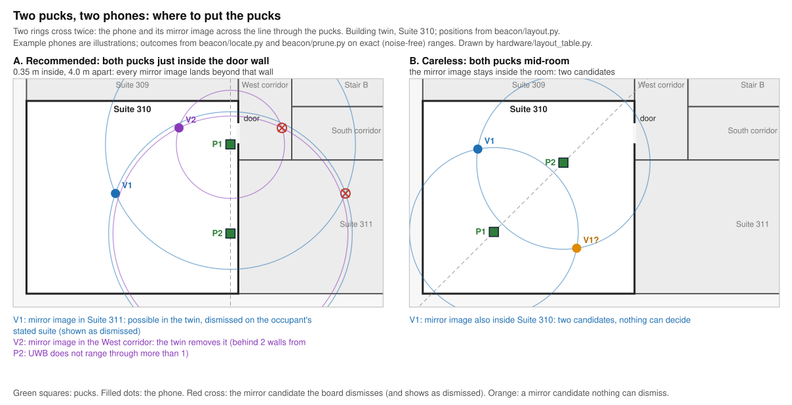

# Where to put two pucks

> **Geometry on the building twin; not tested with real boards.** Puck positions come from `beacon/layout.py`
> (`layout.recommend(twin, "r310")`); the table-scale numbers and the figure come from `hardware/layout_table.py`
> (run it yourself: `python hardware/layout_table.py --scale 3`). The example phones in the figure are illustrations,
> and their outcomes are what `beacon/locate.py` and `beacon/prune.py` return on exact, noise-free ranges.

## The idea in four lines

- One puck measures one distance: the phone is somewhere on a ring.
- Two pucks: two rings cross twice, at the phone and at its **mirror image** across the line through the two pucks.
  Nothing in the measurements says which one is real.
- So put **both pucks just inside the wall the door is in**. The line through them then runs along that wall, and the
  mirror image of anyone in the room lands **on the other side of the wall**: in the corridor where the crew stands, or
  in the next suite.
- The board then dismisses the mirror image, **visibly** (it stays on the plan, crossed out, with its reason): because
  it would lie behind two walls from a puck (the locator does not believe a UWB link through two walls), or, when it is
  physically possible, because the occupant's app says they are in this suite.

With the pucks in the middle of the room (the careless layout), the mirror image stays inside the room and nothing can
decide between the two points.

<!-- LAYOUT_NUMBERS:BEGIN -->
**Simulated** (`results/eval_two_puck.json`; 800 phone positions per layout over the fire room; what a real iPhone would deliver: UWB distances only, no line-of-sight flag; noise model with sources in `beacon/models.py`):

| Layout | One position | of which by the twin alone | of which after the occupant's stated suite | Cannot choose (two spots) | Ring or less | Wrong position, share of all trials | Position error, median / 90th percentile |
|---|---|---|---|---|---|---|---|
| Both pucks just inside the wall the door is in (recommended) | 77% | 48% | 29% | 0% | 23% | 1.1% | 0.26 m / 0.76 m |
| Both pucks along the outside wall | 83% | 78% | 5% | 0% | 17% | 1.8% | 0.26 m / 0.76 m |
| Both pucks mid-room (careless) | 18% | 17% | 0% | 57% | 25% | 0.0% | 0.50 m / 0.96 m |
| Three pucks: the door-wall pair plus one in the far corner | 88% | 84% | 5% | 3% | 9% | 1.0% | 0.20 m / 0.61 m |

"Ring or less" is mostly a phone that only one puck reached (a blocked link in the simulation). A wrong position is one more than three sigma or 1.5 m from the truth.

When the occupant's stated suite is false (the phone is really in a neighbouring room, 300 trials): the statement produces a wrong position in 4.3% of trials with the door-wall layout, and in 13.8% for the suite that shares that wall. That is the price of dismissing a spot on a statement, and why the board shows the dismissal.
<!-- LAYOUT_NUMBERS:END -->

## Positions in the building (Suite 310, 9.50 m by 8.65 m)

From `python hardware/layout_table.py --scale 3` (output copied verbatim):

| Puck | building x, y (m) | on the tape at scale 3, x, y (m) |
|---|---|---|
| P1 | 9.15, 6.70 | 3.05, 2.23 |
| P2 | 9.15, 2.70 | 3.05, 0.90 |

- The door is in the **east wall** (x = 9.5), centre at y = 7.2, 0.9 m wide; it opens into the West corridor.
- Both pucks **0.35 m inside** that wall, **4.0 m apart**: P1 beside the door, P2 slid along the wall.
- Origin (0, 0) is the suite's south-west corner; x runs along the 9.5 m side, y along the 8.65 m side.

## On the demo table: the worked example at scale 3

The exercise scale says how many building metres one metre of floor stands for (`hardware/BRINGUP.md` step 7).

1. **Tape a 3.17 m by 2.88 m rectangle** on the floor. It is Suite 310 at scale 3 (9.5 / 3 and 8.65 / 3).
2. Choose one short (2.88 m) edge as the **door wall**. Call one of its two corners the **start corner** (it is the
   building's corner at x = 9.5, y = 0). Mark the **door** on that edge: its centre **2.40 m** from the start corner,
   **0.30 m** wide (so the door is near the far end of the edge).
3. **P1**: **2.23 m** along the door edge from the start corner (just short of the door), **0.12 m** in from the edge.
4. **P2**: **0.90 m** along the door edge from the start corner, **0.12 m** in from the edge. P1 and P2 are
   **1.33 m apart**.
5. **Phones**: anywhere inside the rectangle; best **more than 1 m from the door edge** (x below about 2.2 m): the
   closer a phone is to the line through the pucks, the worse the geometry.
6. Each puck upright on its stand, at least 15 cm off the floor, non-component side facing into the rectangle
   (`hardware/PUCK.md` section 3). 12 cm from the edge is fine: what matters is that both pucks are equally close to it.

Another table size: `python hardware/layout_table.py --scale 4` (or any scale) prints the same table for it.
At scale 1 (the real room) use the building numbers directly.

The command board draws the same two spots: "Show where to put two pucks".

## Better if you have it: a third puck

A third puck well off the line through P1 and P2 (for example against the far, west wall) removes the mirror image
everywhere, with no statement from the occupant needed. Measure and place it like the others.

## The careless layout, for comparison

`layout.recommend(twin, "r310", strategy="careless")`: P1 (3.19, 2.77), P2 (6.31, 5.88), mid-room. Every mirror image
stays inside Suite 310, both candidates are equally possible, and the board must show two points. Panel B of the figure.
