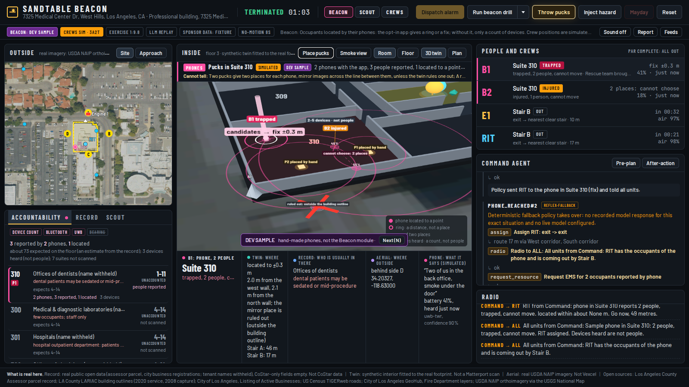
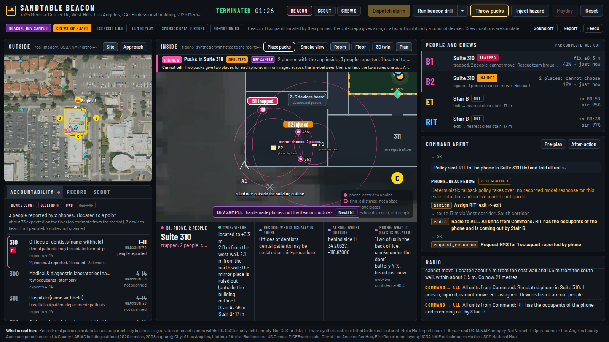
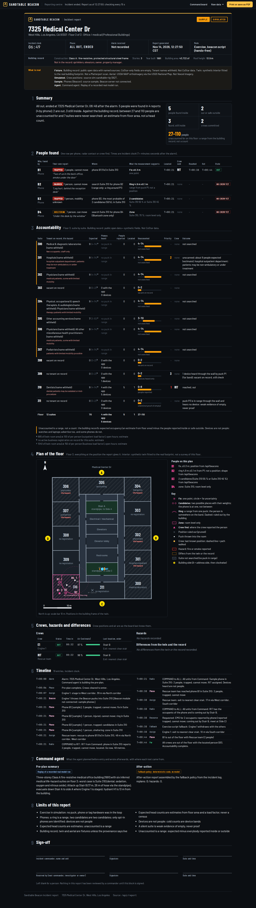
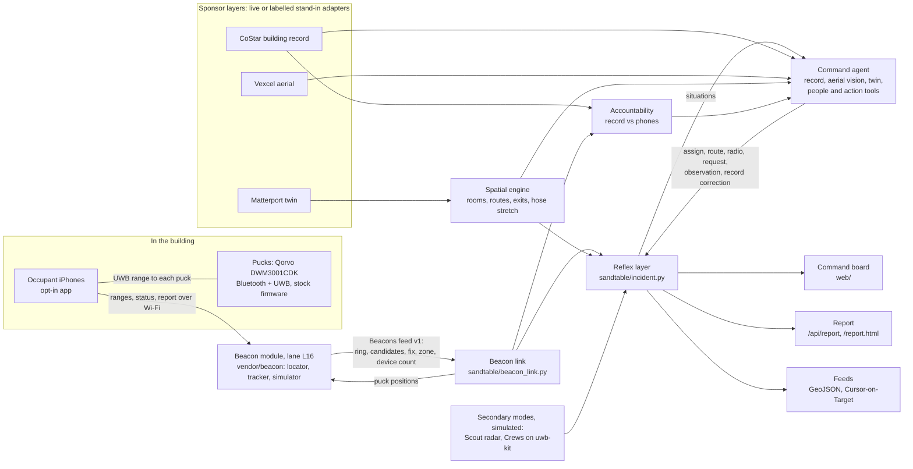
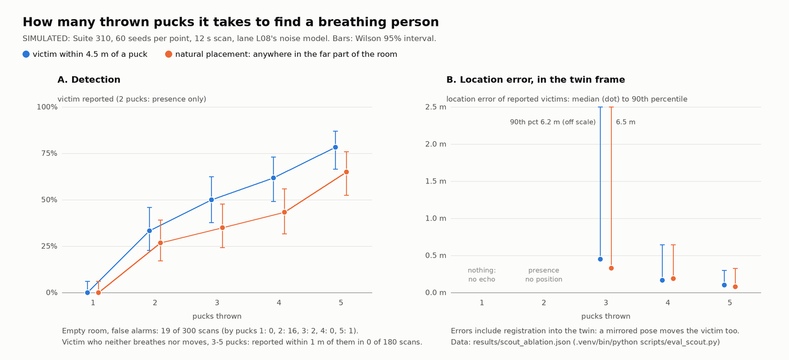

# Sandtable Beacon

**Find the people inside a burning building by their phones, and show each one in the right room of a map built from the building's own data.**

When a commercial building is on fire, the incident commander's hardest question is who is still inside, and where. Sandtable Beacon is a command and reporting centre for that question. When the alarm comes in, an AI command agent reads three layers for the address (the building record with its tenants, the aerial image, the 3D twin) and writes the pre-incident plan. A crew places small pucks (Qorvo DWM3001CDK boards: Bluetooth and UWB) in the building. Occupants who opened an opt-in app are ranged through their phones, and each phone is drawn as what the measurement supports: a ring, two candidate points, or one point, in the right room and beside who the building record expects there. The agent prioritises, routes a rescue crew through the twin, issues the radio order and writes the report the command post keeps. The same code has run privately on live CoStar, Matterport and Vexcel data for one real building; this repository runs on labelled stand-ins, and phones, pucks and crews are simulated.



*Two pucks placed by hand (P1, P2) in Suite 310 of the stand-in building hear two phones. Phone B1's two candidate places are mirror images across the line between the pucks; one falls outside the building outline, so the twin rules it out (the red cross) and B1 becomes a point, beside what the stand-in record has for that suite (a dental office; patients may be sedated). Phone B2's two places are both inside the room: the board says "cannot choose: 2 places" with their weights. Made with the board's development sample (`DEV SAMPLE` badge: hand-made phones, not a measurement); crews simulated; the agent turns shown are the labelled fallback policy.*



Built for HackPrinceton Fall 2026. Main track: **Healthcare**. Special tracks: **CoStar "Inside and Out: AI for the Built World"** (primary), **Best Hardware Hack**, **Best Physical AI Hack**, **Amazon Best Practical AI Innovation**.

## Sponsor data: what ran, what is in this repository, what a judge sees

- **What ran, privately.** On Saturday, 14 November 2026, from about 1:05 to 1:35 pm CST, with the owner's keys and the CoStar hackathon data kit, the same code ran on all three layers for one real 12-storey, sprinklered office building in Los Angeles. **CoStar:** the building's record from the kit: 26 property fields, 72 current tenant rows and 18 available spaces (elevators, height, parking and percent leased are empty in that record). **Matterport:** the Model API for one scanned suite on one storey: 8 rooms with real boundaries, 48 walls, 14 doorways, 30 scan positions and a 199-edge walking graph, with the Showcase SDK view embedded and steered on `localhost`. **Vexcel:** 7 images (orthos, a roof detail and four obliques); the agent's vision tool counted parking stalls and read the roof on them. The board ran a phone-rescue exercise end to end on that building with a live model: a pre-plan citing each layer, both simulated phones located and brought out, and a report with its provenance. Known limits of that run: the scan covers one suite, not the storey; the scan's georeference lands about 90 m from the record's map point, which the pre-plan flagged and nobody corrected; the first live run needed one order given by hand (fixed since). Detail: `docs/LIVE_STATUS.md`.
- **What this repository contains.** None of that data, by the owner's rule and the sponsors' terms: no address, name, tenant, property id or model id of that building. It runs on stand-in data: real open data for a different building (a three-storey medical office building in Los Angeles) and a synthetic twin fitted to its footprint, every layer labelled on screen as not the sponsor's. `docs/TOOLKIT_SWAP.md` says how the same code switches to live with keys and a private bundle.
- **What a judge sees at the table.** The owner's laptop in live mode if it is set up (every page then carries the header "LIVE SPONSOR DATA, PRIVATE"), otherwise the stand-in demo. Either way the phones, pucks and crews are simulated unless the hardware line below says otherwise. **Hardware: not run on hardware.**
- Hands-free live replay: not yet proven; a hands-free run of the live building on recorded model turns is being tested.

## The problem

- **Who is inside, and where.** Today the commander learns it from people who got out, from the radio and from crews searching room by room in smoke. Nearly everyone inside carries a phone with a Bluetooth radio, and recent iPhones carry a UWB radio built to measure distance to another device. Nothing on the fire ground listens to them.
- **The building is known, just not to the first crew.** The record of who occupies which suite, the view from above and the 3D interior all exist for the same address, in three different systems.
- **"How many are missing" is a range, not a number.** The record says who is usually there; a phone says who is there now; neither alone is an answer.
- **The report is written afterwards,** from memory and radio logs.

## What it does

| Step | What happens | Layers |
|---|---|---|
| Pre-plan | A tool-using agent writes the plan the first crews read on the way: construction and floors, tenants by suite and their likely life hazards, the sides of the building and apparatus access (it looks at the aerial image), stairs, hose stretch, and a list of what to verify on site because the layers disagree or a field is missing | record, aerial, twin |
| Pucks in | A crew places pucks in the fire room. On real boards their positions are measured with a tape and clicked onto the plan (the stock firmware does not range board to board); in the simulator they are placed or thrown | twin |
| Phones answer | An occupant who opened the app and pressed a status button is ranged by each puck in reach, and reports status, how many people are with them, whether they can move, battery and floor. The app is lane L16's iOS source, not built or run here | Beacon module |
| Drawn honestly | One puck: a **ring**. Two pucks: **two candidate points**, mirror images across the line between them. The twin deletes a candidate that falls outside the building, inside a wall, or behind a wall while the link is clearly line of sight; if one is left, it is a **point**. Three pucks not in a line: a point. Phones with no app: at most a **device count band**, never people; the simulated pucks report one, but the stock puck firmware cannot collect it | twin + Beacon |
| Accountability | Each suite: what the building record says about it, phones heard, people reported, located, unaccounted as a range, priority, crew assigned, reached, out | record + Beacon |
| Command | The agent prioritises, sends the rescue team by a route through the twin, radios the order with what the record says is in that room, re-routes when a phone's geometry improves, and requests EMS with the occupants' reported condition. With a ring or two candidates the order is to search, never "go to the phone" | all |
| Report and feeds | A printable report for the command post (`/report.html`): people found with times, the accountability table, a plan of the floor, crews, timeline, the agent's summary, limits. The same picture as GeoJSON and Cursor-on-Target | all |

**What the record adds.** The phones say who is in a suite now; the record says who should be. The board sets the two side by side on purpose. With a live record, a scan is often of space that is for lease, so the record may list the scanned suite as available with no tenant while the phones report people in it: the panel then says "the record says this suite is empty; the phones say three people are in it", and the storey's other tenancies, where no puck stands, are shown as not covered, with the range of people the record's employee counts imply (`docs/BEACON_BOARD_CONTRACT.md`, section 4). On the stand-in data, the record gives a dental office in Suite 310 with a head count estimated from floor area, the phones report three people there, and the floor's other suites, with no puck in range, show as not scanned with the record's expected range.
TODO(lead): confirm on the live run that the scanned suite is listed as available with no tenant; the private bundle of 13:12 matched a current tenant to the scanned suite and did not list it as available.

**The two-puck demo** is built for the owner's hardware: two pucks and two iPhones (an iPhone 14 and an iPhone 15) through lane L16's Beacon module. Each phone answers both pucks with two rings that cross at two candidate points. For one phone the twin's walls rule out the mirror candidate and it becomes a point in the room, beside who the record expects there. For the other both candidates are possible, and the board says so: two weighted places and an order to search both, until a crew's search settles it. The map does the work a third puck would otherwise do. Neither iPhone reports direction to these boards, so nothing here uses a bearing. The hands-free exercise plays the same set-up from a recorded run of lane L16's simulated module.



*`/report.html` after a hands-free simulated run on the labelled sample feed of the stand-in building (badges `SAMPLE` and `SIMULATED` at the top right).*

## How it works



- **The phones are lane L16's work.** The Beacon module (`vendor/beacon/`, vendored from the sibling project with credit) owns everything between the puck and the drawn geometry: the iOS source (not built or run here), the server that takes ranges from the phones (`POST /api/ingest`), the locator and tracker, and a simulator. Its feed contract (`vendor/beacon/docs/BEACON_FEED.md`, section 0) is the physics this board must not over-claim: no `x`, `y` for a phone unless the geometry is a fix; devices are not people. This repository consumes that feed and tolerates its absence (`SANDTABLE_BEACON=auto|off|sample`).
- **One coordinate chain.** Twin frame (metres), latitude and longitude (the twin's georeference), aerial pixel. That is how one phone lights up in the plan, the 3D twin, the aerial and the feeds, and how a candidate is tested against a wall.
- **Spatial engine** (`sandtable/spatial`): point-in-room, shortest routes on the twin's walking graph around blocked rooms, doors, stairs or corridor stretches, nearest exit, hose stretch (an outside leg from geography, an inside leg from the twin).
- **Two tiers.** The reflex layer (`sandtable/incident.py`) is plain code: it turns feeds into situations (`phone` when a phone first becomes actionable and again when its geometry improves; `phone_reached`; `scan`; `mayday`), keeps assignments, routes and accountability, and ends the incident when all are out. The command agent (`sandtable/agent`) is a model in a plan, act, re-plan loop over tools in five groups: the record (building, tenants, vacancy), the aerial (outside context, measurements, and a vision tool that sends the image), the twin (floor, locate, route, nearest exit, hose stretch, anchor drops), people (phones, accountability, radar scan) and actions (radio, assign, mark a hazard, request a resource, pin an observation, file a record correction).
- **Replay without fakery.** Every prompt is built from discrete facts only (room ids, graph nodes, whole or half metres, no timestamps), so a recorded real run replays exactly while positions underneath stay noisy. `fixtures/llm_cache/` holds only real model responses recorded through the Claude CLI on the stand-in building. The hands-free Beacon exercise replays a recorded run of lane L16's simulated module (`fixtures/beacon/story_two_pucks.json`; badges "Beacon replay · SIM" and "Replay, module not live"), so the agent sees the same objects every time. A situation with no recording and no live model goes to a small deterministic policy, and every event it emits is labelled `reflex-fallback`.

## How each judging criterion is met

**CoStar: Inside and Out (primary target)**

| Criterion | How, and where to look |
|---|---|
| Use of the data (30%) | Each layer does a job the others cannot, and the join is geometric. **The record** says who should be in each suite (tenants by suite and floor, available space, life hazards inferred from the kind of business, an expected head count) and which fields a crew needs and does not have. **The twin** gives the rooms, walls and routes, and it **removes impossible phone positions**: with two pucks, a candidate outside the building or inside a wall is deleted, which turns two places into one. **The aerial** gives the sides of the building, the approach and staging; the model reads the image. Look at: the People and accountability panels on the board, `GET /api/accountability`, report section 3, and the two-puck section of `results/RESULTS.md` (simulated, lane L16's evaluation) |
| Agentic depth (30%) | Situations arrive as goals with a reply budget; the agent picks its tools and ends in actions: assignments with routes, radio orders, an EMS request with the occupants' reported condition, observations pinned in the twin, corrections filed against the record. It must respect the geometry (a ring or two candidates means search, not "go to"), and it is called again when a phone's geometry improves. Look at: the agent log on the board (every thought, tool call and result, with its source: `replay`, `live` or `reflex-fallback`), `sandtable/agent/prompts.py`, report section 7 |
| Usefulness (25%) | Monday users: the incident commander and the command post (who is inside, where, who is unaccounted for and why that number is a range, a report at the end); a fire-prevention bureau (a pre-plan draft with a verify-on-site list for any commercial address) |
| Demo and polish (15%) | One screen, a printable report, a phone page for the rescue team that reads the GeoJSON feed, every uncertain thing drawn as uncertain. `PITCH.md` is the two-minute script |

**Each track, said straight.**

- **CoStar.** Today: all three layers used together by an agent, run privately on live data for one real building and publicly on labelled stand-ins. The live table run would add real phones resolved against the walls of a real scan.
- **Healthcare (main).** Today: finding trapped and injured people, carrying each occupant's own report (trapped, injured, can or cannot move, how many) to the rescue team and into an EMS request; there is no clinical content beyond that report. The live table run would add real occupants' reports from real phones.
- **Best Hardware Hack.** Today: nothing has run on the boards; there is a hardware path (stock firmware, power only), a bring-up guide and an enclosure designed in software, so this track is not met yet. The live table run, two DWM3001CDK pucks ranging two iPhones, would be the first hardware result.
- **Best Physical AI.** Today: the agent acts on simulated measurements constrained by the twin's walls and directs crews through the building; not met until a real range reaches it. The live table run would put real radio measurements under the same agent.
- **Amazon Practical AI.** Today: a working agentic prototype with a named user, documentation and a demo that runs offline. The live table run would show it on real input.

## Run it

A first run needs Python 3.10 or newer and an internet connection for the one-time install (wheels only, no compiler). Nothing else: no keys, no boards, no phones. Every dependency is pure Python or a wheel, so the same launcher runs on Windows, macOS, Linux and the Arduino UNO Q (Debian aarch64).

**Windows (PowerShell):**
```powershell
py -m venv .venv
.venv\Scripts\python -m pip install -r requirements.txt
.venv\Scripts\python -m sandtable.demo                 # add --storyboard to play the Beacon exercise hands-free
```

**macOS and Linux:**
```bash
bash run_demo.sh                       # creates .venv and installs on the first run; add --storyboard for the hands-free exercise
```

**Arduino UNO Q (Debian aarch64), or any machine without bash:**
```bash
python3 -m venv .venv
.venv/bin/python -m pip install -r requirements.txt
.venv/bin/python -m sandtable.demo --host 0.0.0.0       # reachable from a laptop or phone on the same network
```

Open <http://localhost:1810/>. The launcher also starts the vendored Beacon module on port 1885 (simulated phones) when nothing answers there. Without `--storyboard`, use the mode switch (**Beacon | Scout | Crews**), **Dispatch alarm**, **Place pucks** (click where each tape-measured puck stands, then send them to the Beacon module), **Throw pucks** (simulated), or the exercise button and its menu (Beacon, Scout and mayday exercises). Each exercise plays hands-free in about a minute and a half or less. Reporting centre: `/report.html`. Rescue team's phone page: `/crew.html?unit=RIT`. Feeds: `/feed/scan.geojson`, `/feed/cot.xml`, `/feed/cot/stream`.

| Setting | Values | Default |
|---|---|---|
| exercise script | `POST /api/storyboard {"action": "start", "script": "beacon" \| "scout" \| "mayday"}` | `beacon` |
| `--beacon-url` | a Beacon server elsewhere, for example the one real iPhones report to: `http://<host>:1885` | start the vendored one |
| `--no-beacon` | do not start the Beacon module; the board relays a hand-made sample, badged `SAMPLE` | off |
| `SANDTABLE_BEACON` | `auto` (use the server when it answers), `sample`, `off` | `auto` |
| `LLM_BACKEND` | `replay` (recorded real responses, offline), `anthropic` (needs `ANTHROPIC_API_KEY`), `claude-cli` | `replay` |
| `SANDTABLE_DATA_MODE`, or `COSTAR_MODE` / `MATTERPORT_MODE` / `VEXCEL_MODE` | `fixture` (the stand-ins), `live` (keys and a private bundle: `docs/TOOLKIT_SWAP.md`) | `fixture` |
| `--hub`, `--scenario` | the simulated crews: a uwb-kit scenario in `hardware/scenarios/` | `sim`, 3 anchors + 2 tags |

Tests (offline, replay-mode model): `bash run_tests.sh`. Re-record the agent after changing a prompt, a tool or the bundle: `bash scripts/record_all.sh` (needs the Claude CLI or `LLM_BACKEND=anthropic`), then `python scripts/check_replay.py auto`.

## Three sensing modes

| Mode | Finds | Needs | Cannot do | Status |
|---|---|---|---|---|
| **Beacon** (the product) | occupants, by their phones | pucks with Bluetooth and UWB (DWM3001CDK on Qorvo's stock firmware, power only); the opt-in app on an iPhone 11 or later; puck positions measured and clicked onto the plan | range or identify a phone whose owner installed nothing (cold, at most a count of Bluetooth devices, which the stock puck firmware cannot collect); a direction from an iPhone 14 or 15; ranging with the screen off as built | live path written by lane L16 (iOS source, not built or run here; server; stock firmware); not run on hardware; the hands-free run replays a recorded run of L16's simulated module |
| **Scout** | an untagged person who breathes or moves; a coarse echo outline; where the room differs from the twin | three or more pucks reading channel impulse responses | see a still, non-breathing person; make a LiDAR-grade map; run on these boards (no firmware) | **simulation only** |
| **Crews** | firefighters carrying tags; a mayday when one stops moving | anchors and tags with ranging firmware the uwb-kit hub reads | run on the owner's boards (the kit has no firmware for the nRF52833) | **simulation only**; the mayday exercise is intact |

## What is real, what is a stand-in, what is simulated, what is a sample

| Thing | Status |
|---|---|
| Building record (this repository) | **Stand-in: real public data, not CoStar.** A three-storey medical office building in Los Angeles: county assessor parcel (year, area, use, construction class), city business registrations (suite, floor, category; names withheld on purpose), county building outline and height. CoStar-only fields (sprinklers, elevators, contacts, leasing) are empty. Life hazards are inferred from the kind of business by a rule table and say so. Expected head counts are estimates from floor area |
| Aerial (this repository) | **Stand-in: real USDA NAIP imagery, not Vexcel.** No oblique views |
| Twin (this repository) | **Stand-in: synthetic interior, not a Matterport scan.** A floor fitted to the real footprint and numbered with the real suite numbers. Partitions, doors and stairs are invented and labelled; so is every wall that prunes a phone candidate |
| Hydrants, fire stations, street | Real open data (City of Los Angeles GeoHub, US Census TIGERweb). The engine position and the entrance are inferred and labelled |
| Live sponsor adapters | **Ran live privately** on one real building (see "Sponsor data" above). The CoStar adapter reads the data kit's extract through one mapping table; Matterport through the Model API; Vexcel through API v2. Nothing they read is in this repository |
| Phones, hands-free run | **Replay of a recorded run of lane L16's simulated Beacon module**; badges "Beacon replay · SIM" and "Replay, module not live" |
| Phones with `--no-beacon` | **Sample:** a hand-made Beacons object (`fixtures/beacon/sample_beacons.json`); every message and the board say `SAMPLE` |
| Phones, live | Real iPhones ranging real pucks through lane L16's app (iOS source, not built or run here) and server: **not run.** The phones' badge leaves `SIM` only when the Beacon feed says `simulated: false`. Status and limits: `vendor/beacon/docs/PHONE_FEASIBILITY.md` |
| Device counts | The simulated pucks report a Bluetooth device count per room. The stock puck firmware cannot collect one; a second radio such as the UNO Q's could (written by lane L16, never run) |
| Scout radar | **Simulated** (simulator and DSP adapted from lane L08, its noise model stated) |
| Crews | **Simulated** by the uwb-kit simulator (Gaussian range noise, outliers, dropouts, then the kit's solver) |
| Agent decisions | Stand-in runs: recorded real model output (Claude CLI), replayed; the replay checks in `results/` list the source of every turn. Private live run: a live model |
| Puck enclosure | A CAD model whose STLs were built and checked in software; never printed, weighed or thrown |
| Feeds | Well-formed GeoJSON and Cursor-on-Target 2.0; **not tested against a TAK server** |
| Writes | In stand-in mode, observations and record corrections go to local files and say so |

## Results

Every number lives in a file under `results/` (or `vendor/beacon/results/` for lane L16's), written by code in this repository; `results/RESULTS.md` collects them on one page. No board and no phone has been in the loop of any of them.

- **Beacon, two pucks with and without the twin** (simulated; lane L16's evaluation, `vendor/beacon/results/eval_two_puck.json`): how often two pucks give one answer, how often the twin is what decides it, and how often the answer is wrong. See the two-puck section of `results/RESULTS.md`.
TODO(lead): check that the section name "two-puck" matches the heading in `results/RESULTS.md`.
- **Scout, detection by number of pucks** (simulated): the table in the radar section below, generated from `results/scout_ablation.json` and `results/scout_placement.json` by `scripts/eval_scout.py`.
- **Radar arithmetic** quoted in the radar section: `results/radar_arithmetic.json` (`scripts/radar_arithmetic.py`).
- **Crews on the uwb-kit simulator** (positioning and the mayday reflex): `results/sim_eval.json` (`scripts/eval_sim.py`).
- **The three exercises end to end on the stand-in data**: `results/replay_check_beacon_auto_3A2T.json`, `results/replay_check_scout_auto_3A2T.json` and `results/replay_check_mayday_auto_3A2T.json` (`scripts/check_replay.py`). Each script reaches the end with every agent turn replayed from a recorded real model response and no turn falling back to the deterministic policy.
- **Recorded model responses**: `fixtures/llm_cache/`; **the board walked in a headless browser**: `results/ui_walk.json`; **tests**: `results/tests.json`.

## Is one UWB board enough to scan a room? (the owner's question; Scout mode, simulation only)

Scout is a secondary, **simulation-only** mode of Sandtable Beacon. No board has run the radar. The echo-reading firmware it reuses targets ESP32 boards, not the owner's DWM3001CDK kits.

**One board is not enough.** A DWM3001CDK (nRF52833 + Qorvo DW3110) cannot hear its own echoes. Its antenna is switched either to the transmitter or to the receiver, and Qorvo staff confirm the module cannot do both at once. Its shortest frame lasts 32.6 µs, while a wall 3 m away answers after 20 ns, mid-frame. The smallest radar is a pair: one board transmits, and the other reads the echoes that follow the direct pulse in its channel impulse response.

**More boards fix it.** A pair gives one ellipse per echo, with the two boards as foci and no bearing. N boards give N(N-1)/2 ellipses: 3, 6, then 10. The target is where they cross. The boards first range each other to learn their own positions. In the sample throw, the area consistent with every pair shrinks from 4.01 m² with two boards to 0.40 m² with three and 0.15 m² with five.


**What the "map" is.** About 500 MHz of bandwidth separates echoes only 0.3 to 0.6 m apart, and walls reflect like mirrors. The result is a coarse echo map, never a LiDAR-grade model. The stored twin is the real map. The pucks add an untagged person who moves or breathes, and flag where the room no longer matches the twin. A person who neither moves nor breathes looks like furniture.

**Smoke.** Smoke particles (0.01 to 1 µm) scatter light and LiDAR but are negligible at a 46 mm wavelength. In fire tests, LiDAR erred below 4 m visibility while radar held within 1%. Thermal imagers also see through smoke. Flames, wet walls and metal cost radio signal.

**Biggest risk:** echo strength. Across this room a person's echo is 25 to 36 dB below the direct pulse, near the clutter level in real recorded data. On the one real recording available (ETH Zurich, DWM1000 modules), the reused tracker followed clutter, not the person.

<!-- scout-ablation:start (generated by scripts/make_results_md.py) -->
**Simulated evidence: what N thrown pucks find.** SIMULATED, never measured: Suite 310, 60 seeds per row, a 12 s scan, lane L08's noise model, on a simulator written alongside the detector. Real boards will do worse. Errors are in the twin frame, so a wrong registration counts against the result.

| Pucks | What it gives | Breathing victim reported (within 4.5 m of a puck) | Reported and within 1 m | Location error, median / 90th pct | Pucks placed in the twin: median error, wrong pose |
|---|---|---|---|---|---|
| 1 | nothing: a board cannot hear its own echo | 0/60 (0%) | 0/60 (0%) | n/a | n/a |
| 2 | presence and an echo range, no position | 20/60 (33%), and 16/60 with nobody there | no position | n/a | 2.1 m, wrong in 220/240 |
| 3 | a position with no redundancy | 30/60 (50%, 38-62%) | 21/60 (35%) | 0.45 / 6.22 m | 4.9 cm, wrong in 65/240 |
| 4 | a position, one bad link can be outvoted | 37/60 (62%, 49-73%) | 36/60 (60%) | 0.17 / 0.64 m | 1.7 cm, wrong in 7/240 |
| 5 | a position, ten links | 47/60 (78%, 66-87%) | 45/60 (75%) | 0.10 / 0.30 m | 1.2 cm, wrong in 4/240 |

**Natural placement** (the victim anywhere in the far part of the room, not kept within reach; the honest field number): 5 pucks report 39/60 (65%, 52-76%), 37/60 within 1 m; 4 pucks 26/60 (43%); 3 pucks 21/60 (35%). **False alarms in an empty room:** 2/60, 0/60 and 1/60 with 3, 4 and 5 pucks (2 pucks: 16/60). A victim who neither breathes nor moves was reported within 1 m of where they lay in 0 of 180 scans with 3 to 5 pucks. Debris was flagged within 0.8 m in 85% of 5-puck scans, with 1.7 other flags per scan, 50% of them on the victim or on furniture the twin does not show. In 46 of 60 5-puck seeds the natural draw already fell within 4.5 m of a puck, so the two placements share those scenes.



Data: `results/scout_ablation.json` and `results/scout_placement.json`, written by `.venv/bin/python scripts/eval_scout.py` (about 4 minutes on 4 cores). More detail, and why 1, 2 and 3 pucks fail: [docs/RADAR_FEASIBILITY.md, Simulated evidence](docs/RADAR_FEASIBILITY.md#simulated-evidence).

<!-- scout-ablation:end -->

Full argument, sources and corrections: [docs/RADAR_FEASIBILITY.md](docs/RADAR_FEASIBILITY.md). Numbers: `scripts/radar_arithmetic.py` writes `results/radar_arithmetic.json`. Figures: `figures/radar_ellipses.png`, `figures/radar_wavelengths.png`.

## Hardware and bring-up

- **Phones and pucks (Beacon):** lane L16's documents, copied into `vendor/beacon/` by `scripts/vendor_beacon.py`: `docs/PHONE_FEASIBILITY.md` (what an iPhone 14 and 15 can and cannot do with these boards, one puck against two against three, two boards on one device), `docs/PRIVACY.md`, `docs/research/`, and its hardware guide. In short: flash nothing, power each puck, measure where each puck stands, click it onto the plan, build and install lane L16's iOS app with Xcode (not done here), and point this board at the Beacon server with `--beacon-url`.
- **This board next to a Beacon server, and the simulated modes:** `hardware/BRINGUP.md`.
- **The puck as an object:** `hardware/puck/README.md` (a self-righting ball for one DWM3001CDK and a cell, and a command brick for the UNO Q host). Figures: `figures/puck_render.png`, `figures/puck_exploded.png`, `figures/puck_section.png`, `figures/puck_brick.png`.
- **Sponsor data:** `docs/TOOLKIT_SWAP.md` (how the same code switches each layer to live with keys and a private bundle; the layers switch independently) and `docs/LIVE_STATUS.md` (what has been read live, what is still a stand-in, what broke).

## Repository

```
sandtable/            config, server, incident (reflex layer), director (exercise scripts), beacon_link, demo launcher
sandtable/agent/      model wrapper (anthropic | claude-cli | replay), tools, prompts, the loop and the fallback policy
sandtable/spatial/    twin model, routing, registration, hose stretch, anchor plan
sandtable/adapters/   live adapters for the three sponsor layers and the self-check
sandtable/scout/      the radar mode (simulated): scene, simulator, DSP, registration, mismatch, feeds
web/                  the board (index.html, app.js, beacon.js, plan2d.js, twin3d.js, aerial.js, scout*.js), report.html, crew.html
fixtures/             building/, aerial/ (the stand-ins), beacon/ (labelled sample and recorded simulated run), scout/ (labelled sample), llm_cache/ (recorded real model responses)
scripts/              open-data build, evaluations, replay check, results writer, screenshots, vendoring, publishability check
hardware/             BRINGUP.md, puck/ (enclosure CAD), scenarios/ (uwb-kit), firmware/esp32-reference/ (lane L08's, not for these boards)
vendor/beacon/        lane L16's Beacon module (phones), vendored
vendor/uwbkit/        the bench's shared UWB kit (hub, simulator, solver, clients)
docs/                 contracts, LIVE_STATUS.md, TOOLKIT_SWAP.md, RADAR_FEASIBILITY.md, owner questions
tests/  results/  figures/
```

## Credits

- **Lane L16** (`sandtable-beacon-victim-phones`): the Beacon module in `vendor/beacon/`: the iOS source, the server, locator, tracker and simulator, the feed contract, the phone feasibility research and its evaluation. Everything this README says about phones comes from its documents.
- **Lane L08** (`tagless-uwb-echo-radar`): the radar simulator and DSP that Scout adapts, its noise model, its CIR notes and its analysis of the ETH Zurich DWM1000 recording.
- **The bench's shared uwb-kit** (`vendor/uwbkit/`): hub, simulator and solver behind the Crews mode.
- **Open data:** Los Angeles County Assessor parcel record; Los Angeles County LARIAC building outlines; City of Los Angeles Listing of Active Businesses and GeoHub fire department layers; US Census TIGERweb; USDA NAIP orthoimagery through the USGS National Map. Published research and datasheets are cited in `docs/RADAR_FEASIBILITY.md` and in lane L16's documents.
- **Sponsor data, used privately and not redistributed:** the CoStar hackathon data kit, the Matterport Model API and Showcase SDK, Vexcel API v2.
- three.js; fonts Barlow, Barlow Condensed and JetBrains Mono.

## Limitations

- **Not run on hardware.** No phone and no puck has been in the loop of any result. The live path (stock Qorvo firmware, lane L16's iOS source reporting ranges over Wi-Fi) is written but has not been built or run here; the accuracy of an iPhone ranging these boards in a room has not been measured by anyone we could find.
- **Opt-in only.** A phone is ranged only if its owner opened the app; without it the most a puck could do is count Bluetooth devices, and devices are not people. As built, the app must stay open with the screen on.
- **Two pucks often leave two candidates.** The twin removes one only when the geometry allows; otherwise the board says two places and the order is to search both.
- **Sponsor data.** This repository holds none. Its twin is synthetic, so every wall that prunes a phone candidate here is plausible, not real. The private live run covered one scanned suite, not the storey; the scan's georeference lands about 90 m from the record's map point (flagged, not corrected); its first run needed one order given by hand (fixed since). Life hazards and expected head counts are inferences and estimates.
- **Replays cover the recorded scripts.** Any other situation needs a live model, or gets the labelled fallback policy.
- **Privacy, as built.** This board keeps everything it received about phones for the incident report until reset, and serves `/api/beacons` and `/api/report` without authentication to anyone on the local network. Dropping a phone at once on "Stop sharing", and after 15 minutes of silence, happens in lane L16's module only. A phone id that rotates every 10 minutes is a design, not implemented. A real deployment needs transport security and an access model.
- **Scout and Crews are simulation-only** on these boards. The radar's detection performance comes from a simulator written alongside the detector.
- One floor is modelled. Not a life-safety product: a prototype of one, and an exercise tool.

## What's next

- The first run with the owner's two pucks and two iPhones, and a measured range error against a tape.
- Scan the whole storey of the live building, not one suite, and correct the scan's georeference, so the walls that prune a candidate are the building's real walls everywhere.
- A third puck per room, and the paired background mode so a phone keeps answering with the screen off.
- Multi-floor routing; a pre-plan export in NFPA 1620 form.
