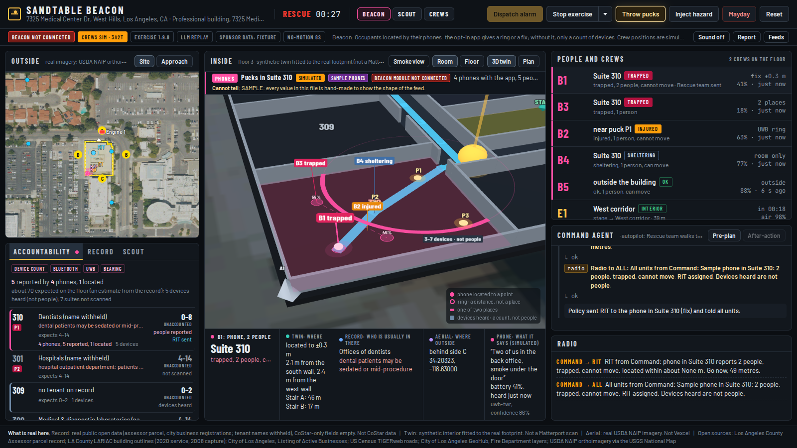
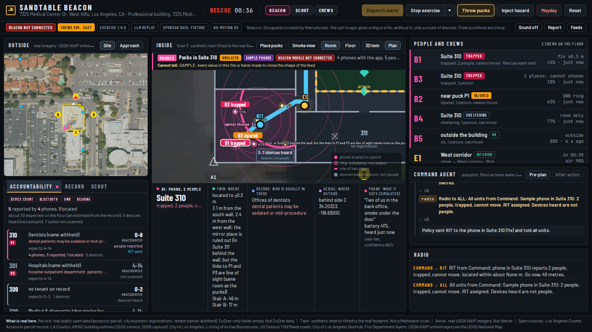
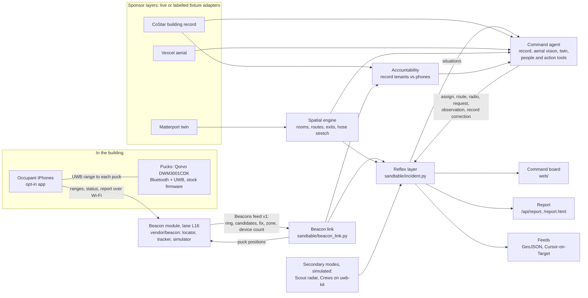
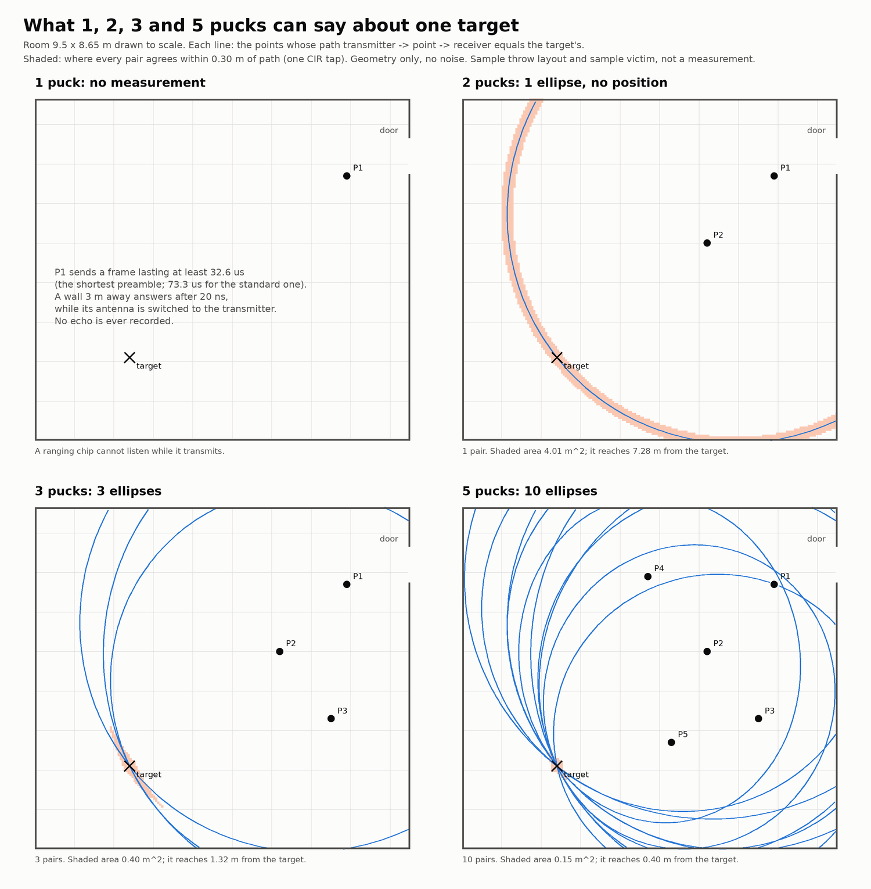

# Sandtable Beacon

**Find the people inside a burning building by their phones, and show each one in the right room of a map built from the building's own data.**

When a commercial building is on fire, the incident commander's hardest question is who is still inside, and where. Sandtable Beacon is a command and reporting centre for that question. When the alarm comes in, an AI command agent reads three layers for the address (the building record with its tenants, the aerial image, the 3D twin) and writes the pre-incident plan. A crew then places small pucks (Qorvo DWM3001CDK boards: Bluetooth and UWB) in the building. Occupants who opened the opt-in app are ranged through their phones, and each phone is drawn as what the measurement supports: a ring, two candidate points, or one point, in the right room and beside the tenant the building record expects there. Phones without the app are only a device count. The agent prioritises, routes a rescue crew through the twin, issues the radio order, re-plans and writes the report the command post keeps. Sponsor layers run as labelled fixtures; positions are simulated until the boards run.



*The board, running on the labelled sample feed (`SAMPLE PHONES` and `SIMULATED` badges): one phone as a point with its uncertainty, one as a ring around a puck, one as two weighted candidates, one as a room-level zone, and a device count marked "not people". Left: the accountability panel sets the building record's tenants against the phones. Crew positions are simulated; the footer says what is real.*



Built for HackPrinceton Fall 2026. Main track: **Healthcare**. Special tracks: **CoStar "Inside and Out: AI for the Built World"** (primary), **Best Hardware Hack**, **Best Physical AI Hack**, **Amazon Best Practical AI Innovation**.

Healthcare, because the job is the first link of emergency care: finding trapped and injured people, knowing their own reported condition (trapped, injured, able to move or not), getting a rescuer to them and handing them to EMS with that information.

## The problem

- **Who is inside, and where.** Today the commander learns it from people who got out, from the radio and from crews searching room by room in smoke. Nearly everyone inside carries a phone with a Bluetooth radio, and recent iPhones carry a UWB radio built to measure distance to another device. Nothing on the fire ground listens to them.
- **The building is known, just not to the first crew.** The record of who occupies which suite, the view from above and the 3D interior all exist for the same address, in three different systems.
- **"How many are missing" is a range, not a number.** The record says who is usually there; a phone says who is there now; neither alone is an answer.
- **The report is written afterwards,** from memory and radio logs.

## What it does

| Step | What happens | Layers |
|---|---|---|
| Pre-plan | A tool-using agent writes the plan the first crews read on the way: construction and floors, life-hazard tenants by suite, the four sides of the building and apparatus access (it looks at the aerial image), stairs and standpipes, hose stretch, and a list of what to verify on site because the layers disagree or a field is missing | record, aerial, twin |
| Pucks in | A crew places pucks in the fire room. On real boards their positions are measured with a tape and clicked onto the plan (the stock firmware does not range board to board); in the simulator they are thrown | twin |
| Phones answer | An occupant who opened the app and pressed a status button is ranged by each puck in reach, and reports status, how many people are with them, whether they can move, battery, floor | Beacon module |
| Drawn honestly | One puck: a **ring**. Two pucks: **two candidate points**, mirror images across the line between them. The twin deletes a candidate that falls outside the building, inside a wall, or behind a wall while the link is clearly line of sight; if one is left, it is a **point**. Three pucks not in a line: a point. Phones with no app: a **device count band**, never people | twin + Beacon |
| Accountability | Each suite of the floor: who the building record expects (an estimate from floor area, stated as a range), phones heard, people reported, located, devices heard, unaccounted as a range, priority, crew assigned, reached, out | record + Beacon |
| Command | The agent prioritises, sends the rescue team by a route through the twin, radios the order with what the record says is in that room, re-routes when a phone's geometry improves, requests EMS with the occupants' reported condition. With a ring or two candidates the order is to search, never "go to the phone" | all |
| Report and feeds | A printable report for the command post (`/report.html`): people found with times, the accountability table, a plan of the floor, crews, timeline, the agent's summary, limits. The same picture as GeoJSON and Cursor-on-Target | all |

**The live demo** uses the owner's hardware: two pucks and two iPhones (an iPhone 14 and an iPhone 15), through lane L16's Beacon module. Each phone answers both pucks with two rings that cross at two candidate points. For one phone the twin's walls rule out the mirror candidate and it becomes a point in the room, beside who the record expects there. For the other both candidates are possible, and the board says so: two weighted places, and an order to search both. That is the moment the map does the work a third puck would otherwise do. Neither iPhone reports direction to these boards, so nothing here uses a bearing.


*`/report.html` after a hands-free simulated run on the labelled sample feed (badges `SAMPLE` and `SIMULATED` at the top right).*

## How it works



- **The phones are lane L16's work.** The Beacon module (`vendor/beacon/`, vendored from the sibling project with credit) owns everything between the puck and the drawn geometry: the iOS app, the server that takes ranges from the phones (`POST /api/ingest`), the locator and tracker, and a simulator. Its feed contract (`vendor/beacon/docs/BEACON_FEED.md`, section 0) is the physics this board must not over-claim: no `x`, `y` for a phone unless the geometry is a fix; devices are not people. This repository consumes that feed and tolerates its absence (`SANDTABLE_BEACON=auto|off|sample`).
- **One coordinate chain.** Twin frame (metres), latitude and longitude (the twin's georeference), aerial pixel. That is how one phone lights up in the plan, the 3D twin, the aerial and the feeds, and how a candidate is tested against a wall.
- **Spatial engine** (`sandtable/spatial`): point-in-room, shortest routes on the twin's walking graph around blocked rooms, doors, stairs or corridor stretches, nearest exit, hose stretch (an outside leg from geography, an inside leg from the twin).
- **Two tiers.** The reflex layer (`sandtable/incident.py`) is plain code: it turns feeds into situations (`phone` when a phone first becomes actionable and again when its geometry improves; `phone_reached`; `scan`; `mayday`), keeps assignments, routes and accountability, and ends the incident when all are out. The command agent (`sandtable/agent`) is a model in a plan, act, re-plan loop over tools in five groups: the record (building, tenants, vacancy), the aerial (outside context, measurements, and a vision tool that sends the image), the twin (floor, locate, route, nearest exit, hose stretch, anchor drops), people (phones, accountability, radar scan) and actions (radio, assign, mark a hazard, request a resource, pin an observation, file a record correction).
- **Replay without fakery.** Every prompt is built from discrete facts only (room ids, graph nodes, whole or half metres, no timestamps), so a recorded real run replays exactly while positions underneath stay noisy. `fixtures/llm_cache/` holds only real model responses recorded through the Claude CLI. A situation with no recording and no live model goes to a small deterministic policy, and every event it emits is labelled `reflex-fallback` (on the board, in the report and in the results).

## How each judging criterion is met

**CoStar: Inside and Out (primary target)**

| Criterion | How, and where to look |
|---|---|
| Use of the data (30%) | Each layer does a job the others cannot, and the join is geometric. **The record** says who should be in each suite (tenants by suite and floor, life hazards inferred from the kind of business, vacant suites, an expected head count from floor area) and which fields a crew needs and does not have. **The twin** gives the rooms, walls and routes, and it **removes impossible phone positions**: with two pucks, a candidate outside the building or inside a wall is deleted, which turns two places into one. **The aerial** gives the sides of the building, the approach, staging and hydrants; the model reads the image. Combined: "phone B1, a point in Suite 310, the dentist's office, patients may be sedated, 17 m from Stair B". Look at: the People panel and accountability panel on the board, `GET /api/accountability`, report section 3, and the Beacon table in Results ("What the twin does with two pucks") |
| Agentic depth (30%) | Situations arrive as goals with a reply budget; the agent picks its tools and ends in actions: assignments with routes, radio orders, an EMS request with the occupants' reported condition, observations pinned in the twin, corrections filed against the record. It must respect the geometry (a ring or two candidates means search, not "go to"), and it is called again when a phone's geometry improves. Look at: the agent log on the board (every thought, tool call and result, coloured by layer, with its source: `replay`, `live` or `reflex-fallback`), `sandtable/agent/prompts.py`, report section 7 |
| Usefulness (25%) | Monday users: the incident commander and the command post (who is inside, where, who is unaccounted for and why that number is a range, a report at the end); a fire-prevention bureau (a pre-plan draft with a verify-on-site list for any commercial address); a building's owner or manager (a reason to tell occupants about the app, and every disagreement between the layers arrives as an evidence-backed request) |
| Demo and polish (15%) | One screen; two physical pucks and two iPhones on the table; a printable report; a phone page for the rescue team that reads the GeoJSON feed. `PITCH.md` is the two-minute script |

**Main rubric (Healthcare).** Creativity: the building's own data decides between two possible positions of a phone, which is the "we didn't know you could do that with our data" moment. Utility: runs end to end, hands-free on the simulator, and the live phone path is written. Charity: finding trapped and injured people sooner, and knowing their condition before a rescuer reaches them. Avidity: three sensing modes, a reporting centre, a puck enclosure, a feasibility answer with sources.

**Best Hardware Hack.** Pucks (Qorvo DWM3001CDK, power only, stock Nearby Interaction firmware), two iPhones, an Arduino UNO Q as a puck host and command post in a box, and a designed enclosure (`hardware/puck/`). The geometry a phone gets is set by where the hardware is placed, and the board shows exactly that.
TODO(lead): after the first live run, replace this line with what ran on the owner's boards and phones (or "not run on hardware").

**Best Physical AI.** The agent acts on measurements of the physical world (ranges from real or simulated radios, constrained by the physical walls of the twin) and directs physical movement (which crew goes where, by which stair, and what to search).

**Amazon Practical AI.** Creativity: phones as a rescue sensor, honestly drawn. Usefulness: a named user (the incident commander) and a report they keep. Technical implementation: a reflex layer plus a tool-using agent, replayable, tested. User experience: one screen, every uncertain thing drawn as uncertain, a printable page.

## Run it

Needs Python 3.10 or newer. Everything is wheels-only and pure Python, so the same commands work on Linux, macOS, Windows and Debian aarch64 (the UNO Q).

```bash
bash run_demo.sh --storyboard          # Linux/macOS: installs into .venv on first run, then plays the Beacon exercise hands-free
```
```powershell
py -m venv .venv                       # Windows
.venv\Scripts\python -m pip install -r requirements.txt
.venv\Scripts\python -m sandtable.demo --storyboard
```

Open <http://localhost:1810/>. The launcher also starts the vendored Beacon module on port 1885 (simulated phones) when nothing answers there. Without `--storyboard`, use the mode switch (**Beacon | Scout | Crews**), **Dispatch alarm**, **Throw pucks**, or the exercise menu. Reporting centre: `/report.html`. Rescue team's phone page: `/crew.html?unit=RIT`. Feeds: `/feed/scan.geojson`, `/feed/cot.xml`, `/feed/cot/stream`.

| Setting | Values | Default |
|---|---|---|
| exercise script | `POST /api/storyboard {"action": "start", "script": "beacon" \| "scout" \| "mayday"}` | `beacon` |
| `--beacon-url` | a Beacon server elsewhere, for example the one the real iPhones report to: `http://<host>:1885` | start the vendored one |
| `--no-beacon` | do not start the Beacon module; the board relays a hand-made sample, badged `SAMPLE` | off |
| `SANDTABLE_BEACON` | `auto` (use the server when it answers), `sample`, `off` | `auto` |
| `LLM_BACKEND` | `replay` (recorded real responses, offline), `anthropic` (needs `ANTHROPIC_API_KEY`), `claude-cli` | `replay` |
| `SANDTABLE_DATA_MODE`, or `COSTAR_MODE` / `MATTERPORT_MODE` / `VEXCEL_MODE` | `fixture`, `live` | `fixture` |
| `--hub`, `--scenario` | the simulated crews: a uwb-kit scenario in `hardware/scenarios/` | `sim`, 3 anchors + 2 tags |

Tests (offline, replay-mode model): `bash run_tests.sh`. Re-record the agent after changing a prompt, a tool or the bundle: `bash scripts/record_all.sh` (needs the Claude CLI or `LLM_BACKEND=anthropic`), then `python scripts/check_replay.py auto`, then `python scripts/make_results_md.py`.

## Three sensing modes

| Mode | Finds | Needs | Cannot do | Status |
|---|---|---|---|---|
| **Beacon** (the product) | occupants, by their phones | pucks with Bluetooth and UWB (DWM3001CDK on Qorvo's stock firmware, power only); the opt-in app on an iPhone 11 or later; puck positions measured and clicked onto the plan | range or identify a phone whose owner installed nothing (cold, only a count of Bluetooth devices, which the stock puck firmware cannot even collect); a direction from an iPhone 14 or 15; ranging with the screen off as built | live path written by lane L16 (app, server, firmware choice); the hands-free run uses L16's simulator |
| **Scout** | an untagged person who breathes or moves; a coarse echo outline; where the room differs from the twin | three or more pucks reading channel impulse responses | see a still, non-breathing person; make a LiDAR-grade map; run on these boards (no firmware) | **simulation only** |
| **Crews** | firefighters carrying tags; a mayday when one stops moving | anchors and tags with ranging firmware the uwb-kit hub reads | run on the owner's boards (the kit has no firmware for the nRF52833) | **simulation only**; the mayday exercise is intact |

## What is real, what is a fixture, what is simulated, what is a sample

| Thing | Status |
|---|---|
| Building record | **Fixture: real public data, not CoStar.** 7325 Medical Center Dr, Los Angeles: county assessor parcel (year, area, use, construction class), city business registrations (suite, floor, category; names withheld on purpose), county building outline and height. CoStar-only fields (sprinklers, elevators, contacts, leasing) are empty. Life hazards are inferred from the kind of business by a rule table and say so. Expected head counts are estimates from floor area |
| Aerial | **Fixture: real USDA NAIP imagery, not Vexcel.** No oblique views in fixture mode |
| Twin | **Fixture: synthetic interior, not a Matterport scan.** A floor fitted to the real footprint and numbered with the real suite numbers. Partitions, doors and stairs are invented and labelled; so is every wall that prunes a phone candidate |
| Hydrants, fire stations, street | Real open data (City of Los Angeles GeoHub, US Census TIGERweb). The engine position and the entrance are inferred and labelled |
| Live sponsor adapters | Written from the public Vexcel OpenAPI spec and Matterport's documented GraphQL samples; CoStar is a mapping table to fill. Unit-tested against mocked transports. **Never called live** (no key reached this machine) |
| Phones, hands-free run | **Simulated** by lane L16's Beacon simulator (vendored); the board shows `SIMULATED` |
| Phones with `--no-beacon` | **Sample:** a hand-made Beacons object (`fixtures/beacon/sample_beacons.json`); every message and the board say `SAMPLE` |
| Phones, live | Real iPhones ranging real pucks through lane L16's app and server. The phones' `SIMULATED` badge goes away only when the Beacon feed says `simulated: false`; the crews stay simulated and keep theirs. Status and limits: `vendor/beacon/docs/PHONE_FEASIBILITY.md` |
| Scout radar | **Simulated** (simulator and DSP adapted from lane L08, its noise model stated) |
| Crews | **Simulated** by the uwb-kit simulator (Gaussian range noise, outliers, dropouts, then the kit's solver) |
| Agent decisions | Recorded real model output (`claude-sonnet-5-5` through the Claude CLI), replayed. Situations with no recording go to the labelled `reflex-fallback` policy; the Results section lists which runs had any. The `anthropic` backend is written and has not been exercised (no key here) |
| Puck enclosure | A CAD model whose STLs were built and checked in software; never printed, weighed or thrown |
| Feeds | Well-formed GeoJSON and Cursor-on-Target 2.0; **not tested against a TAK server** |
| Writes | In fixture mode, observations and record corrections go to local files and say so |

## Results (generated by `scripts/make_results_md.py` from the files named; everything is simulated or arithmetic unless a row says otherwise)

No UWB board and no phone has been in the loop of any number below.

### Beacon: locating phones (lane L16's evaluation, SIMULATED)

*Beacon locator accuracy by method, pucks and twin: not yet measured (`vendor/beacon/results/eval_beacon.json` is missing or unreadable).*

*Two boards on one thrown device against separate pucks: not yet measured (`vendor/beacon/results/eval_layouts.json` is missing or unreadable).*

### Scout: the pucks as a radar (SIMULATED)

SIMULATED, from `results/scout_ablation.json` (`.venv/bin/python scripts/eval_scout.py`): 60 seeded throws per row into Suite 310, 12 s scans at 20 Hz, the full pipeline (self-location, registration into the twin, detection). Noise model: direct-path SNR 36 dB at 1 m, random carrier phase per frame, multipath flicker, person radar cross-section 0.4-0.9 per seed (m²). The simulator was written alongside the detector, so real boards will do worse.

| Pucks | Links | Breathing person within 4.5 m of a puck: reported / within 0.6 m | Median error when reported | Breathing rate error, median | Person anywhere in the room: reported | Empty room: false alarms | Still, not breathing: reported |
|---|---|---|---|---|---|---|---|
| 1 | 0 | 0% / - | - | n/a | 0% | 0% | 0% |
| 2 | 1 | 33% / presence and range only | no position | 4.8 /min | 27% | 27% | 27% |
| 3 | 3 | 50% / 30% | 0.45 m | 0.9 /min | 35% | 3% | 8% |
| 4 | 6 | 62% / 53% | 0.17 m | 0.5 /min | 43% | 0% | 2% |
| 5 | 10 | 78% / 75% | 0.1 m | 0.4 /min | 65% | 2% | 0% |

One puck reports nothing by construction (one puck cannot receive its own echo). Rates are over all scans; Wilson 95% intervals are in the file.

**Radar arithmetic quoted above** (`results/radar_arithmetic.json`, from `scripts/radar_arithmetic.py`; arithmetic and geometry from datasheet constants; no radio data):

| Quantity | Value | Kind |
|---|---|---|
| Shortest DW3000 preamble alone | 32.56 µs | datasheet arithmetic |
| Round trip to a wall 3 m away | 20.01 ns (the preamble lasts 1627 times as long) | arithmetic |
| Monostatic range resolution at 499.2 MHz | 0.3 m | arithmetic |
| Bistatic resolution at 90 and 120 degrees | 0.42 m and 0.6 m | arithmetic |
| Wavelength, channel 5 | 46.2 mm | arithmetic |
| Room area consistent with every pair (sample throw, one-tap tolerance): 2 / 3 / 5 pucks | 4.01 m² / 0.4 m² / 0.15 m² | geometry, no noise |
| Sample victim's echo below the direct pulse: best / median / worst pair | -24.6 dB / -31.8 dB / -36.3 dB | link budget, assumed cross-section |
| Empty room's own multipath flicker in the one real recording | -21.9 dB | real DWM1000 data (ETH Zurich), analysed by lane L08 |
| Lane L08's tracker on that real recording | FAILED: the tracker follows clutter, not the person | real data, not our hardware |

### Crews: tagged firefighters on the uwb-kit simulator (SIMULATED)

From `results/sim_eval.json` (`scripts/eval_sim.py`). Positions come from the shared uwb-kit simulator through the kit's solver, then this board's registration and map matching, as in the mayday exercise. No board was attached.

| Rig (scenario file) | Scale | Simulator noise | Error in the building, median / p90 | Room-level location right | Corridors only | Maydays detected | Latency, mean | False maydays in 40 s of walking |
|---|---|---|---|---|---|---|---|---|
| `sandtable_rig_3A2T.json` | 1:9.8 | range sigma 0.08 m, 2% outliers, 3% dropouts | 0.81 m / 1.46 m | 95.7% of 324 | 88.3% | 5 of 5 | 7.9 s (threshold 8 s) | 0 |
| `sandtable_table_4A1T.json` | 1:49.1 | range sigma 0.02 m, 1% outliers, 2% dropouts | 0.64 m / 1.51 m | 96.0% of 324 | 89.2% | 3 of 3 | 7.92 s (threshold 8 s) | 0 |

### The exercises, end to end

From `results/replay_check_*.json` (`scripts/check_replay.py`, run against a live board). Each row is one complete exercise on the simulator; it lists where every command-agent turn came from: `replay` (a recorded real model response), `live` (a model called during the run) or `fallback` (the labelled deterministic policy).

| Script | Mode | Rig | Wall time | Agent turns: replay / live / fallback | Turns that fell back |
|---|---|---|---|---|---|
| mayday | guided | 4A1T | 68.6 s | 5 / 0 / 0 | none |
| mayday | hands-free | 3A2T | 75.9 s | 5 / 0 / 0 | none |
| mayday | hands-free | 4A1T | 75.9 s | 5 / 0 / 0 | none |
| beacon | | | not yet measured | | |
| scout | | | not yet measured | | |

Recorded agent responses: 23 files in `fixtures/llm_cache/`, model claude-sonnet-5-5, recorded through the Claude CLI between 2026-11-14T10:44 and 2026-11-14T10:49 (local time). The demo replays them; nothing in that folder is hand-written.
Headless-browser walk of the board (`results/ui_walk.json`, `scripts/shots.cjs`): beacon 46.7 s, 16 screenshots, 0 console messages; mayday 77.1 s, 14 screenshots, 1 console messages; scout 65.8 s, 13 screenshots, 0 console messages.
Tests (`bash run_tests.sh`, offline, replay-mode model): 146 passed, 1 failed in 65 s, last run 2026-11-14T12:33.

## Is one UWB board enough to scan a room? (the owner's question; Scout mode, simulation only)

Scout is a secondary, **simulation-only** mode of Sandtable Beacon. No board has run the radar. The echo-reading firmware it reuses targets ESP32 boards, not the owner's DWM3001CDK kits.

**One board is not enough.** A DWM3001CDK (nRF52833 + Qorvo DW3110) cannot hear its own echoes. Its antenna is switched either to the transmitter or to the receiver, and Qorvo staff confirm the module cannot do both at once. Its shortest frame lasts 32.6 µs, while a wall 3 m away answers after 20 ns, mid-frame. The smallest radar is a pair: one board transmits, and the other reads the echoes that follow the direct pulse in its channel impulse response.

**More boards fix it.** A pair gives one ellipse per echo, with the two boards as foci and no bearing. N boards give N(N-1)/2 ellipses: 3, 6, then 10. The target is where they cross. The boards first range each other to learn their own positions. In the sample throw, the area consistent with every pair shrinks from 4.01 m² with two boards to 0.40 m² with three and 0.15 m² with five.



**What the "map" is.** About 500 MHz of bandwidth separates echoes only 0.3 to 0.6 m apart, and walls reflect like mirrors. The result is a coarse echo map, never a LiDAR-grade model. The stored twin is the real map. The pucks add an untagged person who moves or breathes, and flag where the room no longer matches the twin. A person who neither moves nor breathes looks like furniture.

**Smoke.** Smoke particles (0.01 to 1 µm) scatter light and LiDAR but are negligible at a 46 mm wavelength. In fire tests, LiDAR erred below 4 m visibility while radar held within 1%. Thermal imagers also see through smoke. Flames, wet walls and metal cost radio signal.

**Biggest risk:** echo strength. Across this room a person's echo is 25 to 36 dB below the direct pulse, near the clutter level in real recorded data. On the one real recording available (ETH Zurich, DWM1000 modules), the reused tracker followed clutter, not the person.

**Simulated detection by number of pucks** (full pipeline on this tree's simulator; real boards will do worse):

<!-- scout-ablation:start (generated by scripts/make_results_md.py) -->
SIMULATED, from `results/scout_ablation.json` (`.venv/bin/python scripts/eval_scout.py`): 60 seeded throws per row into Suite 310, 12 s scans at 20 Hz, the full pipeline (self-location, registration into the twin, detection). Noise model: direct-path SNR 36 dB at 1 m, random carrier phase per frame, multipath flicker, person radar cross-section 0.4-0.9 per seed (m²). The simulator was written alongside the detector, so real boards will do worse.

| Pucks | Links | Breathing person within 4.5 m of a puck: reported / within 0.6 m | Median error when reported | Breathing rate error, median | Person anywhere in the room: reported | Empty room: false alarms | Still, not breathing: reported |
|---|---|---|---|---|---|---|---|
| 1 | 0 | 0% / - | - | n/a | 0% | 0% | 0% |
| 2 | 1 | 33% / presence and range only | no position | 4.8 /min | 27% | 27% | 27% |
| 3 | 3 | 50% / 30% | 0.45 m | 0.9 /min | 35% | 3% | 8% |
| 4 | 6 | 62% / 53% | 0.17 m | 0.5 /min | 43% | 0% | 2% |
| 5 | 10 | 78% / 75% | 0.1 m | 0.4 /min | 65% | 2% | 0% |

One puck reports nothing by construction (one puck cannot receive its own echo). Rates are over all scans; Wilson 95% intervals are in the file.

<!-- scout-ablation:end -->

Full argument, sources and corrections: [docs/RADAR_FEASIBILITY.md](docs/RADAR_FEASIBILITY.md). Numbers: `scripts/radar_arithmetic.py` writes `results/radar_arithmetic.json`. Figures: `figures/radar_ellipses.png`, `figures/radar_wavelengths.png`.

## Hardware and bring-up

- **Phones and pucks (Beacon):** lane L16's documents, copied into `vendor/beacon/` by `scripts/vendor_beacon.py`: `docs/PHONE_FEASIBILITY.md` (what an iPhone 14 and 15 can and cannot do with these boards, one puck against two against three, two boards on one device), `docs/PRIVACY.md`, `docs/research/`, and its hardware guide. In short: flash nothing, power each puck, measure where each puck stands, click it onto the plan, open the app on the phones, and point this board at the Beacon server with `--beacon-url`.
- **This board next to a Beacon server, and the simulated modes:** `hardware/BRINGUP.md`.
- **The puck as an object:** `hardware/puck/README.md` (a self-righting ball for one DWM3001CDK and a cell, and a command brick for the UNO Q host). Figures: `figures/puck_render.png`, `figures/puck_exploded.png`, `figures/puck_section.png`, `figures/puck_brick.png`.
- **Sponsor toolkit:** `docs/TOOLKIT_SWAP.md`, the 30-minute procedure for switching each layer to live when the CoStar toolkit and keys are in hand. The layers switch independently.

## Repository

```
sandtable/            config, server, incident (reflex layer), director (exercise scripts), beacon_link, demo launcher
sandtable/agent/      model wrapper (anthropic | claude-cli | replay), tools, prompts, the loop and the fallback policy
sandtable/spatial/    twin model, routing, registration, hose stretch, anchor plan
sandtable/adapters/   live adapters for the three sponsor layers and the self-check
sandtable/scout/      the radar mode (simulated): scene, simulator, DSP, registration, mismatch, feeds
web/                  the board (index.html, app.js, beacon.js, plan2d.js, twin3d.js, aerial.js, scout*.js), report.html, crew.html
fixtures/             building/, aerial/, beacon/ (labelled sample), scout/ (labelled sample), llm_cache/ (recorded real model responses)
scripts/              open-data build, evaluations, replay check, results writer, screenshots, vendoring
hardware/             BRINGUP.md, puck/ (enclosure CAD), scenarios/ (uwb-kit), firmware/esp32-reference/ (lane L08's, not for these boards)
vendor/beacon/        lane L16's Beacon module (phones), vendored
vendor/uwbkit/        the bench's shared UWB kit (hub, simulator, solver, clients)
docs/                 contracts, RADAR_FEASIBILITY.md, TOOLKIT_SWAP.md, owner questions
tests/  results/  figures/
```

## Credits

- **Lane L16** (`sandtable-beacon-victim-phones`): the Beacon module in `vendor/beacon/`: the iOS app, the server, locator, tracker and simulator, the feed contract, the phone feasibility research and its evaluation. Everything this README says about phones comes from its documents.
- **Lane L08** (`tagless-uwb-echo-radar`): the radar simulator and DSP that Scout adapts, its noise model, its CIR notes and its analysis of the ETH Zurich DWM1000 recording.
- **The bench's shared uwb-kit** (`vendor/uwbkit/`): hub, simulator and solver behind the Crews mode.
- **Open data:** Los Angeles County Assessor parcel record; Los Angeles County LARIAC building outlines; City of Los Angeles Listing of Active Businesses and GeoHub fire department layers; US Census TIGERweb; USDA NAIP orthoimagery through the USGS National Map. Published research and datasheets are cited in `docs/RADAR_FEASIBILITY.md` and in lane L16's documents.
- three.js; fonts Barlow, Barlow Condensed and JetBrains Mono.

## Limitations

- **No phone and no puck has been in the loop of any number in this README.** The live path (stock Qorvo firmware, lane L16's iOS app reporting ranges over Wi-Fi) is written; the accuracy of an iPhone ranging these boards in a room has not been measured by anyone we could find.
- **Opt-in only.** A phone is ranged only if its owner opened the app; without it the most a puck could do is count Bluetooth devices, and devices are not people. As built, the app must stay open with the screen on.
- **Two pucks often leave two candidates.** The twin removes one only when the geometry allows; otherwise the board says two places and the order is to search both.
- **No CoStar, Matterport or Vexcel data has been seen.** The live adapters will need field-name fixes on first contact. The twin is synthetic, so every wall that prunes a phone candidate is a plausible wall, not the real one. Life hazards and expected head counts are inferences and estimates.
- **The agent's Beacon and Scout turns** replay only where a recording exists; otherwise the labelled fallback policy acts (the Results section says which).
- **Scout and Crews are simulation-only** on these boards. The radar's detection performance comes from a simulator written alongside the detector.
- One floor is modelled. No authentication on the feeds or the app's link to the server; a real deployment needs transport security and an access model.
- Not a life-safety product. A prototype of one, and an exercise tool.

## What's next

- The first live run with the owner's two pucks and two iPhones, and a measured range error against a tape.
- Live CoStar, Matterport and Vexcel data for a Houston or Los Angeles building, so the walls that prune a candidate are real walls.
- A third puck per room, and the paired background mode so a phone keeps answering with the screen off.
- Record the agent's Beacon and Scout runs with a live model; multi-floor routing; a pre-plan export in NFPA 1620 form.
