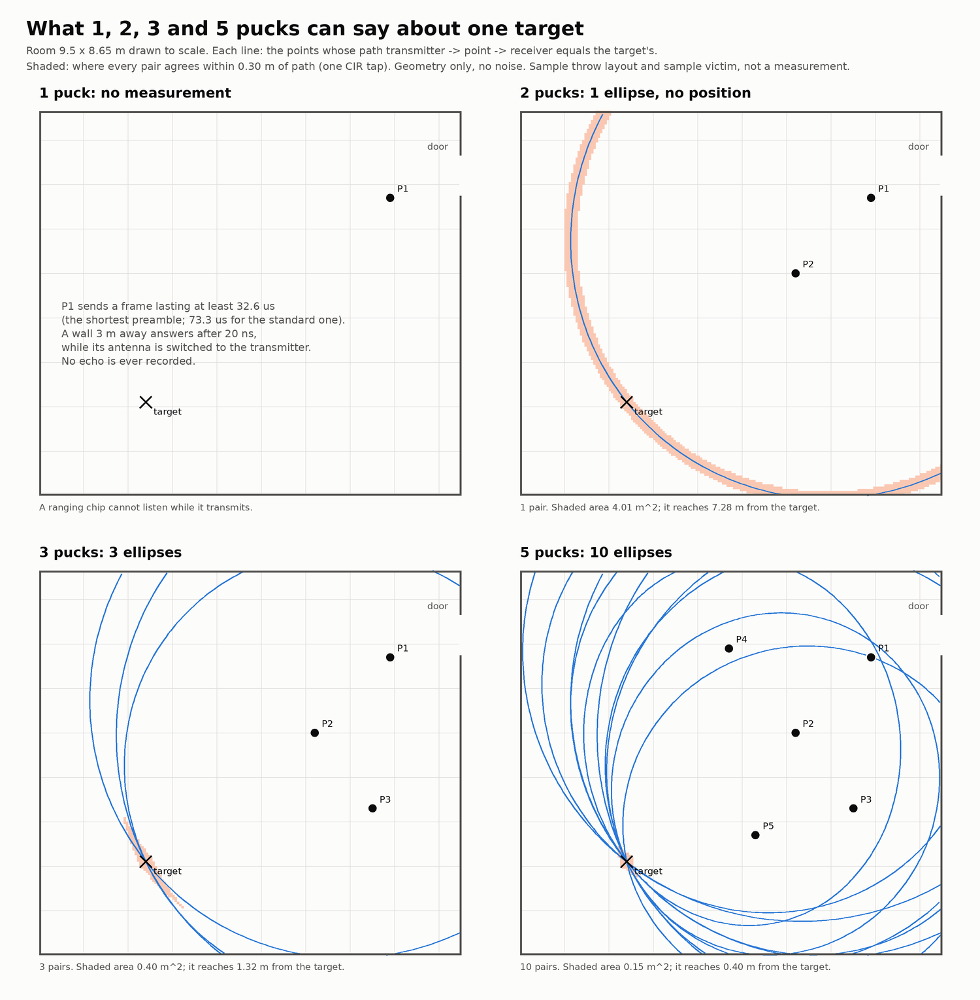
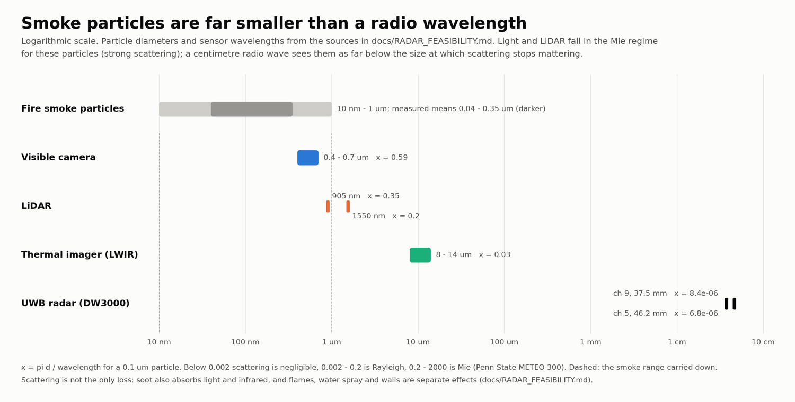
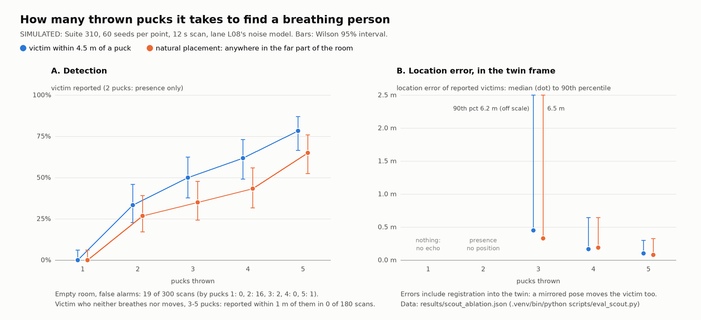
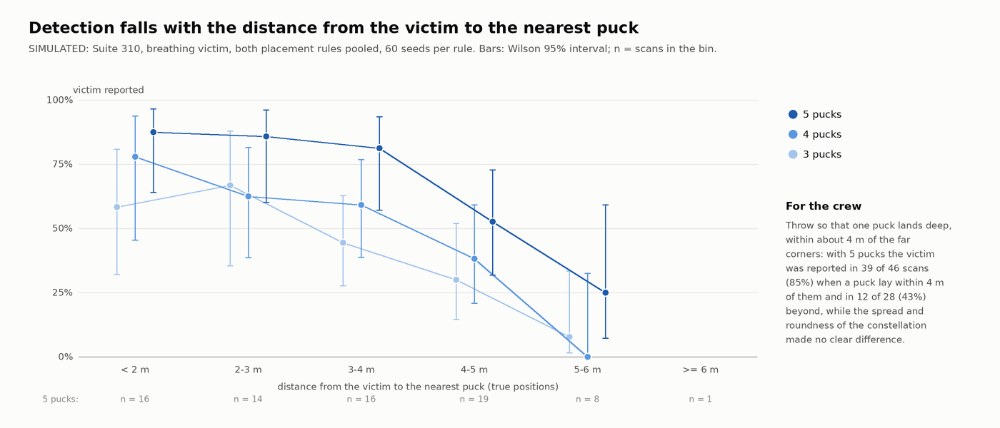
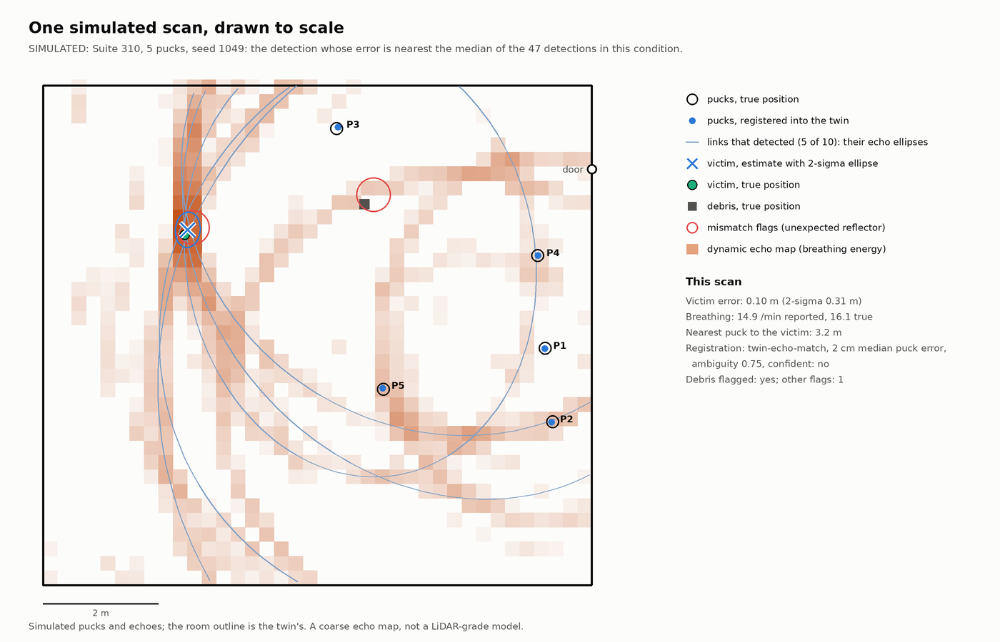

# Is one UWB board enough to scan a room? Radar feasibility for scout mode

This document answers one question from the owner: is one UWB sensor enough to scan a room by radar, and if not, why not, and how do several boards fix it? It also checks the smoke claim behind scout mode. It is written for an engineer who wants to probe it.

How to read it:

- **Nothing here was measured on our boards.** No board has been attached. The document holds datasheet facts, published results by other people, and arithmetic.
- Every computed number comes from `scripts/radar_arithmetic.py`, which writes `results/radar_arithmetic.json` and the two figures. Run it with `.venv/bin/python scripts/radar_arithmetic.py`. It takes about 7 seconds.
- Every external fact cites a source that was opened while writing this. They are listed in [Sources](#sources), numbered [S1]...[S39]. Where no solid source was found, the text says **not verified**.
- "Simulated" means the radar simulator of lane L08 (`../tagless-uwb-echo-radar`), whose noise model is stated in its `docs/SIM_MODEL.md`. "Real data, not our hardware" means the public ETH Zurich DWM1000 recording [S8] as analysed by L08's code. L08 is being archived, so every L08 number used here is also copied, with its label, into `results/radar_arithmetic.json` under `l08_excerpt`.

## Status (read this first)

- **The boards** are five Qorvo **DWM3001CDK** development kits. Each DWM3001C module carries an nRF52833 Bluetooth microcontroller and a **DW3110** UWB transceiver [S35], the single-antenna-port member of the DW3000 family [S1]. Everything below about the DW3000 applies to the DW3110.
- **Radar on real hardware is out of scope this weekend.** The echo-reading firmware reused from L08 targets ESP32 + DW3000 boards, not the DWM3001CDK's nRF52833. There is also no nRF toolchain on the build machine.
- **Scout mode is a secondary, simulation-only mode** of the product, now called **Sandtable Beacon**. Beacon's headline is locating victims by their phones; a sibling document covers that feasibility.
- Section 3.5 states what it would take to run the radar on DWM3001CDK boards later.

## 1. The short answer

**No. One of these boards cannot scan a room by radar.** The board is a ranging transceiver. Its antenna is switched either to the transmitter or to the receiver [S1]. Qorvo's own staff say so about this exact module: "The DWM3001C was not meant for radar and it cannot simultaneously transmit and receive at the same time" [S36]. It sends frames that last tens of microseconds; even the shortest preamble alone lasts 32.56 µs. A wall 3 m away answers after 20.01 ns, while the frame is still going out and the receiver is off. The chip never records its own echo. The fix is to split the roles. One board transmits and the others listen. Each listener's channel impulse response (CIR) then shows the direct pulse from the transmitter followed by the echoes.

**One pair gives one number per echo.** That number is the extra path length, which places the reflector on an ellipse with the two boards as foci. The DW3110 has a single antenna port and no phase-difference-of-arrival support [S1], so there is no bearing. **Several boards fix this by adding ellipses that cross.** With N boards you get N(N-1)/2 of them: 3 from three boards, 6 from four, 10 from five. Where they cross is the target. Each extra board adds ellipses at new angles, which shrinks the region consistent with every pair. For the sample throw it shrinks from 4.01 m² with two boards to 0.40 m² with three and 0.15 m² with five (figure below). Each extra board also adds redundancy, so a bad link can be outvoted. The boards must first find their own positions by ranging each other, because every ellipse needs known foci.

**What it can honestly produce:** a moving or breathing person shows up against the static room, plus a coarse echo outline, and flags where the room's echoes disagree with the stored 3D twin. **It cannot produce a LiDAR-grade model.** About 500 MHz of bandwidth separates echoes only about 0.3 to 0.6 m apart, depending on geometry. Walls reflect like mirrors, and a person who neither moves nor breathes looks like furniture.

**The open risk is signal strength, not geometry.** A person several metres from the boards returns an echo 25 to 36 dB below the direct pulse. That is at or below the level at which the static multipath flickers by itself in the one real recording available. The pipeline this project reuses failed to track a person in that recording (section 6.4). Whether five DWM3001C pucks find a breathing person across a 9.5 m room is unproven until a board runs.

*Geometry only, no noise. Pucks at the sample throw positions of `fixtures/scout/sample_scan.json`, target at its sample victim (2.4, 2.1). Shaded: every pair agrees within 0.30 m of path (one CIR tap).*

## 2. Corrections to the working read

The coordinator's technical read was mostly right. These are the places where it was imprecise or incomplete.

0. **The board.** The read assumed ESP32 + DW3000 boards. The boards are DWM3001CDK kits (nRF52833 + DW3110). The single-board argument does not change: the DW3110 is the one-port DW3000 variant [S1], and Qorvo staff confirm that the DWM3001C cannot transmit and receive at once [S36]. What does change is the firmware path (section 3.5).
1. **Why one board cannot hear its echo.** "Half-duplex" is true but is not the whole reason. A pulsed radar is also half-duplex: it blanks its receiver during each pulse [S10]. It works because its pulse lasts nanoseconds and the receiver opens right after it. The DW3000's unit of transmission is not a nanosecond pulse but a frame. The receiver gets a CIR only by correlating over a preamble, and the shortest preamble the driver offers lasts 32.56 µs, 1,627 times the 20.01 ns round trip to a wall 3 m away. For the echo of a standard 64-symbol preamble plus SFD to start arriving after that header has been sent, the reflector would have to be 10,983 m away. So the receiver is off for the entire echo, not just part of it.
2. **"The minimum is a pair" is right for this module, but it is about this chip, not about UWB.** Purpose-built single-chip UWB radars exist (NXP Trimension SR250 [S6], Novelda X4 [S5]). A single puck carrying two DW3000 radios on separate antennas would in principle be a co-located pair. It would still give only range, with strong direct coupling between the antennas, and that option is not verified.
3. **Resolution "about 30 cm" is the monostatic best case.** The CIR of a pair measures total path. Two echoes separate when their paths differ by about c/B = 0.601 m. Projected into the room, that is 0.300 m only when the bistatic angle at the target is near zero. It is 0.425 m at 90°, 0.601 m at 120° and 1.16 m at 150°. The contract's "one tap is about 1 ns, 0.3 m of path" is correct as tap spacing, but tap spacing is not resolution, because the pulse spans about two taps. Accuracy is a separate matter: an isolated echo can be placed to a fraction of a tap.
4. **The pairs and ellipses are right, with three additions.** Both directions of a link trace the same ellipse, so five boards give 10 ellipses from 20 measurements. With all pucks on the floor the geometry is planar and cannot measure height, so the solver must assume one. Three pucks thrown in a cluster cross at shallow angles far from the cluster (GDOP 2.80 at the sample victim, against 0.80 with five).
5. **"The twin is the map" is right, and the twin does one more job.** The pucks' self-location is only relative, with arbitrary rotation, mirror and offset. Matching the measured wall echoes to the echoes the twin predicts is also how the pucks get placed into the building.
6. **The smoke claim is right against cameras and LiDAR, but it overstates the case against thermal imaging.** Fire-service thermal imagers work in the 8-14 µm band precisely because it passes smoke well [S16]. In tests they kept working where LiDAR and visual cameras failed [S18]. Their documented failures are heavy smoke combined with high heat, saturation, and water spray [S16]. Radio also has losses the read omitted: flames cost 1.6 to 5.8 dB at 8 to 10.5 GHz in one measurement [S24], wetted concrete 6 to 12 dB [S27], and metal blocks it [S23].
7. **The read missed the main risk.** That risk is echo strength across a room, quantified in section 6.4. Resolution is not the limiting factor.

## 3. Why one DW3000 board cannot be a monostatic radar

### 3.1 Datasheet facts

- "A TX/RX switch is used to connect the receiver or transmitter to the antenna port" (DW3000 datasheet v1.1, section 2 [S1]). TX and RX are separate operating states. TX "automatically reverts to IDLE_PLL after transmission", and RX is entered separately (Table 21 and Figure 20 [S1]).
- The driver's "response expected" flag "will enable the receiver after TX has completed" [S2]. Every documented way of combining the two runs them one after the other. CCA mode listens first, then transmits [S2]. SNIFF mode duty-cycles the receiver only. The continuous-wave and continuous-frame modes are transmit-only test modes for regulatory approval [S2]. No mode in the datasheet or the driver header runs the receiver while the transmitter is on. The full DW3000 user manual is not openly downloadable and was not read, so this is "high confidence", not "proven".
- The DW3000 variant with two antenna ports (DW3120) does not change this. Its receiver switches between the two ports to measure the phase difference of arrival [S1]. The owner's DWM3001C modules use the single-port DW3110 anyway [S35].
- For this exact module, a Qorvo staff member answered a user who wanted to use the DWM3001CDK "as a UWB radar system": "The DWM3001C was not meant for radar and it cannot simultaneously transmit and receive at the same time. Our QM35 series has this ability" (Qorvo Tech Forum, 2 June 2026 [S36]).

### 3.2 Timing: the frame against the room

Preamble symbol duration at 64 MHz PRF: 1017.63 ns (Table 18 [S1]). The SFD is 8 symbols for 64-symbol preambles (Table 7 [S1]). These are lower bounds: PHR and payload add more time on top.

| Preamble | Preamble alone | Preamble + SFD | Reflector distance whose echo would start only after the header has been sent |
|---|---|---|---|
| 32 symbols (shortest the driver offers [S2]) | 32.56 µs | 40.71 µs | 6,102 m |
| 64 symbols (shortest standard) | 65.13 µs | 73.27 µs | 10,983 m |
| 128 symbols | 130.26 µs | 138.4 µs | 20,745 m |

| Wall distance | Round trip | Shortest preamble / round trip |
|---|---|---|
| 1 m | 6.67 ns | 4,881 x |
| 3 m | 20.01 ns | 1,627 x |
| 6 m | 40.03 ns | 814 x |
| Room diagonal 12.85 m | 85.7 ns | |

The echo of any part of a frame arrives 6.67 ns (wall at 1 m) to 85.7 ns (room diagonal) after that part was sent, which is always during the frame itself. For the whole of that time the antenna is connected to the transmitter. The pulse-radar rule says the receiver is blind for "the pulse width plus the recovery time" [S10]. Here the "pulse" the receiver needs is the whole preamble.

### 3.3 Does the CIR diagnostic change this?

No. The accumulator holds the result of the receiver correlating a received preamble (the Ipatov CIR) or STS. It exists only after a reception [S1, S2]. L08's `hardware/CIR_NOTES.md` adds that the accumulator is valid only until the receiver is re-enabled. Reading it is how a listening board sees echoes of another board's frame. It gives the transmitting board nothing.

### 3.4 What a monostatic UWB radar chip has that this one lacks

- **Novelda X4** [S4, S5]: an "impulse radar" SoC with a transmitter at 7.29 or 8.748 GHz and "a direct RF sampling receiver" [S4]. One module built on it lists a 1.4 GHz bandwidth, "integrated planar patch antenna pair" (separate transmit and receive antennas), "RF data sampled at 23.328 GS/s", and respiration sensing out to 5 m [S5]. A 1.4 GHz bandwidth gives a monostatic resolution of 0.107 m, against 0.300 m for the DW3000.
- **NXP Trimension SR250** [S6]: "low-power short-range UWB radar operating at 6-8.5 GHz" next to secure ranging. It "can detect presence, location or even motion, such as breathing or gestures", and "UWB radar is a passive solution requiring only the single-chip IC" (press release, 10 Sept 2024).
- **Qorvo QM35 series**: a Qorvo staff member names it as the Qorvo family that can transmit and receive at the same time [S36]. Its radar specifications were not read.
- **Qorvo QPF5100Q**: search results describe it as supporting monostatic and multistatic impulse radar for child presence detection. Qorvo's site refused automated requests, so this is **not verified**.

What these parts have in common: a receiver that runs on the transmitter's own clock and samples nanoseconds after each short pulse (or continuously, with isolation between separate antennas), many pulses integrated per measurement, and firmware built for a radar mode. The DW3000 has a single switched antenna port, a frame-based link layer, and a receiver that must acquire a preamble from another radio.

### 3.5 What it would take to run the multistatic radar on DWM3001CDK boards

The radar needs one thing the stock firmware does not give: after every frame a board receives, its nRF52833 must read the DW3110's accumulator over SPI and stream the CIR to the host. Qorvo staff confirm "The CIR is read from the UWB transceiver over SPI" and recommend sending only "a number of indexes before and after the first path" rather than the full CIR [S37]. A forum user names an `ex_02k_simple_rx_cir` example in Qorvo's DW3_QM33_SDK 1.0.2 [S38]. In Qorvo's UCI firmware build, the number of CIR taps reported per frame is set by `rx_diag_config.cir_n_taps` and `cir_fp_tap_offset`. The default chunk is 16 samples, and staff warn that more taps can cause "memory issues or throughput issues" [S38]. Users of the stock CLI/FiRa firmware report that calling the driver's CIR read directly returned zeros, because the FiRa library owns the driver [S39]. One user streamed CIRs from a DWM3001CDK over USB/UART at 30 to 40 Hz at 1,000,000 baud, after starting at about 2 Hz [S37]. That is a user report, not a specification. So the path exists but would mean: an nRF toolchain (the user in [S36] used SEGGER Embedded Studio), Qorvo's SDK with the UCI build or a bare driver application, a transmit schedule across five boards, and a CIR stream in the format of L08's `cir` message. That is new firmware. L08's ESP32 sketch does not carry over, only its host-side processing. Whether the SDK exposes the 1/64-tap first-path index and the complex taps as the ESP32 path assumed is **not verified**.

## 4. What one pair measures

- **The bistatic path.** The listener's CIR starts with the direct pulse from the transmitter and continues with echoes. An echo's delay after the direct pulse gives its excess path. Adding the baseline (known from ranging) gives the total path transmitter, reflector, receiver. The set of points with that total path is an ellipse with the two boards at its foci (an ellipsoid in 3-D) [S9]. The ETH study used exactly this with off-the-shelf DWM1000 modules [S7].
- **The direct pulse is also the reference.** The two boards share no clock. In the ETH study's words, the modules "are not triggered by the same RF-clock" [S7]. Delays are therefore measured from the direct pulse in the same CIR, not from a shared time base. L08 also uses the direct pulse's phase to make frames coherent for breathing. That idea is simulated only and has never run on a radio.
- **No bearing.** The DW3110 has one antenna port and no phase-difference-of-arrival support [S1], and the DWM3001C has one planar UWB antenna [S35]. An echo has the same delay anywhere on the ellipse, and nothing in the frame says from which side it came. The DWM3001C's antenna pattern was not found. Qorvo documents the related DWM3000 module's antenna as omnidirectional in one plane [S3]. With the sample throw, the area consistent with one pair at one-tap tolerance is 4.01 m², reaching 7.28 m from the true target (figure, panel 2).
- **No height either, with pucks on the floor.** The 3-D locus is an ellipsoid around the baseline. With every puck on the floor, a reflector's height and its horizontal offset trade against each other, so the solver must assume a height (the scene uses 0.25 m for a lying person). This follows from the geometry. No measurement was made.
- **What one pair can still give:** presence (something changed), the excess path, and a breathing rate from the echo's phase. L08 simulated two boards reading a breathing rate with a mean absolute error of 2.02 breaths per minute, missing 2 of 4 breath holds. That figure is simulated.

## 5. What N pucks give

| Pucks | Pairs (ellipses) | Ordered links | Self-location unknowns (2-D) | Redundant ranges | What it buys |
|---|---|---|---|---|---|
| 1 | 0 | 0 | 0 | 0 | Nothing. The board cannot receive while it transmits |
| 2 | 1 | 2 | 1 | 0 | Presence, echo path, breathing. No position |
| 3 | 3 | 6 | 3 | 0 | A 2-D position. Self-location has no check |
| 4 | 6 | 12 | 5 | 1 | A 2-D position with redundancy. One bad link can be outvoted |
| 5 | 10 | 20 | 7 | 3 | Better crossing angles, outlier rejection, a coarse echo map |

Self-location unknowns are 2N-3: N positions in 2-D minus a rotation and an offset. The mirror ambiguity also remains and is resolved at registration.

### 5.1 Where the ellipses cross

Region of the room consistent with every pair for the sample victim. No noise and exact puck positions; first N pucks in throw order:

| Pucks | Area, 0.30 m path tolerance (one tap) | Farthest consistent point | Area, 0.10 m tolerance (sub-tap) | Farthest |
|---|---|---|---|---|
| 2 | 4.01 m² | 7.28 m | 1.32 m² | 7.26 m |
| 3 | 0.40 m² | 1.32 m | 0.05 m² | 0.40 m |
| 4 | 0.21 m² | 0.64 m | 0.02 m² | 0.11 m |
| 5 | 0.15 m² | 0.40 m | 0.02 m² | 0.08 m |

With three pucks clustered by the door, the three ellipses meet the victim almost tangentially. That is why the consistent sliver is 1.32 m long (figure, panel 3).

### 5.2 Dilution of precision

The position error is about GDOP times the per-link path error. GDOP = sqrt(trace((JᵀJ)⁻¹)), where each row of J is the gradient of R1 + R2 for one pair. That gradient has length 2 cos(β/2), which is also where the bistatic resolution formula in section 6.1 comes from. Grid at 0.25 m inside the room, skipping cells within 0.3 m of a puck:

| Layout | Pucks | Room median | Room 90th pct | At sample victim | At room centre | At NW corner | Room median over all subsets of that size |
|---|---|---|---|---|---|---|---|
| Sample throw (clustered near the door) | 3 | 2.22 | 3.33 | 2.80 | 1.44 | 3.05 | 1.31 to 2.26 |
| | 4 | 1.04 | 1.65 | 1.18 | 0.65 | 1.91 | 0.82 to 1.04 |
| | 5 | 0.67 | 0.99 | 0.80 | 0.44 | 1.02 | 0.67 |
| Spread around the room (hand-placed contrast) | 3 | 1.02 | 1.31 | 1.09 | 1.00 | 1.18 | 0.99 to 1.17 |
| | 4 | 0.66 | 0.71 | 0.71 | 0.71 | 0.76 | 0.66 to 0.67 |
| | 5 | 0.49 | 0.54 | 0.55 | 0.51 | 0.60 | 0.49 |

Take an assumed per-link path error of 0.10 m (an assumption to show scale, not a measurement). The room-median position error is then 0.22 m with three thrown pucks, 0.10 m with four and 0.07 m with five. Two lessons follow. Each added puck buys geometry. Where the pucks land matters about as much as how many there are: a clustered throw of five is no better than a spread layout of four.

### 5.3 Self-location must come first, and its error passes through

Every ellipse needs its foci. The pucks get them by two-way ranging each other and solving for a relative layout. The radar engine contract specifies MDS for this step. Its error enters the target directly. In a Monte Carlo (seed 310, 400 trials), each puck's position is off by a Gaussian error per axis, the echo paths are exact, and the solver uses the wrong puck positions:

| Puck position error (per axis) | 3 pucks, victim: median / 90th | 4 pucks | 5 pucks | 5 pucks, room centre |
|---|---|---|---|---|
| 3 cm | 0.107 / 0.241 m | 0.054 / 0.126 m | 0.044 / 0.099 m | 0.020 / 0.042 m |
| 5 cm | 0.172 / 0.391 m | 0.088 / 0.209 m | 0.071 / 0.160 m | 0.039 / 0.071 m |
| 10 cm | 0.310 / 0.782 m | 0.203 / 0.441 m | 0.146 / 0.319 m | 0.073 / 0.133 m |
| 20 cm | 0.676 / 1.671 m | 0.346 / 0.872 m | 0.309 / 0.700 m | 0.138 / 0.282 m |

For scale, Qorvo quotes DW3000 location accuracy as "10 cm" [S1]. The ETH study's self-localised modules had an average position error of 3 cm [S7]. L08's simulation found the same pass-through in its own geometry: board error 0 / 3 / 6 / 10 cm gave a median target error of 2.0 / 4.3 / 8.3 / 13.5 cm (simulated). Registration into the twin adds its own error on top. These numbers are relative to the pucks.

## 6. Resolution and accuracy arithmetic

### 6.1 Bandwidth to resolution

- Channel bandwidth: 499.2 MHz on both channel 5 (6489.6 MHz) and channel 9 (7987.2 MHz) [S1].
- Monostatic range resolution c/(2B): **0.300 m**.
- Bistatic path resolution c/B: **0.601 m**. Projected into the room it is c/(2B cos(β/2)), with β the bistatic angle at the target: 0.300 m at 0°, 0.347 m at 60°, 0.425 m at 90°, 0.601 m at 120°, 1.16 m at 150° and 3.445 m at 170°. Near the line between the two pucks (β close to 180°) a pair resolves nothing.
- CIR tap spacing: 1/(2 × 499.2 MHz) = **1.0016 ns**, which is 0.300 m of path or 0.150 m of monostatic range. The ETH study reports "approximately 1 ns" [S7]. The pulse is about 1/B = 2.003 ns wide, two taps.
- **Resolution is not accuracy.** An isolated echo with good SNR can be timed to a fraction of a tap, and the chip reports the first-path index in 1/64 tap (L08 `CIR_NOTES.md`). Measured with real DWM1000 hardware, a walking person was tracked with an RMSE of 0.33 m using four modules and 0.42 m using three [S7]. When L08's code re-analysed that recording, 32.7% of per-link echo detections fell within one tap of the motion-capture truth (chance: 9.8%), with a median path error of 14.1 cm for those that did. Those are real data, not our hardware.

### 6.2 Wavelength and chest motion

- Wavelength: **46.20 mm** on channel 5 and **37.53 mm** on channel 9. One millimetre of path is 7.79° of phase on channel 5.
- Breathing moves the chest by roughly 1 to 10 mm [S12]. The path changes by 2 × motion × cos(β/2):

| Chest motion | Path change, β = 0 | Phase, β = 0 | Path change, β = 90° | Phase, β = 90° |
|---|---|---|---|---|
| 1 mm | 2.00 mm | 0.272 rad (15.6°) | 1.41 mm | 0.192 rad (11.0°) |
| 2 mm | 4.00 mm | 0.544 rad (31.2°) | 2.83 mm | 0.385 rad (22.0°) |
| 3 mm | 6.00 mm | 0.816 rad (46.8°) | 4.24 mm | 0.577 rad (33.1°) |
| 4 mm | 8.00 mm | 1.088 rad (62.3°) | 5.66 mm | 0.769 rad (44.1°) |
| 5 mm | 10.00 mm | 1.360 rad (77.9°) | 7.07 mm | 0.962 rad (55.1°) |

These swings are large, so breathing is easy to see in phase, provided the phase is coherent from frame to frame. Two free-running radios have a random carrier phase per frame. L08's fix (divide each frame by its own direct pulse) is simulated only. A published DW3000-class breathing system reports a mean absolute error of 1.73 breaths per minute on unseen situations with a CNN [S13]. That paper's abstract does not state the subject distance or the device arrangement.

### 6.3 Link budget, in words

The direct pulse travels one distance and spreads once. An echo spreads twice, once on the way to the person and once back, and only the part the body scatters toward the receiver returns. Relative to the direct pulse, the echo amplitude is sqrt(σ/4π) × d / (R1 × R2). Here σ is the body's radar cross-section, d the baseline, and R1 and R2 the distances from the person to each board. Antenna gains, polarisation and wall losses are left out. The formula is L08's simulator model. The cross-section σ = 0.6 m² is an assumption carried over from it, and the cross-section of a person lying on the floor seen from floor level is **not verified**.

- Person on the perpendicular bisector of a 2 m baseline, at 1 / 2 / 3 / 4 / 5 / 6 m: **-13.2 / -21.2 / -27.2 / -31.8 / -35.5 / -38.6 dB** below the direct pulse.
- The sample victim (2.4, 2.1) seen by the ten pairs of the sample throw: best **-24.6 dB**, median **-31.8 dB**, worst **-36.3 dB**.
- The real reference, from the ETH DWM1000 recording as analysed by L08: median noise floor **-33.0 dB**, and the residual after the direct pulse in a quiet scene, meaning static multipath flickering by itself, is **-21.9 dB**.
- Integrating 20 frames per second, the best possible coherent gain is 10 / 13 / 16 dB over 0.5 / 1 / 2 s. That assumes white noise and a still echo. Flickering multipath is not white noise, so the real gain is smaller.
- Regulation caps the transmit power, so more power cannot buy margin. Indoor UWB in the US is limited to an average of -41.3 dBm EIRP per MHz between 3.1 and 10.6 GHz [S28]. The DW3000's programmable output reaches -31 dBm/MHz (Table 11 [S1]), so it must be set so that the radiated level, antenna gain included, stays within the mask.

### 6.4 What the budget means

A person 3 m or more from every puck returns an echo at or below the level at which the empty room already flickers in the one real recording. L08 ran its pipeline on that recording, and its verdict (copied in `l08_excerpt`) is "FAILED: the tracker follows clutter, not the person". Inside the module rectangle the median error was 1.87 m. L08's own explanation is that the echo sits about 20 dB under the direct path at 2 to 4 m, the same level as the flicker. The ETH authors' own filter did track the person in that 4 m square [S7], so the task is possible with better processing at that scale. The demo room is 9.5 x 8.65 m and the throw clusters near the door, so the sample victim's echoes sit at -24.6 to -36.3 dB, against L08's estimate of about -20 dB in the ETH square. Expect reliable detection within a few metres of the pucks. A breathing person in the far corner is doubtful until measured. Throwing pucks deeper into the room helps, because the echo scales with 1/(R1 × R2).

## 7. What "map" honestly means

- **Walls are mirrors at this wavelength.** A wall echo appears on a link only if the mirror point of the path lies on the wall. A plaster wall is smooth compared with 46 mm, so it reflects mostly specularly, like a mirror; that is a physics argument, not a measurement. Each specular wall echo makes the wall tangent to one link's ellipse. Several links tangent to the same line give the line. Corners return strongly, furniture adds clutter, and paths that bounce twice arrive late and look like phantom reflectors.
- **Resolution keeps it coarse.** Wall echoes whose paths differ by less than about 0.6 m merge. Ten links give ten path lengths per reflector, not a point cloud. The honest product is a coarse outline, a handful of strong static reflectors, and a map of what moved. A LiDAR scan gives dense centimetre points, and this does not.
- **Static people are invisible to change detection.** The ETH study states: "persons or objects which are not moving cannot be localized" [S7]. Breathing rescues a still person only if the echo phase can be followed, which is unverified on hardware. A person who neither moves nor breathes looks like furniture.
- **Why the twin turns a weak mapper into a useful sensor.** The stored twin already has the walls, doors and furniture plan. With it, the pucks no longer have to map anything. They do three jobs the hardware is suited to:
  1. **Register themselves.** The twin's walls predict every first-order wall echo for any candidate puck pose. The pose whose predictions match the measured echoes places the pucks in the building. That match also resolves the rotation and mirror left over from self-location.
  2. **Detect change.** Any strong echo that no wall predicts, or a predicted wall echo that is missing, flags where the room no longer matches the twin, such as debris or a fallen partition.
  3. **Find people.** After the static scene is subtracted, what moves or breathes is a person, and the search can be confined to open floor in the twin.

  Without a twin, the scan falls back to a coarse box fitted to the strongest echoes.

## 8. Smoke

### 8.1 Particle size against wavelength

- **Smoke particles.** The UL smoke characterisation study measured particles from 10 nm to 10 µm. Mean diameters ranged from 0.040 to 0.293 µm in small-scale flaming tests and 0.041 to 0.156 µm in non-flaming tests, and from 0.05 to 0.35 µm in its full-scale fire test room [S14]. A pine-wood fire study found ultrafine particles under 100 nm early, then 100 to 1000 nm with a peak at 200 nm as the fire grew [S15]. The UL report itself notes that flaming fires are not always the ones with smaller particles [S14].
- **Sensor wavelengths.** Visible light runs from 0.4 to 0.7 µm [S16]. Automotive LiDAR uses 850 to 950 nm (905 nm mainstream) or 1550 nm [S17]. Fire-service thermal imagers use 8 to 14 µm [S16], and one product is specified at 7.5 to 14 µm [S19]. The DW3000 operates at 46.2 mm and 37.5 mm.
- **Scattering regime.** The size parameter is x = πd/λ. Below 0.002 scattering is negligible, from 0.002 to 0.2 it is Rayleigh, and from 0.2 to 2000 it is Mie [S11]. For a 0.1 µm particle: visible x = 0.594 (Mie), 905 nm x = 0.347 (Mie), 1550 nm x = 0.203 (Mie, on the boundary), thermal 0.0297 (Rayleigh), UWB channel 5 6.8 × 10⁻⁶. For a 1 µm particle: UWB 6.8 × 10⁻⁵, still more than an order of magnitude below the negligible threshold. Rayleigh scattering falls as the fourth power of wavelength [S11]. Smoke is a strong scatterer for cameras and LiDAR and essentially transparent to centimetre radio.
- **Measured.** In fire-smoke tests, "Distances from the LIDAR were subject to error when the visibility reduced below 4 m". The same tests found "Infrared stereo vision and radar could locate the distance to target objects immersed in the smoke to within 10% and 1%", "independent of smoke visibility level". The dense-smoke tests went below 1 m visibility at under 100 °C, and the hot tests exceeded 250 °C with visibility above 5 m [S18]. A mmWave mapping study found that "lidar gives very inaccurate map results even with low levels of smoke" and that "Depth and RGB cameras also fails to see through smoke" [S20]; its smoke results are qualitative. Between 430 MHz and 2.6 GHz, a compartment-fire study found microwaves "attenuated slightly by smoke", with the flame's plasma the more important effect [S25].

### 8.2 Thermal imagers, stated fairly

Thermal imagers are the incumbent, and they do see through ordinary smoke. The 8 to 14 µm band was chosen because it has high transmittance [S16]. A manufacturer states plainly "Yes, thermal cameras can detect heat through smoke" [S21], and in the tests above long-wave infrared stereo worked "when LIDAR and visual stereo vision fail" [S22]. Their documented limits come from NIST tests [S16]:

- Heavy smoke (0.671 g/m³) "significantly reduces" image contrast.
- "The microbolometers were unable to discern the target bars in high heat and smoke conditions."
- Images saturated "as the compartment surface temperatures rose".
- "During the application of water sprays ... the target is not readily apparent."

Glass "acts like a mirror for infrared radiation", and thermal cameras "cannot see through walls" [S21]. A room at uniform temperature giving low contrast is plausible but **not verified** (no source found). The honest claim is narrower than "smoke blinds everything but UWB". UWB pucks help where a thermal imager is blinded by heat or water, where the person is out of line of sight behind furniture or a partition, and where a breathing rate is needed. The imager remains the better tool for seeing fire and hot surfaces.

### 8.3 Search and rescue and through-wall radar: the physics works, with purpose-built radios

- NASA JPL's FINDER detects a heartbeat "beneath 30 feet (9 meters) of crushed material", "behind 20 feet (6 meters) of solid concrete" and "from a distance of 100 feet (30 meters) in open space" [S29]. In Nepal it found four men "buried under about 10 feet of brick, mud, wood and other debris", using "a low-powered microwave signal" [S30].
- Responder through-wall radars, from an NIJ market survey [S23]:
  - Range-R: 3.18 to 3.42 GHz, 15.25 m, 160°. It "uses Doppler techniques to detect motion, even the slight motion associated with breathing".
  - Camero Xaver 100: 3 to 10 GHz UWB, 8 m.
  - Xaver 400: 2 to 10 GHz, 20 m.
  - Limit: "radio waves cannot penetrate continuous metal barriers".
- These are dedicated radars with their own antennas and processing. They show that vital-sign and through-wall sensing at a few GHz is real. They do **not** show that ranging boards reach the same sensitivity.
- US rules restrict through-wall imaging devices to "law enforcement, emergency rescue or firefighting organizations that are under the authority of a local or state government" [S26]. Whether ranging modules certified as indoor UWB devices may be operated as a radar this way is a regulatory question this document does **not** answer.

### 8.4 Caveats, as strong as the claims

- **Flames and ionisation.** Through a pine-litter fire at 1080 K, 8 to 10.5 GHz signals lost 1.6 to 5.8 dB [S24]. In a compartment test, a kerosene fire caused no attenuation above 2 dB, while a urethane-foam fire on a path through the flame cost up to 6.06, 5.20 and 16.0 dB at 430, 700 and 900 MHz [S25]. Flames do not block the signal outright, but they cost decibels and fluctuate, which adds to the clutter flicker.
- **Water.** Wetting the outer layer of concrete added 6 to 12 dB of attenuation at 7 to 13 GHz [S27]. Wet brick: **not verified**. Hose streams and steam add moving scatterers that the change detector will also see. That effect is not quantified here and **not verified**.
- **Building materials and metal.** 13 mm of drywall dissipated only 6% of the signal, while 305 mm of concrete lost about 90 dB at 8 GHz [S31]. "Radio waves cannot penetrate continuous metal barriers" [S23]. Foil-backed insulation was reported at 17 dB at 28 GHz in a secondary citation [S32]; not verified at 6.5 GHz.
- **Heat on the electronics.** The DW3110 is rated from -40 to +85 °C [S1]. Distributor listings give the same range for the DWM3001C module, but Qorvo's module datasheet was not opened. In a severe fire the hot upper layer reaches up to 1000 °C [S16]. A temperature rise of 500 to 600 °C indicates the onset of flashover [S33], and modern living-room fires flash over in under 5 minutes [S34]. Pucks on the floor sit in the cooler lower layer, but how long a thrown puck survives is **not verified**. Puck design should assume minutes, not an hour.
- **A motionless, non-breathing victim** looks like furniture [S7]. This is a hard limit of change detection.
- **Clutter and multipath.** In the real recording the empty room's own flicker sits at -21.9 dB. That is about where a person 2 m from a 2 m baseline lands (-21.2 dB); at 3 m the echo is already below it (-27.2 dB, section 6.3).
- **Antenna orientation.** For the related DWM3000 module, Qorvo says the antenna is meant to stand vertically, and if antennas are oriented perpendicular to each other "there are nulls at certain angles" [S3]. The DWM3001C's planar antenna pattern was not found (**not verified**), but a thrown puck that lands tilted should be expected to lose signal on some links.
- **Power.** Transmit power is capped at -41.3 dBm/MHz average EIRP indoors [S28], so the shortfall from R1 × R2 cannot be fixed with power.

## 9. What is not verified because no board has run

- That firmware for the DWM3001CDK's nRF52833 can read the DW3110 accumulator after every received frame and stream enough taps fast enough. Only forum reports exist (section 3.5). No such firmware exists in this project, and no nRF toolchain is installed.
- The direct-path SNR and the frame rate in a real room.
- That a breathing person's echo is detectable across a 9.5 x 8.65 m room from pucks thrown near the door. The budget in section 6.4 says it is marginal, and the one real-data test of the reused pipeline failed.
- That phase referencing to the direct pulse makes two free-running DW3000s coherent enough to follow breathing (simulated only).
- That wall echoes are strong and distinct enough to register the pucks against the twin.
- The cross-section of a lying person seen from floor level, the effect of puck orientation, and multi-bounce paths in a furnished room.
- That pucks survive the throw and the heat for the minutes needed.
- That flames, water spray and steam leave enough margin (published numbers exist only for other frequencies and set-ups).
- The regulatory status of operating ranging modules as a radar.
- Everything in scout mode's demo is **simulated**. The geometry in this document is exact arithmetic; the detection performance it implies is not.

## Sources

Opened while writing this document. [S1] to [S13] and [S35] to [S39] were opened directly. [S14] to [S34] were opened by a research helper that extracted verbatim quotes; [S11] and [S18] were re-opened and their quotes checked.

- [S1] Decawave/Qorvo, DW3000 Datasheet, Version 1.1 (2020). Sections 2, 4.2-4.4, 5; Tables 1, 7-11, 16-18, 21. <https://atta.szlcsc.com/upload/public/pdf/source/20220621/2EAA42E8F3E2D83DDB8686FF8DCFAD44.pdf>
- [S2] Qorvo DW3000 driver, `dw3000_device_api.h`, as shipped in the Arduino library UWB_DW1000_DW3000 1.0.1 (lines 85-91, 141, 168-176, 1062-1070, 1273-1289, 1946-1980). Local file, no URL.
- [S3] Qorvo, DWM3000 module datasheet, revision B (May 2021). <https://farnell.com/datasheets/4509027.pdf>
- [S4] Microwave Journal, "Novelda launches easy to use single chip UWB radar" (10 March 2017). <https://microwavejournal.com/articles/28002-novelda-launches-easy-to-use-single-chip-uwb-radar>
- [S5] SensorLogic, SLMX4 Health Module data sheet (2022, X4-based module). <https://sensorlogicinc.github.io/modules/docs/SLMX4_Data_Sheet_2022.pdf>
- [S6] NXP press release, Trimension SR250 (10 September 2024). <https://www.nxp.jp/company/about-nxp/newsroom/NW-NXP-COMBINES-ULTRA-WIDEBAND-SECURE>
- [S7] Ledergerber and D'Andrea, "A Multi-Static Radar Network with Ultra-Wideband Radio-Equipped Devices", Sensors 20(6):1599, 2020. <https://pmc.ncbi.nlm.nih.gov/articles/PMC7147715>
- [S8] ETH Zurich dataset accompanying [S7], doi:10.3929/ethz-b-000397625, as analysed by lane L08 in its `results/real_eth.json`. The numbers used here are copied into `results/radar_arithmetic.json` (`l08_excerpt`). The dataset was not re-downloaded.
- [S9] Wikipedia, "Bistatic radar" (iso-range ellipse with foci at transmitter and receiver). <https://en.wikipedia.org/wiki/Bistatic_radar>
- [S10] US Navy NEETS Module 18, Radar Principles, chapter 1 (receiver blind for pulse width plus recovery time). <https://www.rfcafe.com/references/electrical/neets-modules/NEETS-Module-18-1-1-1-10.htm>
- [S11] Brune, METEO 300 section 6.12, Penn State (size parameter, scattering regimes, Rayleigh scaling). <https://courses.ems.psu.edu/meteo300/node/785>
- [S12] Marty et al., "Investigation of mmWave Radar Technology For Non-contact Vital Sign Monitoring", arXiv:2309.08317 ("breathing oscillations, which are in the range of 1 mm–10 mm"). <https://ar5iv.labs.arxiv.org/html/2309.08317>
- [S13] Lambrecht et al., "Low-cost Embedded Breathing Rate Determination Using 802.15.4z IR-UWB Hardware for Remote Healthcare", arXiv:2504.03772. <https://arxiv.org/abs/2504.03772>
- [S14] Fabian and Gandhi, "Smoke Characterization Project", UL / Fire Protection Research Foundation, 2007 (Tables 9, 10, 21). <https://code-authorities.ul.com/wp-content/uploads/2014/04/SmokeStudyTechnicalReport.pdf>
- [S15] Mustafa, Andrews et al., "Smoke Particle Size Distribution in Pine Wood Fires", ISFEH9, 2019. <https://eprints.whiterose.ac.uk/157368/1/Mustafa%20et%20al%202019-ISFEH9%20Smoke%20Particle%20Size%20Distribution%20in%20Pine%20Wood%20Fires-k19-52.pdf>
- [S16] Amon, Bryner, Lock, Hamins, NIST Technical Note 1499, 2008 (thermal imagers for the fire service). <https://nvlpubs.nist.gov/nistpubs/Legacy/TN/nbstechnicalnote1499.pdf>
- [S17] Li and Ibanez-Guzman, "Lidar for Autonomous Driving", arXiv:2004.08467, 2020. <https://arxiv.org/pdf/2004.08467>
- [S18] Starr and Lattimer, "Evaluation of Navigation Sensors in Fire Smoke Environments", Fire Technology 50:1459-1481, 2014. <https://link.springer.com/article/10.1007/s10694-013-0356-3>
- [S19] FLIR K75 product page (spectral range 7.5-14 µm). <https://www.flir.com/products/k75/>
- [S20] Lu et al., "See Through Smoke: Robust Indoor Mapping with Low-cost mmWave Radar" (milliMap), MobiSys 2020, arXiv:1911.00398. <https://ar5iv.labs.arxiv.org/html/1911.00398>
- [S21] FLIR, "Can Thermal Imaging See Through Walls?". <https://www.flir.com/discover/home-outdoor/can-thermal-imaging-see-through-walls/>
- [S22] Starr, PhD dissertation, Virginia Tech, 2016. <https://vtechworks.lib.vt.edu/handle/10919/73780>
- [S23] NIJ / ManTech, "Through the Wall Sensors for Law Enforcement" (market survey, about 2012). <https://ojp.gov/pdffiles1/nij/nlectc/240729.pdf>
- [S24] Mphale and Heron, J. Phys. D 40:2818, 2007 (microwave loss through a pine-litter fire). <https://researchonline.jcu.edu.au/2587/1/17424_Mphale_%26_Heron_2007.pdf>
- [S25] Hong et al., J. Electromagn. Eng. Sci. 21(3), 2021 (microwave attenuation in compartment fires). <https://ksp.etri.re.kr/ksp/article/file/64687.pdf>
- [S26] 47 CFR 15.510, through-wall imaging systems. <https://www.law.cornell.edu/cfr/text/47/15.510>
- [S27] Asp et al., "Impact of concrete moisture on radio propagation", ISWCS 2019. <https://researchportal.tuni.fi/en/publications/impact-of-concrete-moisture-on-radio-propagation-fundamentals-and/>
- [S28] 47 CFR 15.517, indoor UWB systems. <https://www.law.cornell.edu/cfr/text/47/15.517>
- [S29] NASA JPL, "New Technology Can Detect Heartbeats in Rubble" (17 September 2013). <https://www.jpl.nasa.gov/news/new-technology-can-detect-heartbeats-in-rubble/>
- [S30] NASA JPL, "FINDER search and rescue technology helped save lives in Nepal". <https://www.jpl.nasa.gov/news/finder-search-and-rescue-technology-helped-save-lives-in-nepal/>
- [S31] Stone, NISTIR 6055, "Electromagnetic Signal Attenuation in Construction Materials", NIST, 1997. <https://nvlpubs.nist.gov/nistpubs/Legacy/IR/nistir6055.pdf>
- [S32] Hosseini et al., arXiv:2004.12568, 2020 (secondary citation of a 28 GHz foil-backed insulation result). <https://arxiv.org/pdf/2004.12568>
- [S33] NBSIR 83-2712, "A Simple Correlation for Predicting Temperature in a Room Fire", NBS, 1983. <https://nvlpubs.nist.gov/nistpubs/Legacy/IR/nbsir83-2712.pdf>
- [S34] Kerber, "Analysis of Changing Residential Fire Dynamics and Its Implications on Firefighter Operational Timeframes", Fire Technology 48, 2012. <https://technicalpanels.fsri.org/docs/Analysis_of_Changing_Residential_Fire_Dynamics_and_Its_Implications_on_Firefighter_Operational_Timeframes.pdf>
- [S35] MikroElektronika, RTLS UWB Click (MIKROE-6863) data sheet, hosted by Farnell. A third-party board built on the DWM3001C, which "integrates a DW3110 UWB transceiver, nRF52833 Bluetooth Low Energy MCU, LIS2DH12 accelerometer, planar UWB antenna". Qorvo's own DWM3001C datasheet was not reachable (qorvo.com refused automated requests). <https://www.farnell.com/datasheets/4790155.pdf>
- [S36] Qorvo Tech Forum, "Device-free human activity sensing project using the DWM3001CDK development board", Qorvo staff reply of 2 June 2026. <https://forum.qorvo.com/t/device-free-human-activity-sensing-project-using-the-dwm3001cdk-development-board/25697>
- [S37] Qorvo Tech Forum, "DWM3001CDK reading CIR through UART data rate" (July-August 2024; Qorvo staff reply 7 August 2024; user report of 30-40 Hz on 22 August 2024). <https://forum.qorvo.com/t/dwm3001cdk-reading-cir-through-uart-data-rate/18620>
- [S38] Qorvo Tech Forum, "Getting raw CIR data from DWM3001CDK" (February 2025; Qorvo staff replies on `rx_diag_config.cir_n_taps`, `cir_fp_tap_offset` and the UCI build). <https://forum.qorvo.com/t/getting-raw-cir-data-from-dwm3001cdk/21581>
- [S39] Qorvo Tech Forum, "How to modify the CLI firmware to read the raw CIR data from DWM3001CDK?" (March-May 2025). <https://forum.qorvo.com/t/how-to-modify-the-cli-firmware-to-read-the-raw-cir-data-from-dwm3001cdk/21916>

Found in searches but not opened, and therefore not used as evidence: Santoro et al., "UWB bistatic radar sensor: across channels evaluation", IEEE Sensors Letters 2023 (a DW3000 bistatic radar; the repository returned 403); Qorvo QPF5100Q product page and Qorvo's UWB radar white paper (the site returned 429). Lane L08's README cites arXiv:2507.13938 as a "comparable four-node DW1000" system at about 15 cm RMSE. The abstract opened here confirms the 15 cm RMSE and CIR-based device-free localisation, but it names neither the chip nor the number of anchors.

<!-- eval_scout:begin (generated by scripts/eval_scout.py from results/scout_*.json; edit the script, not this block) -->
## Simulated evidence

This section was added by the evaluation script `scripts/eval_scout.py` and is regenerated by it; every number here is read from `results/scout_ablation.json` and `results/scout_placement.json`. **Everything in it is simulated.** The simulator (`sandtable/scout/sim.py`) was written alongside the detector it tests, by the same builder, using lane L08's noise model. **Real boards will do worse**: section 6.4 explains why the echo of a person across this room is marginal, and the one real-data test of the reused pipeline failed. Read every rate below as an upper bound on what the method can do, not as a prediction for the DWM3001CDK pucks.

### What was run

- The room is the exercise's fire room, read from the twin by the same rule the exercise uses: Suite 310 (`r310`), door `d310`.
- For N = 1 to 5 pucks and 60 seeds each (1000-1059, disjoint from the seeds the engine was developed on), four scenes: a breathing victim kept within 4.5 m of the nearest puck (the scene's default), a breathing victim anywhere in the far part of the room (natural placement), an empty room, and a victim who neither breathes nor moves. Every scene also holds a debris pile that the twin does not show and five weak furniture reflectors along the walls.
- Each scan runs the pipeline of the live session: simulate the frames and ranges, self-locate the pucks from their ranges, extract the static echoes, register the pucks into the twin, look for a breathing or moving person inside the room polygon, and flag where the echoes disagree with the twin. The link-shadow fallback (`shadow.locate`) runs on the same ranges.
- Scan: 12 s at 20 frames per second. Noise model (L08's): direct-path SNR 36 dB at 1 m, static-path flicker 0.4 RMS with a 0.5 s time constant (fitted in L08 to a real DW1000 recording), ranges with 3 cm noise, breathing seen as 3 mm of torso motion. The full model is in the result file.
- Command: `.venv/bin/python scripts/eval_scout.py`, about 3 minutes on 4 cores. Intervals are Wilson 95% intervals. Location errors are measured in the twin frame, so a wrong registration counts against the result.

### Finding the person

| Pucks | Reported, victim within reach | Within 0.6 m | Within 1.0 m | Error, median / 90th pct / max | Breathing-rate error, median / max (per min) | Natural placement: reported | Natural: within 1.0 m | Empty room: false alarms | Still victim: reported (within 1 m of them) |
|---|---|---|---|---|---|---|---|---|---|
| 1 | 0/60 (0%, 0-6%) | 0/60 (0%) | 0/60 (0%) | n/a | n/a | 0/60 (0%, 0-6%) | 0/60 (0%) | 0/60 (0%) | 0/60 (0%) |
| 2 | 20/60 (33%, 23-46%) | 0/60 (0%) | 0/60 (0%) | no position | 4.8 / 21.4 | 16/60 (27%, 17-39%) | 0/60 (0%) | 16/60 (27%) | 16/60 (27%) |
| 3 | 30/60 (50%, 38-62%) | 18/60 (30%) | 21/60 (35%) | 0.45 / 6.22 / 9.03 m | 0.9 / 13.9 | 21/60 (35%, 24-48%) | 15/60 (25%) | 2/60 (3%) | 5/60 (8%) (0) |
| 4 | 37/60 (62%, 49-73%) | 32/60 (53%) | 36/60 (60%) | 0.17 / 0.64 / 1.08 m | 0.5 / 2.2 | 26/60 (43%, 32-56%) | 26/60 (43%) | 0/60 (0%) | 1/60 (2%) (0) |
| 5 | 47/60 (78%, 66-87%) | 45/60 (75%) | 45/60 (75%) | 0.10 / 0.30 / 4.08 m | 0.4 / 1.9 | 39/60 (65%, 52-76%) | 37/60 (62%) | 1/60 (2%) | 0/60 (0%) (0) |

With five pucks the reported uncertainty is honest in these scenes: 45 of 47 reported positions lie within two reported sigmas of the truth. The natural-placement column is the one to quote for the field: a crew cannot choose where the victim lies. It draws the victim anywhere in the far part of the room; in 46 of the 60 five-puck seeds that draw already fell within 4.5 m of a puck, so the two columns share those scenes and differ only on the rest.

### Self-location, registration into the twin, and twin mismatches

Pooled over the four scenes (four times the seeds per row). A pose is wrong when the registered pucks sit more than 0.5 m RMS from the truth (a mirrored or turned constellation; a right pose is centimetres off).

| Pucks | Self-location error, median / max | Registered pucks: median RMS error | Worst puck | Wrong pose | Marked confident | Ambiguous (score of the next pose >= 0.6) | Decided by the door prior | Wrong pose marked confident | Debris flagged within 0.8 m | Other flags per scan (on the victim, on furniture, elsewhere) |
|---|---|---|---|---|---|---|---|---|---|---|
| 2 | 1 / 3 mm | 2.1 m | 5.9 m | 220/240 (92%) | 0/240 (0%) | 240/240 (100%) | 0/240 (0%) | 0 | 0/240 (0%) | 0.00 (0, 0, 0) |
| 3 | 3 / 6 mm | 4.9 cm | 7.7 m | 65/240 (27%) | 5/240 (2%) | 240/240 (100%) | 69/240 (29%) | 0 | 44/240 (18%) | 1.00 (16, 38, 187) |
| 4 | 3 / 13 mm | 1.7 cm | 5.0 m | 7/240 (3%) | 76/240 (32%) | 232/240 (97%) | 45/240 (19%) | 0 | 149/240 (62%) | 1.79 (79, 45, 306) |
| 5 | 3 / 5 mm | 1.2 cm | 4.5 m | 4/240 (2%) | 157/240 (65%) | 203/240 (85%) | 40/240 (17%) | 0 | 205/240 (85%) | 1.73 (123, 86, 205) |

- No wrong pose was ever marked confident (with 3 to 5 pucks: 0 cases). When five pucks registered correctly the median puck error was 1.2 cm. Self-location is millimetres because the simulated ranges have 3 cm of white noise and no bias; real ranging has antenna-delay and non-line-of-sight biases, so expect centimetres (section 5.3 shows how that error passes into the victim's position).
- The ambiguity score is cautious: with five pucks it reached 0.6 (the level at which the session warns that another pose fits almost as well) in 203/240 (85%) scans, while the pose was wrong in 4/240 (2%). A rectangular room has mirror poses that wall echoes alone cannot separate; the door prior does the rest.
- With five pucks, 205 of 240 scans had a flag on the debris, and the same scans raised 414 other unexpected-reflector flags: 123 on the victim, 86 on furniture and 205 elsewhere. No wall was reported missing (0 flags; no wall is missing in these scenes).
- The mismatch finder also flags the victim: a person is a reflector the twin does not show. With five pucks, 123 flags fell within 1 m of the victim. The live session does not pass the located victim to `find_mismatches(known=...)`; passing it leaves 58. Flags on furniture are real differences from the twin (the twin's polygons hold no furniture), so only the last number is a pure false flag.

### Where the pucks land matters

Detection against the distance from the victim to the nearest puck (true positions; both placement rules pooled, a scene counted once when both rules put the victim in the same place; 5 pucks, 74 scans):

| Nearest puck | < 2 m | 2-3 m | 3-4 m | 4-5 m | 5-6 m | >= 6 m |
|---|---|---|---|---|---|---|
| 5 pucks: reported | 14/16 (88%) | 12/14 (86%) | 13/16 (81%) | 10/19 (53%) | 2/8 (25%) | 0/1 (0%) |
| 4 pucks: reported | 7/9 (78%) | 10/16 (62%) | 13/22 (59%) | 8/21 (38%) | 0/8 (0%) | 0/2 (0%) |
| 3 pucks: reported | 7/12 (58%) | 6/9 (67%) | 12/27 (44%) | 6/20 (30%) | 1/13 (8%) | 0/1 (0%) |

Against the spread of the constellation (hull area, thirds) with 5 pucks: < 6.0 m2 (smallest third) 18/24 (75%), 6.0-8.1 m2 17/25 (68%), >= 8.1 m2 (largest third) 16/25 (64%). Against how flat the throw is (second over first singular value; the scene generator rejects throws below 0.18): < 0.35 (near-collinear) 7/9 (78%), 0.35-0.6 20/31 (65%), >= 0.6 (round) 24/34 (71%). Neither shows a clear effect in this room; distance to the nearest puck does.

**For the crew:** Throw so that one puck lands deep, within about 4 m of the far corners: with 5 pucks the victim was reported in 39 of 46 scans (85%) when a puck lay within 4 m of them and in 12 of 28 (43%) beyond, while the spread and roundness of the constellation made no clear difference.

### The link-shadow fallback

`shadow.locate` (no baseline: the pucks land in a room where the person already lies) reported presence in 0 of 960 scans, victim or not. That is no false alarms, and also no detections: in these scenes the victim lay inside the pucks' convex hull in 0 of 234 scans with 3 to 5 pucks, because the scene puts the victim in the far part of the room and the pucks land nearer the door. Link shadowing only sees a body that blocks a puck-to-puck line, so here it has nothing to see. `hardware/eval_shadow.py` tests it with the victim moved inside the hull. A crew that wants this rung must throw pucks beyond the person, which they cannot know in advance.

### Why 1, 2 and 3 pucks fail

- **One puck: nothing** (0/60 (0%) in every scene). This is section 3: the board cannot receive while it transmits, so there is no echo to process. The detector says so instead of guessing.
- **Two pucks: presence only, and in simulation not even that.** One pair is one ellipse (section 4): no position. "Someone is there" came up in 20/60 (33%) scans with a breathing victim within reach and in 16/60 (27%) with nobody in the room, rates whose intervals overlap: with nothing to corroborate one link, the flicker of the static echoes (section 6.4) triggers it about as often as a person does. When it fired with a victim present, the echo's extra path was right within one tap in 7/20 (35%), and the breathing-rate error had a median of 4.8 per minute. Registration cannot work either: one pair hears too few wall echoes to fix a pose (section 7), so the pose was wrong in 220/240 (92%) scans (never marked confident).
- **Three pucks: a position, often the wrong one.** Three ellipses cross, but at shallow angles for a throw clustered near the door (the dilution of precision in section 5.2), and with no redundant pair a bad link cannot be outvoted (section 5). The victim within reach was reported in 30/60 (50%) scans but within 1 m in only 21/60 (35%); the 90th-percentile error is 6.2 m. 7 of those 30 reports came with a wrong registration: three pucks give three pairs of wall echoes, too few to tell the room's mirror-image poses apart (the next pose scored 0.6 or more of the best in 240/240 (100%) scans; wrong in 65/240 (27%)). The empty room raised 2/60 (3%) false alarms and the still-victim scenes 5/60 (8%) reports, none within 1 m of the still victim: ghosts, not detections.
- **Four and five pucks** add pairs at new angles and redundancy (6 and 10 pairs): false alarms 0/60 (0%) and 1/60 (2%), wrong poses 7/240 (3%) and 4/240 (2%). What remains is reach: with five pucks the missed victims lay a median 4.4 m from the nearest puck, the reported ones 2.9 m. That is the 1/(R1 R2) echo loss of section 6.3.

### Checks against leaked ground truth

A number this good from a simulator invites the question whether the detector sees the answer. What was checked:

- **Runtime guard.** The script removes the ground truth from the recording before any call to `self_locate`, `static_echoes`, `register`, `find_victims`, `find_mismatches` or `shadow.locate`, and never passes them the scene. A module that read `rec["truth"]` would fail. None did.
- **Source.** Lines that mention "truth" in the detector modules: `dsp.py`: 1 line (Pure numpy. Input is a recording (sim.simulate, or real puck...); `register.py`: 0 lines; `mismatch.py`: 0 lines; `shadow.py`: 0 lines. None of them imports the scene or the simulator.
- **The still victim.** A victim placed by the same rule, who neither breathes nor moves, was reported within 1 m of where they lay in 0 of 180 scans with 3 to 5 pucks. A detector that knew the position would find them; this one only finds the breathing.
- **The development seeds.** On seeds 300-315, where `sandtable/scout/RADAR_NOTES.md` measured 5 pucks by hand at 9/16 reported and 8/16 within 0.6 m, this script gets 9/16 (56%) reported and 8/16 (50%) within 0.6 m (4 pucks: 9/16 (56%)). The held-out seeds above give a higher rate for 5 pucks (47/60 (78%)); with 16 seeds the two are within sampling noise (Wilson intervals 33-77% and 66-87%), so quote the larger sample and its interval, not a better detector.

What is optimistic without being leakage: the twin's polygon is exactly the simulated room, so registration matches walls that are where the twin says; ranges carry no bias; the scene holds one person and nothing else moves (no crew in the doorway, no fire, no hose stream); pucks lie flat with no antenna pattern and no floor bounce; the detector's thresholds were tuned on this simulator. Each of these will cost detections on real boards.

<!-- eval_scout:end -->
