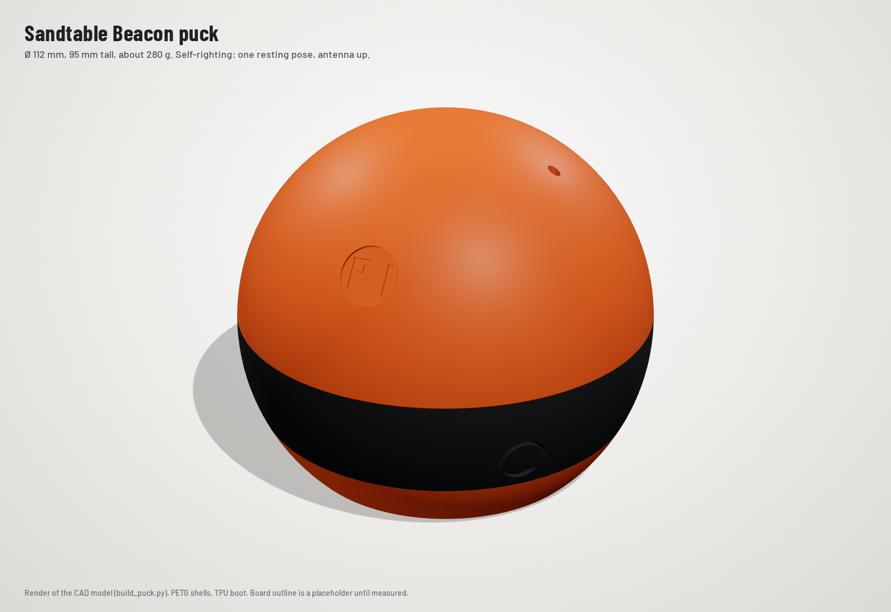
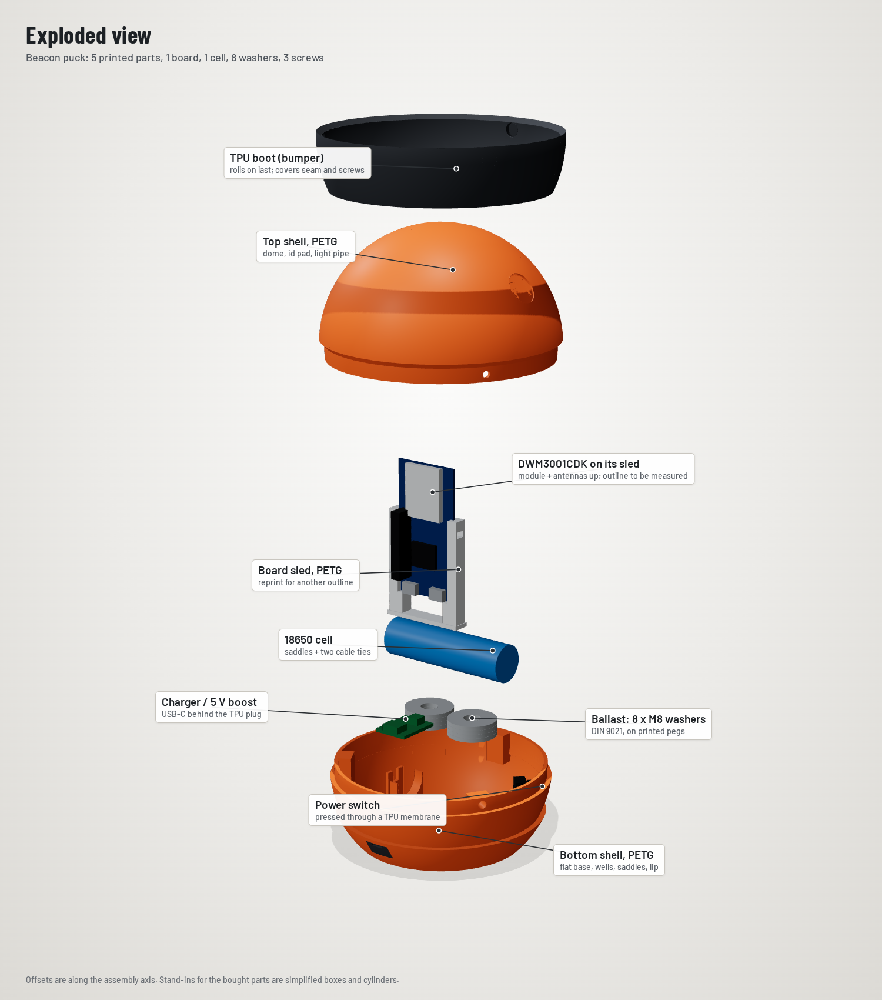
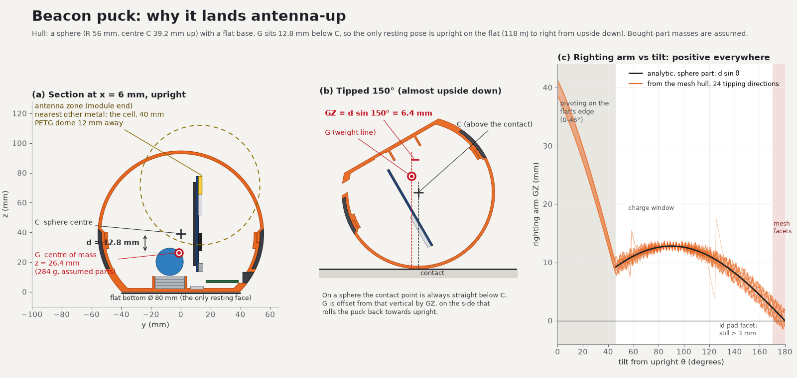
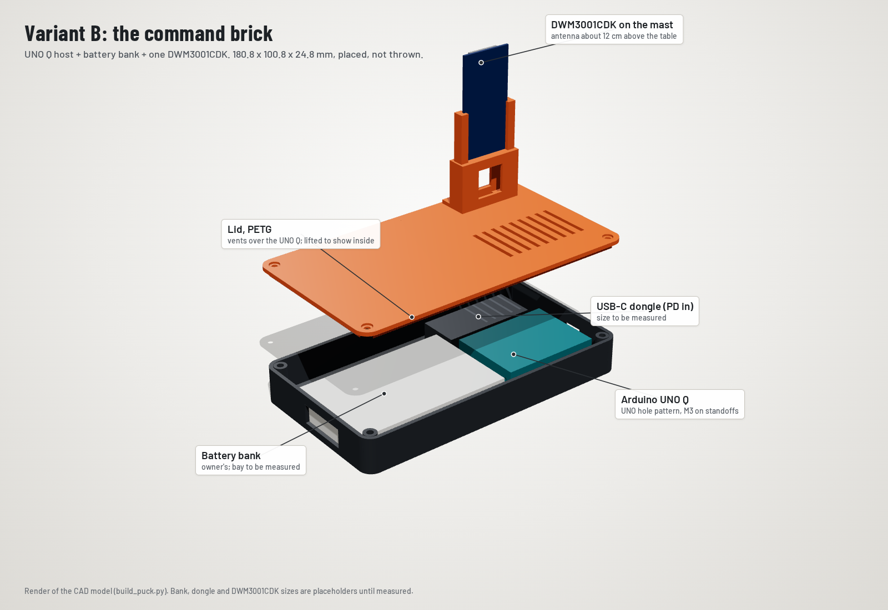

# The puck as an object: Beacon puck and command brick

Two printable enclosures in one parametric family, for the owner's five **Qorvo DWM3001CDK** boards:

- **A. Beacon puck**: one DWM3001CDK and one 18650 cell in a self-righting ball with a flat base. You toss it gently through a doorway and it settles antenna-up. All five are this one.
- **B. Command brick**: a flat box for the **Arduino UNO Q** host, the owner's battery bank and a USB-C dongle, with one DWM3001CDK standing on a mast. It is placed, not thrown.



**What was executed and what was only written.** `build_puck.py` was run here. It builds every part with manifold3d, exports the STLs, checks them and computes the mass properties, the stability analysis and the print estimates. Everything is written to `results/puck_build.json`. `make_section.py` and `render/render.cjs` (three.js in headless Chromium) made the four figures. **`puck.scad` was written to the same construction and parameter names but was never rendered**, because OpenSCAD is not installed on this machine. If it disagrees with the STLs, the STLs are the checked reference. No part has been printed, weighed or thrown.

**Board outline: to be measured.** Qorvo publishes no outline drawing for the DWM3001CDK. Neither the product brief nor the forum thread where a user asked for enclosure dimensions has one; the only figure given there is "the hole size is 3 mm". So `board_w = 32`, `board_h = 64`, `comp_front = 9` (26-pin Raspberry Pi header) and the antenna-zone values are **placeholders**. The board sits in a separate sled (4 g, 20 min print) that takes `board_w` 25-36 mm and `board_h` up to about 74 mm. Above that the dome clearance check in `build_puck.py` fails, so measure the board and rerun. The UNO Q outline comes from its datasheet (below).

## A. Beacon puck



### Why the shape is a ball with a flat base

The puck has to settle antenna-up after tumbling. The design rule is that the **convex hull of the whole puck is exactly one sphere** (R 56 mm, centre C 39.2 mm above the floor) **plus a flat base** (Ø 80 mm). Everything else is either flush with that sphere or recessed into it: the boot, the seam, the screw heads, the id pad, the switch, the windows and the light pipe. The cord loop is soft and cannot prop the puck.

On a sphere the floor contact always sits directly under C. If the centre of mass G is below C, gravity always rolls the puck back toward the flat. The righting arm is GZ(θ) = (z_C − z_G)·sin θ at a tilt θ. The flat is the only face G can rest over, so there is exactly one resting pose. Any flat face on the hull would add a second one: the first version had a recessed id pad at the apex, its hull face was flat, and the analysis found a stable upside-down pose. That is why the id pad moved to the flank.



| Stability (from `results/puck_build.json`; bought-part masses are **assumptions**) | value |
|---|---|
| total mass (printed parts as solid volume x density; board 14 g, cell 46 g, charger 4 g assumed) | 284 g |
| centre of mass G (x, y, z) | (0.0, −1.5, 26.4) mm |
| sphere centre C height | 39.2 mm |
| margin d = z_C − z_G | **12.8 mm** |
| resting poses found on the mesh hull (20 000 floor directions; a pose must hold for every tilt of 2-6°) | **1: upright on the flat** |
| other local minima | 1 tessellation artefact 8° from upside down: a 0.1 mm dip that a 2° tilt escapes. It comes from the 160-segment sphere |
| righting arm on its side (θ = 90°) / at θ = 150° | 12.8 mm / 6.4 mm |
| smallest righting arm, 5-170°, all 24 tipping directions | 0.45 mm, near 170°. Past 160° the mesh adds about ±1.5 mm of facet noise to d·sin θ |
| righting arm crossing the id-pad facet | still above 3 mm |
| energy released going from upside down to upright | 118 mJ |
| without the 8 ballast washers | margin 8.7 mm: still self-righting, but more slowly |
| board mass that would cancel the margin | 564 g (no realistic board does) |

Worst pose: almost upside down, rocking on the dome. That equilibrium is unstable, but near it the righting arm is small (6.4 mm at 150°), so the puck rights slowly from there.

### Engineering choices

- **Antenna.** The board stands vertical in the x-z plane with the DWM3001C module end (UWB and BLE antennas) up. The board sits on a 10 mm pedestal so the antenna is further from the cell. Qorvo's forum advice is to "avoid having any components/metal objects below antenna". Measured from the antenna zone in the model: cell 40 mm, joint screws and inserts 40 mm, ballast 56 mm, charger 55 mm, switch 54 mm, data socket 54 mm. The PETG dome is 11.5 mm away. **The cell is below the antenna at 40 mm, not the 10 cm that `hardware/BOM.md` asks for anchors.** In a 95 mm object 10 cm is impossible, so this has to be measured: range bias and first-path power, with and without the cell, about 10 minutes. No carbon-filled or metal-filled filament. No metal parts in the dome.
- **Board sled.** This is a separate PETG part: two grooved rails (PCB edge in a 1.9 mm groove), 40 mm long, plus a pedestal that is open in the middle so right-angle micro-USB plugs fit under the board's bottom edge. A cable tie through each rail top holds the board. The sled is fixed by two M3 nylon screws from below, recessed into the flat. For another board, change `board_w`, `board_h` and `pcb_t` and reprint only the sled.
- **Power.** I assume **one 18650 cell with a generic 1S USB-C charge and 5 V boost module**, not a USB battery bank. Reasons: a bank's case wastes the low volume where the cell is most useful as ballast, and small banks commonly switch off below about 50-100 mA of load, which a board doing sparse UWB ranging may not draw. That auto-off threshold is a known behaviour of cheap banks; it has not been measured with these boards. The boost output feeds the board's nRF USB (J20) through a short right-angle micro-USB lead. The kit also has a battery connector with its own DC-DC (product brief), but its input range was not found, so check the schematic before you wire a 4.2 V cell to it.
- **Cell retention.** The cell lies along x behind the board, in two saddles, with end stops (notched for the tab wires) and two cable ties through slots in the saddles. Under it are two wells with printed pegs, each holding 4 DIN 9021 M8 steel washers (49 g of ballast in total).
- **USB access.** Two windows sit low in the bottom shell, below the boot. **Charge** (+y): the charger's USB-C, closed by a push-in TPU plug that is flush with the hull. **Data** (45°): a panel USB-C socket on a pigtail to the board's **J-Link micro-USB (J9)**, used for flashing and the serial console without opening the puck.
- **Button and status light.** A 7 mm latching push switch in the bottom shell wall, pressed through a 1 mm TPU membrane in the boot, which carries a debossed ring. A Ø 3.2 mm vertical light pipe through the dome, on the side away from the antenna, holds a 3 mm LED or clear rod in a printed tube. Wiring it to a GPIO needs a firmware line that has not been written.
- **Impact.** PETG walls of 2.0 mm (5 perimeters). The bottom shell is 4.4 mm thick where the boot does not cover it, which is also useful low mass. A 2.4 mm TPU boot runs from latitude −25° to just above the seam and covers the seam and the three screw heads. It is flush with the sphere: a boot that stuck out would create a resting edge, which was checked. The joint is a 7 mm lip with 3 radial M3 screws into brass heat-set inserts in bosses.
- **Carry.** A 3 mm cord loop runs through two holes in the boot and along a channel under it. Clip five loops on one carabiner on a turnout coat. The cord is soft, so it cannot prop the puck.
- **Id.** A recessed pad on the dome flank (latitude 35°) carries a debossed `P1` to `P5` (set `id_text`; kit ids are N1 to N5). The pad is below the hull. Its hull facet is not a resting face because G's foot lands about 3 mm outside it, which was checked on the mesh.

### Parameters (top of `puck.scad`, same names in `build_puck.py`)

| name | value | meaning |
|---|---|---|
| `R`, `rf` | 56, 40 | sphere radius, flat-base radius |
| `wall`, `floor_t`, `tb` | 2.0, 2.4, 2.4 | PETG wall, bottom, TPU boot |
| `lat_boot_lo`, `split_dz`, `boot_ov` | −25°, −6, 7 | boot lower edge, split plane from the centre, boot overlap on the top shell |
| `lip_h`, `lip_t`, `fit` | 7, 1.8, 0.25 | joint lip and clearance |
| `board_w`, `board_h`, `pcb_t`, `comp_front`, `comp_back` | 32, 64, 1.6, 9, 2 | **DWM3001CDK, to be measured** |
| `ant_len`, `ant_w` | 12, 20 | antenna zone at the module end, **to be measured** |
| `rail_w`, `rail_h`, `groove_d`, `sled_lift` | 5, 40, 1.2, 10 | sled |
| `cell_d`, `cell_len`, `cell_y` | 18.4, 67, −7.5 | 18650 with welded tabs |
| `wash_*` | Ø24 / Ø8.4 x 2.0, 4 per well | DIN 9021 M8 ballast |
| `chg_w`, `chg_l`, `chg_standoff` | 17, 22, 4 | charger and boost module (generic; **check yours**) |
| `usb_w`, `usb_h`, `data_az` | 13, 7.5, 45° | windows |
| `sw_d`, `sw_az`, `sw_z`, `membrane` | 7.2, 225°, 24, 1.0 | power switch |
| `id_r`, `id_lat`, `id_az`, `id_text` | 7.5, 35°, 180°, "P1" | id pad |
| `cord_d`, `cord_az`, `cord_z` | 3.5, 315°, 24 | cord holes |

## B. Command brick (UNO Q host)



The outside is 181 x 101 x 25 mm, plus a mast. Three PETG parts: tray, lid, mast. Inside are the owner's battery bank (bay 100 x 63 x 15 mm, **to be measured**), the UNO Q on four M3 standoffs (UNO hole pattern) and a USB-C dongle with PD pass-through (60 x 26 x 12 mm bay, **to be measured**). Power runs bank → dongle PD input → UNO Q. The DWM3001CDK sits on a short USB lead from the dongle, upright in the mast, which uses the same rail profile as the puck sled. Its antenna top is 119 mm above the table and 78-84 mm from the bank, the UNO Q and the dongle. Windows: the UNO Q USB-C on the +x end (its position on the board edge is **to be measured**) and the bank's ports on the −x end. There are vents over the UNO Q. The lid has 4 corner M3 screws into inserts, and there are recesses for 4 TPU feet.

Stability: 368 g (assumed parts) with G 15.1 mm up. It tips only past 73° (long sides) or 80° (ends), so it does not need to self-right.

## Checks that were run (all in `results/puck_build.json`)

- **Watertight.** For every printable part: manifold3d status `NoError`, a single body (`decompose`), trimesh `is_watertight` and `is_winding_consistent`, positive volume. Each exported STL was reloaded from disk and checked again. All pass: the puck's bottom shell, top shell, boot, sled and plug, and the brick's tray, lid and mast. `puck_assembly_preview.stl` is a union of touching parts for viewing only and is not watertight. That is expected, and it is not meant to be printed.
- **Interference.** Every pair of solids in each assembly was boolean-intersected: shells, boot, sled, plug, board, cell, washers, charger, switch, socket; tray, lid, mast, bank, UNO Q, dongle, board. Every overlap is 0 except 0.055 mm³ where the switch-cap stand-in touches the boot's membrane pocket, which is by design. Minimum gaps: top shell to board 10.6 mm, bottom shell to board 4.5 mm, board to cell 6.3 mm, cell to shell 0.3 mm. The shells touch only at the seating face.

## Print settings, mass and time

Mass is solid volume x density (PETG 1.27, TPU 1.21 g/cm³); walls of 2-2.4 mm print as solid perimeters. **Time is not from a slicer**: it is solid volume divided by an assumed average flow of 4 mm³/s for PETG and 1.5 mm³/s for TPU (0.4 mm nozzle, 0.2 mm layers), plus 10 % for supports on the top shell. Slice before you trust it.

| part | material | orientation | supports | mass | time (est.) |
|---|---|---|---|---|---|
| puck bottom shell | PETG | flat base down (overhang 44° at the flat's edge) | none | 72 g | 3.9 h |
| puck top shell | PETG | opening down (STL is already oriented) | tree supports from the build plate under the dome ceiling, removed through the opening | 54 g | 3.2 h |
| puck boot | TPU 95A | lower edge down (overhang 25-30°) | none | 25 g | 3.9 h |
| board sled | PETG | base down | none | 5 g | 0.3 h |
| port plug | TPU | as exported | none | 0.4 g | 0.1 h |
| **one puck** | | | | **157 g** | **about 11.4 h** |
| brick tray / lid / mast | PETG | floor down / top face down / base down | none | 92 / 56 / 12 g | 5.0 / 3.1 / 0.6 h |

PETG: 240/80 °C, 5 perimeters, 25 % gyroid, 0.2 mm layers. TPU: 225/50 °C, 25 mm/s, 6 perimeters (solid). Five pucks are about 57 printer-hours, so for the event print one, test it, then print the rest on several printers.

## Assembly (one puck, about 35 minutes after printing)

1. Clean up the prints: remove the tree supports from the top shell and deburr the windows (5 min).
2. Press 3 M3 heat-set inserts into the lip bosses at about 220 °C (3 min).
3. Stack 4 washers on each peg and add a drop of CA glue (2 min).
4. Solder and wire: the cell's tab wires to the charger B+/B−, the latching switch in series with the boost output, and the boost 5 V to the right-angle micro-USB lead (10 min). Charge the cell to 50 % before closing.
5. Lay the cell in the saddles and close the two cable ties. Seat the charger on its rails with the USB-C in the window, and glue the panel socket into the data window (5 min).
6. Slide the DWM3001CDK into the sled, plug both micro-USB leads (power into J20, data pigtail into J9 J-Link), tie the board to the rails, and screw the sled to the floor from below with 2 M3 nylon screws (5 min).
7. Push the switch through its hole and tighten its nut. Fit the LED or clear rod into the light-pipe tube (2 min).
8. Fit the top shell over the lip and drive the 3 M3 x 6 button-head screws (2 min).
9. Thread the 3 mm cord through the boot holes, roll the boot down over the dome (about 4 % stretch) onto its seat, tie the loop and push in the TPU plug (3 min).
10. Test: press the switch and check the board enumerates over the data port (`uwbkit identify`). Toss the puck onto a mat from 1 m, ten times, and record how it lands (5 min).

## Bill of materials (one Beacon puck; prices are rough estimates in USD, not quotes)

| qty | part | est. cost |
|---|---|---|
| 1 | Qorvo DWM3001CDK (owner has 5) | owner's |
| 1 | 18650 Li-ion cell with welded tabs, protected | 5-8 |
| 1 | 1S charge + 5 V boost module, USB-C input (generic) | 2-4 |
| 1 | right-angle micro-USB lead, 10 cm (power to J20) | 2 |
| 1 | panel-mount USB-C female to right-angle micro-USB male pigtail (data to J9) | 4-6 |
| 1 | 7 mm latching push switch | 0.3 |
| 8 | DIN 9021 M8 steel washers (24 x 8.4 x 2) | 1.5 |
| 3 + 3 | M3 brass heat-set inserts + M3 x 6 button-head screws | 0.6 |
| 2 | M3 x 6 nylon screws (sled) | 0.2 |
| 1 | 3 mm LED or 3 mm clear acrylic rod (light pipe) | 0.2 |
| 0.6 m | 3 mm cord; 2 cable ties | 0.4 |
| 131 g + 26 g | PETG + TPU filament | 3.5 |
| | **total without the board** | **about 20-27** |

Command brick: 160 g PETG (about USD 3), 8 M3 inserts, 6 M3 screws, 2 M3 nuts, 4 TPU feet, plus the owner's UNO Q, battery bank, USB-C PD dongle and one DWM3001CDK with a short micro-USB lead.

## Sources for the dimensions

- Arduino UNO Q datasheet (ABX00162), section 12 "Mechanical Information": 68.58 x 53.34 mm, bottom-side parts under 2 mm, UNO-compatible outline and hole pattern, 4 x R1.6 holes; USB-C VBUS 5 V up to 3 A. https://docs.arduino.cc/resources/datasheets/ABX00162-datasheet.pdf (product page: https://docs.arduino.cc/hardware/uno-q/)
- Qorvo DWM3001CDK product brief Rev. B: two micro-USB ports (J-Link, nRF52833), 26-pin Raspberry Pi header, battery connector, reset and user buttons, LEDs. **No dimensions.** https://www.qorvo.com/products/p/DWM3001CDK
- Qorvo forum, "What is the preferred orientation of the DWM3001CDK" (enclosure question): "avoid having any components/metal objects below antenna"; "The hole size is 3mm"; no outline given. https://forum.qorvo.com/t/what-is-the-preferred-orientation-of-the-dwm3001cdk/13835
- The UNO hole coordinates (13.97, 2.54), (15.24, 50.8), (66.04, 7.62), (66.04, 35.56) are the standard UNO pattern, which the datasheet says the UNO Q follows.

## Honest limits

This is a hackathon concept for a table demo and a gentle toss. It is not a rated device. It has **no thermal protection** for a real fire room: PETG softens at about 80 °C, and a lithium cell in a hot room is itself a fire and venting hazard. It is **not intrinsically safe** and has **no ingress rating**. The seam is not sealed and the windows are open or plugged. It has not been printed, dropped or weighed. The stability numbers rest on assumed board, cell and charger masses, and the DWM3001CDK outline is a placeholder. It is a ball, so after a throw it **rolls** until the flat catches it; a real throw onto a hard floor will travel. The antenna sits about 7 cm above the floor; the bench's own layout notes say ranging is better at 0.3-0.5 m because of the grazing ground reflection. The cell is 40 mm below the antenna, and its effect on ranging is unmeasured.

A real device would need: a sealed, flame-retardant, high-temperature housing (for example glass-filled PEEK or a metal can with an RF window) with insulation sized for a stated heat exposure and time; a cell chemistry and pack that survive that exposure, inside an intrinsically-safe design certified for the atmosphere; and drop, ingress (IP67) and RF testing of the finished unit. None of that has been done here.

## Rebuild

```bash
uv venv data/puck_venv -p 3.12 && uv pip install -p data/puck_venv/bin/python trimesh manifold3d numpy scipy shapely mapbox-earcut networkx rtree matplotlib
data/puck_venv/bin/python hardware/puck/build_puck.py      # STLs, checks, results/puck_build.json (about 5 s)
data/puck_venv/bin/python hardware/puck/make_section.py    # figures/puck_section.png
NP=$(ls -d ~/.npm/_npx/*/node_modules/playwright | head -1); NODE_PATH="${NP%/playwright}" node hardware/puck/render/render.cjs   # the other three figures
```

`stl/` holds the printable parts in print orientation, plus two assembly previews. `render/parts/` holds the per-part meshes in the assembled frame that the figure scripts use; they are generated, so regenerate them rather than editing.
