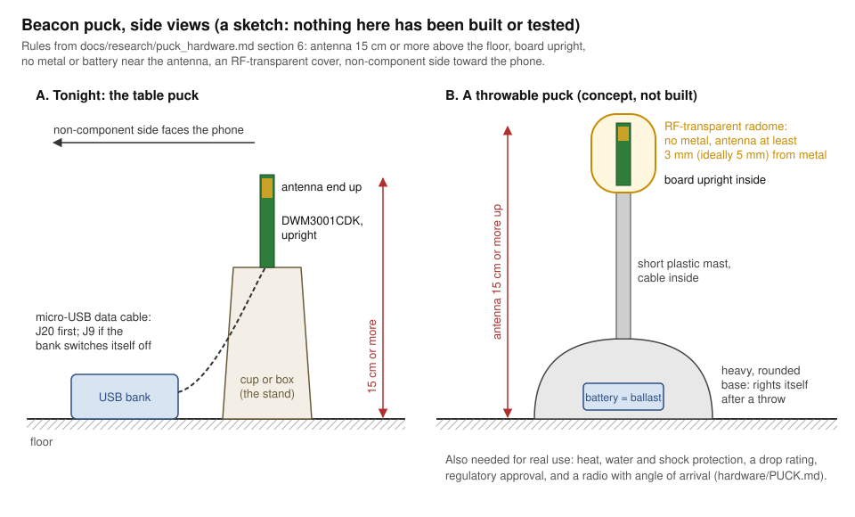

# The Beacon puck: what it is tonight, and what a real one would need

> **Written from documentation and forum reports; not executed on a board.** Nothing here has been built, powered or
> thrown. Sources are cited inline; the full notes are `docs/research/puck_hardware.md` and `docs/research/ios_ni.md`.
> Lines marked "derived" are calculations, not sourced claims.

## 1. Tonight's pucks

Tonight there are **two pucks** (the owner's decision; `hardware/BRINGUP.md`):

- **Puck A**: a DWM3001CDK powered from a battery bank together with the Arduino UNO Q (which can also run the Beacon
  server and the puck host, `hardware/UNO_Q.md`).
- **Puck B**: a DWM3001CDK powered by the Android phone through a USB-OTG adapter.
- Both stand just inside the wall the door is in (`hardware/LAYOUT.md`). A third puck is better if you have it.

Each puck is one **Qorvo DWM3001CDK** (DWM3001C module: nRF52833 with Bluetooth 5.2, DW3110 UWB chip, one UWB antenna and one
Bluetooth antenna on the module; on-board J-Link) running Qorvo's **stock, unmodified** Nearby Interaction firmware,
**plus power, plus a stand.** That is all.
([product brief](https://www.firaconsortium.org/sites/default/files/2024-08/DWM3001CDK%20Product%20Brief.pdf))

- The iPhone app connects to the board over Bluetooth, runs an Apple Nearby Interaction session with it, reads the
  distance and posts it to the Beacon server. The board itself sends nothing to the server; it needs no host.
- The board writes its debug log over SEGGER RTT on the J-Link port J9, not over any serial port
  ([forum 13613](https://forum.qorvo.com/t/dwm3001cdk-nearby-interaction-trying-to-get-ranging-via-usb-uart/13613)). A
  host can read that log (experimental, `python -m beacon.host --rtt`), but the format of its lines is not confirmed.
- The DW3110 has a single antenna: no angle of arrival on the puck (DW3000 datasheet: "DW3110 ... PDoA support: No",
  [distributor mirror](https://atta.szlcsc.com/upload/public/pdf/source/20220621/2EAA42E8F3E2D83DDB8686FF8DCFAD44.pdf)).
- It cannot range another board on the stock firmware ("two boards do not range each other on it without code changes",
  [forum 12439](https://forum.qorvo.com/t/dwm3001cdk-what-should-i-do-to-start-ranging-between-the-two-boards/12439)),
  so pucks cannot measure their own positions tonight: you measure them with a tape (BRINGUP step 7).

## 2. Power options, compared honestly

Current draw: no official whole-board figure for idle, Bluetooth advertising or ranging was found. The UWB chip alone
peaks at about 48 to 78 mA at 3.0 V during two-way ranging, with 18 mA between frames (DW3000 datasheet, same mirror);
the on-board J-Link chip draws "something around 10-15mA (if recall it correctly)"
([forum 13973](https://forum.qorvo.com/t/does-any-one-know-where-to-find-the-offical-power-requirement-of-the-dwm3001cdk/13973)).
The module takes 2.5 to 3.6 V (forum paraphrase of the datasheet, same thread).

| Option | Verdict | Why |
|---|---|---|
| **USB battery bank per puck** | **Recommended** (puck A tonight; the fallback for puck B) | Each puck independent, no wiring, any bank fits. Caveat: "Some large capacity power banks turn off their supply after a short period of time when detecting low current draw" ([forum 22115](https://forum.qorvo.com/t/dwm3001cdk-board-transmits-slower-on-battery-power/22115)). Start on J20 (community advice for standalone NI use, [forum 25626](https://forum.qorvo.com/t/dwm3001cdk-iphone-16-demo-not-working/25626)); if the bank switches off, move the cable to J9 (the J-Link chip adds its 10 to 15 mA of load), use a bank with an always-on or low-current mode, or a wall adapter. Derived: even at a pessimistic 150 mA, a 5,000 mAh bank lasts many hours. |
| **Wall adapter or laptop USB port** | Fine for a table demo | Never switches off. Ties the puck to a cable. |
| **Arduino UNO Q as host**, through a USB-C dongle with power pass-through | Optional, for one puck | The UNO Q's single USB-C port can act as a USB host, but the reported-working setup is a USB-C hub/dongle with PD input; host mode does not come up when the UNO Q is powered from VIN; "The UNO Q does not supply power to the USB-C dongle"; and the manual says any PD dongle works "except Apple ones" ([forum 1442207](https://forum.arduino.cc/t/uno-q-usb-port-not-working-if-board-powered-from-5v/1442207), [datasheet](https://docs.arduino.cc/resources/datasheets/ABX00162-ABX00173-datasheet.pdf), [manual mirror](https://ja-bots.com/wp-content/uploads/2026/03/UNO-Q-User-Manual-_-Arduino-Documentation.pdf)). What it adds: the board shows the puck as hosted (heartbeat), optionally the puck's RTT log and a cold Bluetooth device count from the UNO Q's own radio. It needs a 5 V / 3 A PD supply ("brief dips can cause resets or link drops", datasheet). Setup: `hardware/UNO_Q.md`. |
| **Android phone (USB OTG)** | **Puck B tonight** (power only, never as a reader) | A phone with USB host (OTG) support puts 5 V on the cable, usually budgeted around 500 mA, plenty for one board; you need a USB-C (phone end) to micro-B cable or an OTG adapter ([arachnoid.com](https://arachnoid.com/usb_power/index.html)). **Not worth it as a host:** the stock firmware prints nothing on any serial port (its log is RTT, which needs the J-Link protocol); no evidence was found of anyone reading RTT or the J-Link serial port from Chrome on Android; and wired Web Serial in Chrome for Android is tied to Android 17 and device configuration ([Chrome 148 notes](https://developer.chrome.com/release-notes/148), [Intent to Ship](https://groups.google.com/a/chromium.org/g/blink-dev/c/HBJ-uYFvkpM)). Tonight the Android phone does two jobs: power for puck B and the Wi-Fi hotspot. What can go wrong with OTG power (phones that switch 5 V on only when a USB device shows up, idle timeouts, an "OTG" switch in settings, the cable, battery drain) and how to tell: `hardware/BRINGUP.md` step 6.2. Use the board's **J9** port: its J-Link chip shows up as a USB device; J20 does not with the stock firmware. Not found in the research: whether a phone can run its hotspot while it powers a board over OTG. Fallback: a second battery bank. |
| **LiPo on the battery connector** | Not tonight | The Quick Start Guide lists a JST SR battery connector at J12 and a loose-wire option at J1, with "no battery charger" (search snippet; the PDF did not load), which conflicts with the Zephyr page's "battery connector and charging circuit" ([Quick Start Guide](https://www.mouser.com/datasheet/2/412/Qovro_7_7_2022_DWM3001CDK_Quick_Start_Guide-2998998.pdf), [Zephyr](https://docs.zephyrproject.org/latest/boards/qorvo/decawave_dwm3001cdk/doc/index.html)). **Not confirmed:** the voltage the connector accepts, its polarity, whether a charger is fitted. Do not plug a cell in without the schematic in hand. It is the right answer for a real puck (no USB cable, no bank switching off). |

## 3. Mounting and orientation

From `docs/research/puck_hardware.md` section 6:

- **Upright** (antenna end up), **at least 15 cm above the floor**: "15 cm separation from the ground plane (be it actual
  ground or metal lath such as suspended ceiling grids) is required to mostly negate this behavior"
  ([forum 8712](https://forum.qorvo.com/t/position-of-the-tag-keeps-changing/8712)). A board lying flat on the floor is
  the worst case: the floor reflection arrives within millimetres of the direct path and partly cancels it (long readings
  or dropouts; derived in the research, not measured).
- **Non-component side toward the phone** ([forum 25626](https://forum.qorvo.com/t/dwm3001cdk-iphone-16-demo-not-working/25626)).
- **No metal near the antenna**: "at least 3mm from metal components or surfaces, and ideally 5mm"; antennas "will not
  work within fully enclosed metal enclosures" ([Taoglas](https://www.taoglas.com/datasheets/UWC.20.pdf)). Keep the
  battery below the board, not behind it ([mwrf](https://www.mwrf.com/21128361)).
- Rotation about the antenna axis can shift a range by "5 to 10 cm" ([forum 8712](https://forum.qorvo.com/t/position-of-the-tag-keeps-changing/8712));
  antenna orientation can account for "up to 25 cm" ([EWSN 2020](https://www.ewsn.org/file-repository/ewsn2020/156_161_schroder.pdf)).
  Do not turn the pucks after you measured them.

**Not confirmed:** the DWM3001C antenna's radiation pattern and its nulls (a figure in the module datasheet that could not
be loaded); the measured error of a board lying flat on a floor; any drop or shock rating for the kit; the board's
dimensions.

## 4. A throwable enclosure (concept, not built)

The sketch above, panel B. The design follows from section 3:

- a **heavy, rounded base** with the battery as ballast, so the puck rights itself after a throw (no Qorvo guidance on
  ruggedising or throwing the board was found);
- a **short plastic mast** that holds the antenna 15 cm or more above the floor whichever way the puck lands;
- an **RF-transparent radome** (plain plastic, no metal-flake paint) around the upright board, 3 to 5 mm clear of
  any metal;
- the battery far from the antenna; padding around the board.

## 5. What a real fire puck would need

From `docs/research/puck_hardware.md`, "What a real fire puck would need":

- **Direction on the puck itself:** a dual-port DW3120/DW3220-class radio (phase difference of arrival, about 5 degree
  sigma per the DW3000 datasheet) or a three-antenna array, instead of range differences between two single-antenna
  boards (section 6 below).
- **The antenna off the floor whatever way it lands:** self-righting body, mast, radome (section 4).
- **Heat, water and shock:** high-temperature cells and enclosure, potting, a drop rating; the DW3000 is rated -40 to
  +85 C ambient.
- **Firmware that streams** ranges, link quality and non-line-of-sight indicators over a radio link to command, not a
  debug log; puck-to-puck ranging so thrown pucks can survey their own positions.
- **Per-unit antenna-delay calibration** ("a one-nanosecond timestamping error corresponds to 30 cm in ranging error",
  [arXiv 2210.05888](https://arxiv.org/pdf/2210.05888)), wall and body bias models, and outlier rejection for the
  metre-level phone outliers seen in studies ([arXiv 2303.11220](https://arxiv.org/html/2303.11220v1)).
- **Regulatory approval** for the radios, and a plan for phones that are locked, in pockets or face down (`docs/research/ios_ni.md`).

## 6. Bill of materials

Prices are what the research found on 2026-11-14; "unknown" means nobody looked one up. Nothing needs buying tonight.

| Item | Qty tonight | Unit price | Source |
|---|---|---|---|
| Qorvo DWM3001CDK dev kit | 2 for the demo, 4 for two phones at once (5 owned) | USD 29.50 (DigiKey, 1,100 in stock, factory lead time 37 weeks) | [DigiKey](https://www.digikey.com/en/products/detail/qorvo/DWM3001CDK/24367348) |
| USB battery bank (one 5 V / 3 A USB-C PD for the UNO Q) | 2 (one spare for puck B) | unknown | |
| USB-C OTG adapter or USB-C to micro-B cable (for puck B on the Android phone) | 1 | unknown | |
| micro-USB data cable | 4 to 6 | unknown | |
| stand (cup, box), tape | 2 or 3 | unknown | |
| Arduino UNO Q (optional host) | 1 (owned) | unknown | |
| USB-C hub/dongle with PD pass-through (not Apple) and a 5 V / 3 A PD supply | 1 (for the UNO Q) | unknown | |
| For a custom puck board later: Qorvo DWM3001C module (DWM3001CTR13) | | USD 59.37 (qty 1, cut tape) | [DigiKey](https://www.digikey.com/en/products/detail/qorvo/DWM3001CTR13/24367353) |
| Alternative with Apple NI support (NXP SR150 route): Murata Type 2BP EVK | | USD 179.99 | [DigiKey](https://www.digikey.com/en/products/detail/murata-electronics/LBUA0VG2BP-EVK-P/16680947) |
| LiPo cell, radome, mast, ballast (throwable puck) | | unknown | |

## 7. Two boards on one puck or two pucks?

The question: should a thrown puck carry two boards a few centimetres apart (so the range difference gives a bearing),
or should the five boards be separate pucks a few metres apart?

<!-- LAYOUT_NUMBERS:BEGIN -->
**Simulated** (`results/eval_layouts.json`; 50 trials per row, phone 2 to 8 m away in the fire room, pucks thrown not placed; noise model with sources in `beacon/models.py`). Bearing error is measured after choosing the nearer of the two mirror solutions, so the mirror ambiguity is on top of it:

| Layout | Bearing error to the phone, median | Sideways (cross-range) error, median | Mirror ambiguity left | A position is published | Position error when published, median | Area the phone is confined to, median |
|---|---|---|---|---|---|---|
| Two boards on one device, 0.1 m apart | 33 degrees | 2.34 m | 100% | 0% | n/a | 16.1 m2 |
| Two boards on one device, 0.3 m apart | 17 degrees | 1.51 m | 100% | 0% | n/a | 15.5 m2 |
| Two boards on one device, 0.5 m apart | 22 degrees | 1.51 m | 98% | 0% | n/a | 12.5 m2 |
| Two separate pucks 2 m apart | 7 degrees | 0.71 m | 100% | 0% | n/a | 5.3 m2 |
| Two separate pucks 3 m apart | 6 degrees | 0.42 m | 98% | 2% | 0.34 m | 3.5 m2 |
| Two separate pucks 4 m apart | 5 degrees | 0.34 m | 96% | 4% | 0.33 m | 2.8 m2 |
| Three separate pucks (thrown) | n/a | n/a | n/a | 58% | 0.23 m | 1.2 m2 |

Two boards on one device never produce a position: the locator publishes a ring. Two separate pucks a few metres apart confine the phone to a much smaller area with a several times better bearing, and the twin removes the mirror solution in part of the cases even with thrown pucks (the placed layouts are in `results/eval_two_puck.json`).
<!-- LAYOUT_NUMBERS:END -->

### 7.1 Two boards on one rigid puck: a bearing from the range difference

Model (standard geometry, derived in `docs/research/puck_hardware.md` section 5b): boards A and B at baseline b, the
phone far away at angle theta from the baseline. Range difference d_A - d_B ≈ b cos(theta), so
**sigma_theta ≈ sqrt(2) · sigma_r / (b · |sin theta|)**. A difference between the two links' fixed biases does not
average away: angle bias ≈ delta_bias / (b · |sin theta|).

Broadside (theta = 90 degrees); **double these at 30 or 150 degrees**:

| sigma_r per link | b = 10 cm | b = 30 cm | b = 50 cm |
|---|---|---|---|
| 1.5 cm (datasheet, line of sight) | 12 deg | 4.1 deg | 2.4 deg |
| 5 cm (realistic line of sight) | about 40 deg (useless) | 13.5 deg | 8.1 deg |
| 14 cm (phone, rooms) | useless | 38 deg | 23 deg |
| 10 cm uncorrected differential bias | 90 deg range, useless | 19 deg bias | 11.5 deg bias |

Further against it, tonight: with the stock firmware each board runs its own session with the phone, so the two ranges
are not simultaneous and a moving phone adds error; and each board probably serves only one phone, so two boards per
puck halve the number of pucks. No paper measuring this with two independent DW3000 nodes 10 to 50 cm apart was found.

### 7.2 Two separate pucks a few metres apart

Least-squares geometry (derived in section 5c of the research): with the two pucks seen from the phone at plus and minus
beta from the perpendicular, **sigma_along = sigma_r / (sqrt(2) · sin beta)** and
**sigma_across = sigma_r / (sqrt(2) · cos beta)**.

| Baseline | Phone on the bisector at | beta | sigma_along | sigma_across |
|---|---|---|---|---|
| 3 m | 5 m | 16.7 deg | 2.5 sigma_r | 0.74 sigma_r |
| 3 m | 10 m | | 4.8 sigma_r (about 0.7 m with sigma_r = 15 cm) | |

- Near the line through both pucks the across-baseline error goes to infinity; on that line the phone is unobservable
  across it. So never put the phone in line with two pucks, and never put three pucks in a line.
- Two circles always cross twice: a **mirror ambiguity** across the line between the pucks. The building twin removes a
  candidate that falls outside the building or inside a wall; a third puck removes it everywhere.

**Verdict for tonight (from the closed forms above):** two separate pucks, both just inside the wall the door is in,
so the mirror image of anyone in the room falls beyond that wall (`hardware/LAYOUT.md`); a third puck off that line if
you have it. Two boards on one puck would need a rigid baseline of 50 cm or more and per-unit differential calibration
to give a bearing worth drawing.

(Two boards at one puck POSITION do have a use tonight, but not for bearing: each board serves one phone at a time, so
two boards per position let two phones range continuously, `hardware/BRINGUP.md` step 8 (c).)
